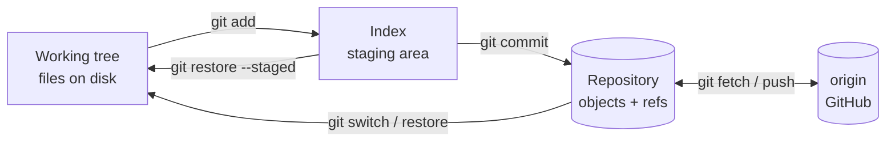

# Git & Collaboration — Overview
[← Topic](../README.md)

**TECH:** Git 2.56 (latest stable, released 2026-09-28), GitHub.com, `gh` CLI
**LEVEL:** intermediate (mid-level, has shipped production code)

## Why this matters in production
- Every deploy, rollback, and audit trail starts with Git. A bad history makes incidents slower to fix.
- Teams lose days to long-lived branches, botched rebases, and force-pushes over other people's work.
- A leaked secret in a public repo is found by bots within minutes, not days.
- Without a protected main branch, one push from a laptop can break production.
- "Which commit broke this?" should take minutes with `bisect`, not an afternoon of guessing.

## Mental model
Git is a **content-addressed object store** plus **movable pointers**.

- Objects (blob, tree, commit, tag) are immutable and named by their hash.
- Refs (branches, tags, `HEAD`) are small files that point at commits.
- Almost every command does one of three things: creates objects, moves refs, or copies data between the three areas below.
- "Rewriting history" never edits commits. It makes new ones and moves a ref. The old ones stay reachable through the reflog for a while, which is why recovery is almost always possible.

## Prerequisites
- You have used `git add`, `commit`, `push`, `pull`, and opened a pull request.
- Git 2.56 inside WSL2 (`git --version`). Keep code in the WSL2 filesystem (`~/code/...`), not `/mnt/c/...`.
- A GitHub account with an SSH key; `gh` CLI installed and signed in (`gh auth status`).

## Lesson map
| Lesson | Checklist items |
|:--|:--|
| [01 · Objects, commits, everyday commands](01-objects-and-commits.md) | 1, 2, 3 |
| [02 · Repo setup and keeping secrets out](02-repo-setup-and-secrets.md) | 4, 13 |
| [03 · Branching, integrating, conflicts](03-branching-and-integration.md) | 5, 6, 7 |
| [04 · Rewriting, recovering, investigating](04-rewrite-recover-investigate.md) | 8, 9, 10 |
| [05 · Pull requests and a protected main](05-pull-requests-and-protection.md) | 11, 12 |
| [06 · Signing, tags, and releases](06-signing-and-releases.md) | 14, 15 |
| [Cheatsheet](cheatsheet.md) | all |

## Suggested order
1. Read 01 and 02, then do [T01 · Repo bootstrap](../tasks/T01-repo-bootstrap/TASK.md).
2. Read 03 and 04, then do [T02 · Branch cleanup](../tasks/T02-branch-cleanup/TASK.md) and [T03 · Incident drills](../tasks/T03-incident-drills/TASK.md).
3. Read 05 and 06, then do [T04 · Team repo on GitHub](../tasks/T04-team-repo-on-github/TASK.md).
4. Keep the [cheatsheet](cheatsheet.md) open while you work.

## Version notes
- Git 3.0 is planned for 2027: new repos will default to `main`, SHA-256, and reftable. Nothing in these lessons depends on those defaults. Set `init.defaultBranch = main` now.
- `git switch` and `git restore` are stable. Prefer them over the overloaded `git checkout`.
- `git history` (fixup, reword, split, drop) is **experimental** in 2.54–2.56. These lessons use `rebase -i`, which is stable.
- GitHub rulesets replace classic branch protection for new setups.

## Sources
- [Git — latest release](https://git-scm.com/)
- [Git BreakingChanges (Git 3.0 plan)](https://git-scm.com/docs/BreakingChanges)
- [What's new in Git 2.56.0 — GitLab](https://about.gitlab.com/blog/whats-new-in-git-2-56-0/)
- [Highlights from Git 2.55 — GitHub Blog](https://github.blog/open-source/git/highlights-from-git-2-55/)
- [Pro Git book](https://git-scm.com/book/en/v2)
