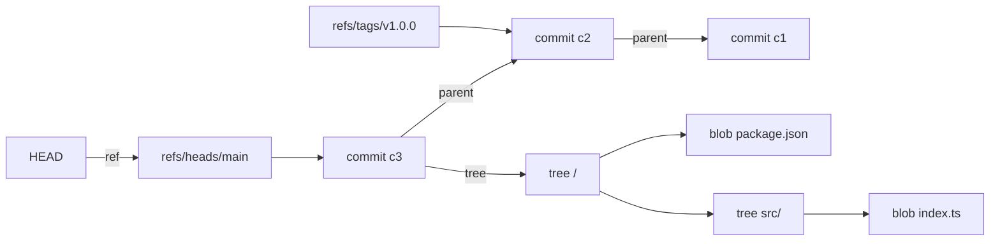

# Objects, commits, and everyday commands
[← Overview](00-overview.md)

## Why it matters
- During an incident you need to revert *one* change. If it is buried in a 900-line "fix stuff" commit with three other changes, you can't.
- People panic after `reset --hard` or a bad rebase because they think commits were edited or deleted. Knowing the object model tells you they weren't.

## Concepts

### Four object types
| Object | Holds | Named by |
|:--|:--|:--|
| blob | file contents (no name, no mode) | hash of contents |
| tree | a directory listing: names, modes, blob/tree hashes | hash of listing |
| commit | one tree + parent(s) + author, committer, message | hash of all that |
| tag (annotated) | a pointer to an object + tagger + message (+ signature) | hash of all that |

Change one byte in a file and its blob hash changes. So the tree hash changes, so the commit hash changes, and every later commit's hash changes too. This is why a rebase gives you **new** commits.

### Refs and HEAD
- A branch is a file holding one commit hash: `refs/heads/main`.
- `refs/remotes/origin/main` is your last-fetched copy of the remote branch. It only moves on `fetch`/`pull`.
- `HEAD` usually points at a branch (`ref: refs/heads/main`). If it points directly at a commit, you are in **detached HEAD**. Commits made there are easy to lose.



## Example: look inside a repo
`explore.sh` — run it in any repo with at least two commits.
```bash
#!/usr/bin/env bash
set -euo pipefail

git cat-file -t HEAD            # commit
git cat-file -p HEAD            # tree <hash>, parent <hash>, author, message
git cat-file -p 'HEAD^{tree}'   # tree listing: mode, type, hash, name
git rev-parse HEAD main origin/main 2>/dev/null || true
cat .git/HEAD                   # ref: refs/heads/<branch>

# Same content -> same blob hash, in any repo, on any machine
echo 'hello' | git hash-object --stdin
```

## Atomic commits
One commit = one logical change that builds and passes tests on its own.
- **Revertable:** `git revert <sha>` removes exactly one change.
- **Bisectable:** every commit builds, so `git bisect` can test it (lesson 04).
- **Reviewable:** reviewers can read the PR commit by commit.

Split by intent, not by file. A rename plus a behaviour change is two commits. A refactor that enables a feature is two commits: refactor first.

### Conventional Commits 1.0.0
```text
<type>[optional scope][!]: <description>

[optional body: why, not how]

[optional footer(s)]
```
- Types used in practice: `feat`, `fix`, `docs`, `refactor`, `perf`, `test`, `build`, `ci`, `chore`, `revert`.
- `!` after the type/scope, or a `BREAKING CHANGE:` footer, marks a breaking change.
- Subject: imperative ("add", not "added"), lowercase, no full stop, about 50 chars, hard limit 72.
- Body: wrap at 72. Explain **why** and any trade-off. The diff already shows *what*.

```text
fix(auth): reject sessions after password change

Sessions created before a password reset stayed valid for up to 30
days. Store a password_changed_at timestamp and compare it on every
request.

Refs: #482
```

## Everyday commands done right
| Goal | Modern command | Avoid |
|:--|:--|:--|
| Change branch | `git switch main` | `git checkout main` |
| Create branch | `git switch -c feat/x` | `git checkout -b feat/x` |
| Back to previous branch | `git switch -` | |
| Discard edits to a file | `git restore src/a.ts` | `git checkout -- src/a.ts` |
| Unstage | `git restore --staged src/a.ts` | `git reset HEAD src/a.ts` |
| File as it was 2 commits ago | `git restore --source=HEAD~2 src/a.ts` | |
| Stage part of a file | `git add -p` | `git add .` without looking |
| Review staged diff | `git diff --staged` | |
| See the diff while writing the message | `git commit -v` | `git commit -m` for every commit |
| Park work, including new files | `git stash push -u -m "wip: login form"` | plain `git stash` (skips untracked) |

`checkout` still works, but it does two unrelated jobs (switch branches, overwrite files). One typo and it overwrites a file with no undo. `switch` and `restore` each do one job.

`git add -p` keys: `y` stage, `n` skip, `s` split hunk, `e` edit hunk by hand, `q` quit, `?` help.

## Production patterns
- **Stage with `add -p`, commit with `-v`.** You review your own diff twice before anyone else sees it.
- **Commit early locally, clean up before the PR.** Messy WIP commits are fine on your laptop. Lesson 04 shows how to tidy them.
- **Never commit generated or local files.** Build output, `node_modules`, `.env`. See lesson 02.
- **Use `stash` for minutes, branches for hours.** Old stashes get forgotten. A WIP commit on a branch is safer.

## Mistakes
Wrong: one commit for everything.
```bash
git add .
git commit -m "updates"
```
Right: look, stage by intent, explain why.
```bash
git add -p src/auth/
git commit -v   # fix(auth): reject sessions after password change
git add src/README.md
git commit -m "docs(auth): document session invalidation"
```

Wrong: stash loses your new file.
```bash
git stash          # new-file.ts is untracked, stays behind, switch may fail
git switch main
```
Right:
```bash
git stash push -u -m "wip: new-file experiment"
git switch main
git stash list     # stash@{0}: On feat/x: wip: new-file experiment
```

Wrong: commit while detached and walk away.
```bash
git switch --detach v1.2.0
# ...edit, commit...
git switch main    # commit is now only reachable via reflog
```
Right: make a branch first, or right after.
```bash
git switch -c hotfix/1.2.1 v1.2.0
```

## Check yourself
1. You change a comment in `src/a.ts` and amend the last commit. Which object hashes change?
2. What is the difference between `main` and `origin/main` after a teammate pushes, before you fetch?
3. Why is "refactor + feature" better as two commits than one?

<details>
<summary>Answers</summary>

1. The blob for `a.ts`, every tree above it (`src/`, root), and the commit. You get a new commit; the old one is still in the object store and the reflog.
2. Neither moves. `origin/main` is a local snapshot of the remote. It updates only on `git fetch` (or `pull`).
3. Reviewers can confirm the refactor changes no behaviour, then focus on the feature. You can revert the feature alone if it breaks, and `bisect` points to the exact half that caused a bug.
</details>

## Sources
- [Pro Git — Git Objects](https://git-scm.com/book/en/v2/Git-Internals-Git-Objects)
- [Pro Git — Git References](https://git-scm.com/book/en/v2/Git-Internals-Git-References)
- [git-switch](https://git-scm.com/docs/git-switch) · [git-restore](https://git-scm.com/docs/git-restore) · [git-stash](https://git-scm.com/docs/git-stash)
- [Conventional Commits 1.0.0](https://www.conventionalcommits.org/en/v1.0.0/)
