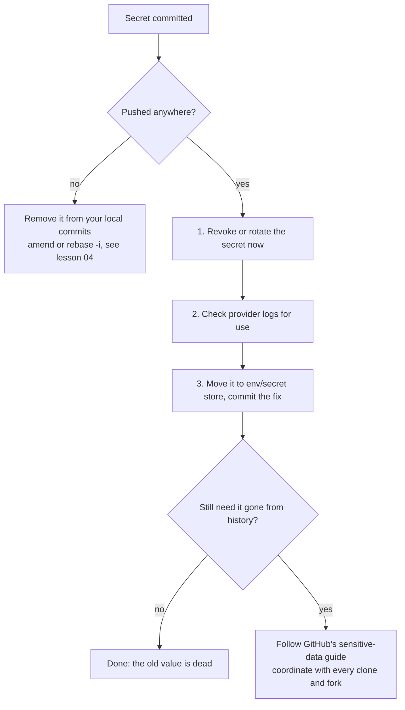

# Repo setup and keeping secrets out
[← Overview](00-overview.md)

## Why it matters
- A `.env` with cloud keys pushed to a public repo gets scraped by bots within minutes. Deleting it in the next commit does nothing: it is still in history.
- A shell script committed from Windows with CRLF endings fails in a Linux container with `/bin/sh^M: bad interpreter`.
- Committed `node_modules` or build output makes every diff unreadable and every clone slow.

## Concepts
Three layers of config, and each one wins over the one above it:

| Layer | File | Travels with the repo? |
|:--|:--|:--|
| system | `/etc/gitconfig` | no |
| global | `~/.gitconfig` or `~/.config/git/config` | no |
| local | `.git/config` | no |
| **attributes / ignore** | `.gitattributes`, `.gitignore` | **yes** (committed) |

Rule: personal preferences go in global config. Anything the **whole team** must share goes in committed files (`.gitattributes`, `.gitignore`, `.githooks/`), because config is never cloned.

WSL2 note: Git for Windows and Git in WSL2 have **separate** global configs. Pick one (WSL2 for this course) and configure it fully.

## Example: global config
`~/.gitconfig` (inside WSL2). Each line fixes a real annoyance.
```ini
[user]
  name = Your Name
  email = 12345678+you@users.noreply.github.com  # GitHub no-reply address, hides your inbox
[init]
  defaultBranch = main
[core]
  excludesFile = ~/.config/git/ignore   # OS/editor junk, for every repo
[pull]
  rebase = true            # no merge bubbles when you pull your own branch
[push]
  autoSetupRemote = true   # first push of a new branch sets upstream
  followTags = true        # push annotated tags that point at pushed commits
[fetch]
  prune = true             # drop origin/* refs for branches deleted on GitHub
[merge]
  conflictStyle = zdiff3   # show the common ancestor in conflicts (lesson 03)
[rerere]
  enabled = true           # remember conflict resolutions (lesson 03)
[rebase]
  autoSquash = true        # apply fixup! commits automatically (lesson 04)
  autoStash = true
  updateRefs = true        # move stacked branches along during a rebase
[diff]
  algorithm = histogram
  colorMoved = default
[commit]
  verbose = true           # show the diff in the message editor
[branch]
  sort = -committerdate
[tag]
  sort = version:refname

[includeIf "gitdir:~/work/"]
  path = ~/.config/git/work   # different email/signing key for client work
```
Debug where a value comes from: `git config --show-origin --show-scope --get pull.rebase`.

## Example: committed repo files
`.gitignore`
```gitignore
node_modules/
dist/
build/
.next/
coverage/
*.tsbuildinfo
*.log

.env
.env.*
!.env.example
```
OS and editor files (`.DS_Store`, `.idea/`, `Thumbs.db`) go in your **global** ignore, not every project's `.gitignore`.

`.gitattributes`
```gitattributes
# Normalize text to LF in the repo and in the working tree
* text=auto eol=lf

# Windows-only scripts keep CRLF
*.cmd text eol=crlf
*.bat text eol=crlf
*.ps1 text eol=crlf

# Never diff or merge as text
*.png binary
*.jpg binary
*.ico binary
*.woff2 binary

# Collapse in GitHub diffs
pnpm-lock.yaml linguist-generated=true
```
Adding `.gitattributes` to an existing repo: run `git add --renormalize .` and commit it on its own (`chore: normalize line endings`).

Don't rely on `core.autocrlf`. It is a per-machine setting; `.gitattributes` applies to every clone.

## Example: a shared hook
Hooks live in `.git/hooks/`, which is **not** committed. Commit them in a folder and point Git at it.

`.githooks/pre-commit`
```sh
#!/bin/sh
# Block env files from being committed. .env.example is allowed.
set -eu

blocked=$(git diff --cached --name-only --diff-filter=ACMR \
  | grep -E '(^|/)\.env(\..+)?$' \
  | grep -vE '(^|/)\.env\.example$' || true)

if [ -n "$blocked" ]; then
  echo "pre-commit: refusing to commit env files:" >&2
  echo "$blocked" | sed 's/^/  /' >&2
  echo "Unstage with: git restore --staged <file>" >&2
  exit 1
fi
```
Turn it on once per clone:
```bash
chmod +x .githooks/*
git update-index --chmod=+x .githooks/pre-commit   # keep the executable bit in Git
git config core.hooksPath .githooks
```
Hooks run on the developer's machine and `git commit --no-verify` skips them. They give fast feedback; CI is what enforces the rule (lesson 05).

## Keeping secrets out
Layers, cheapest first:
1. **`.gitignore`** covers `.env*`. Commit `.env.example` with placeholder values only.
2. **pre-commit hook** catches what `.gitignore` misses (a renamed file, `git add -f`).
3. **GitHub push protection** blocks pushes that contain known secret formats. It is on by default for your personal account when you push to public repos. Repo-level push protection (blocks for everyone, creates alerts) is a repo setting.
4. **Secret scanning** alerts on secrets already in the repo.

also seen: gitleaks as a local and CI scanner (covered in 06-security).

### When a secret leaks

Rotate **first**. Once the value is revoked, the copy in history is harmless. Rewriting history is slow, breaks everyone's clones, drops signatures, and does not reach forks or existing clones.

also seen: git-filter-repo with `--sensitive-data-removal`, GitHub's recommended tool when history must be purged.

## Production patterns
- **Commit `.gitattributes` on day one.** Mixed Windows/WSL2/macOS teams get line-ending churn otherwise.
- **Use the GitHub no-reply email** and enable "Block command line pushes that expose my email".
- **Hooks for speed, CI for enforcement.** Same check in both places, one script.
- **Treat any pushed secret as compromised.** Even in a private repo, even for one minute.

## Mistakes
Wrong: add a rule for a file Git already tracks, expect it to vanish.
```bash
echo ".env" >> .gitignore
git commit -am "ignore env"    # .env is still tracked
```
Right: stop tracking it, keep the local file, then rotate what was in it.
```bash
git rm --cached .env
git commit -m "chore: stop tracking .env"
```

Wrong: "fix" a leak by deleting the file.
```bash
git rm config/keys.ts && git commit -m "remove keys" && git push
```
Right: revoke at the provider first, then remove from code.
```bash
# 1. rotate in the provider console / CLI
# 2. read from env instead
git commit -m "fix(config): read payment key from environment"
```

Wrong: hooks only in `.git/hooks/`; teammates never get them.
Right: commit `.githooks/` and set `core.hooksPath`; document it in the README.

## Check yourself
1. Why does a team-wide line-ending rule belong in `.gitattributes`, not in everyone's `core.autocrlf`?
2. A key was pushed to a private repo 10 minutes ago and removed in the next commit. Is it safe?
3. A teammate commits with `--no-verify`. What still stops a bad commit reaching main?

<details>
<summary>Answers</summary>

1. Config isn't cloned and differs per machine. `.gitattributes` is committed, so every clone and CI runner applies the same rule.
2. No. It is in history, in every clone and fork made since, and possibly in CI logs. Rotate it now.
3. CI running the same checks as a required status check on the protected branch (lesson 05). Hooks are a convenience, not a control.
</details>

## Sources
- [git-config](https://git-scm.com/docs/git-config) · [gitattributes](https://git-scm.com/docs/gitattributes) · [gitignore](https://git-scm.com/docs/gitignore) · [githooks](https://git-scm.com/docs/githooks)
- [GitHub — Configuring Git to handle line endings](https://docs.github.com/en/get-started/git-basics/configuring-git-to-handle-line-endings)
- [GitHub — About push protection](https://docs.github.com/en/code-security/secret-scanning/introduction/about-push-protection)
- [GitHub — Removing sensitive data from a repository](https://docs.github.com/en/authentication/keeping-your-account-and-data-secure/removing-sensitive-data-from-a-repository)
- [GitHub — Setting your commit email address](https://docs.github.com/en/account-and-profile/setting-up-and-managing-your-personal-account-on-github/managing-email-preferences/setting-your-commit-email-address)
