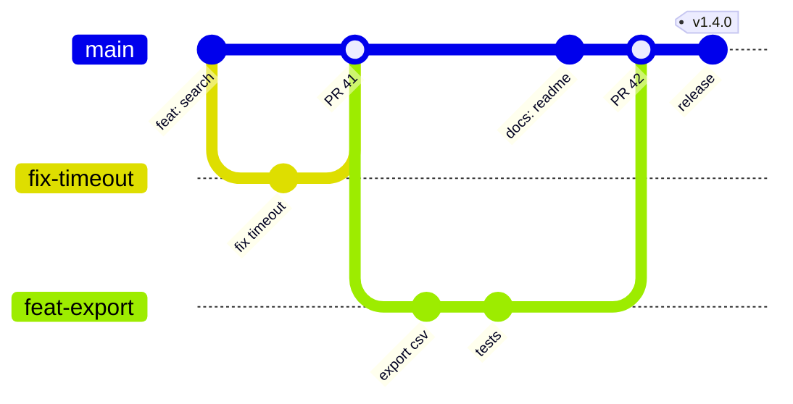

# Branching, integrating, and conflicts
[← Overview](00-overview.md)

## Why it matters
- A feature branch that lives three weeks turns into a two-day merge, and the bugs show up after release.
- `git push --force` on a shared branch silently deletes a teammate's commits.
- A conflict "resolved" by picking one side drops a fix that was already in production. Tests pass because nobody re-ran them.

## Concepts

### Trunk-based development
- `main` is always releasable. Every change reaches it through a short-lived branch and a PR.
- Branches live **hours to two days**. If work is bigger, split it, or merge it behind a feature flag.
- Integrate with `main` at least daily (rebase your branch onto `origin/main`).
- Releases are tags on `main`. A release branch exists only to patch an old version (lesson 06).


The diagram draws merges so you can see the branches. With squash merge each PR lands as one commit on main.

also seen: GitFlow (long-lived `develop` and release branches). It suits apps that ship versioned releases on a fixed schedule; most web teams have moved to trunk-based.

### Three ways to integrate
```text
Before:        main  A---B---C
               feat       \--X---Y

Merge commit:  A---B---C-------M     M has two parents; X and Y kept as-is
                    \--X---Y--/
Rebase:        A---B---C---X'--Y'    X', Y' are NEW commits; old X, Y remain in reflog
Squash:        A---B---C---S         S = X+Y as one commit; branch deleted
```
| | Merge commit | Rebase | Squash |
|:--|:--|:--|:--|
| History on main | true topology, noisy | linear, every commit kept | linear, one commit per PR |
| Revert a whole PR | `git revert -m 1 M` | revert each commit | `git revert S` |
| Needs clean commits in the PR | no | **yes** | no |
| Good default when | long-running integration branches | PR commits are curated and atomic | small PRs (most teams) |

This course uses **squash merge on GitHub** with small PRs, and **rebase** to keep your own branch current.

### The golden rule of rewriting
Rebase, amend, and `reset` create new commits. That is fine **only for commits nobody else has built on**.
- Your PR branch, before or during review: rewrite freely, then `git push --force-with-lease --force-if-includes`.
- `main`, release branches, a branch two people push to: **never** rewrite. Use `git revert` instead.

`--force-with-lease` refuses to push if the remote moved since you last fetched. `--force-if-includes` also refuses if the remote tip never appeared in your local history. That catches the case where your IDE auto-fetched in the background. Set it once: `git config --global push.useForceIfIncludes true`.

## Example: update your branch and resolve a conflict
`sync-branch.sh` — the daily routine on a PR branch.
```bash
#!/usr/bin/env bash
set -euo pipefail

git fetch origin
git rebase origin/main          # replay my commits on top of the latest main
# On conflict Git stops. Resolve (below), then:
#   git add <files> && git rebase --continue
# Give up and return to where you started:
#   git rebase --abort

node --test                     # re-run tests on the rebased result
git range-diff '@{u}...HEAD'    # compare old branch vs new: did my commits change?
git push --force-with-lease --force-if-includes
```

### Reading a conflict with zdiff3
```text
<<<<<<< HEAD
const TAX_RATE = 0.21;              // what main has now
||||||| base
const TAX_RATE = 0.2;               // what both sides started from
=======
const TAX_RATE = 0.2;               // what my commit has
export const MAX_DISCOUNT = 0.5;    // ...plus my new line
>>>>>>> 3f2a1c9 (feat(pricing): cap discounts)
```
With the base visible the answer is clear: main changed the rate, I added a line. Keep both: `0.21` and `MAX_DISCOUNT`. Without `zdiff3` you only see the two sides and have to guess which one changed. (Labels vary by command; the three sections don't.)

### Ours and theirs flip during a rebase
| Operation | `--ours` | `--theirs` |
|:--|:--|:--|
| `git merge feat` (on main) | main | feat |
| `git rebase origin/main` (on feat) | origin/main + commits replayed so far | **your** commit being replayed |

So during a rebase, `git restore --theirs src/a.ts` keeps *your* version. Take a whole side only when you are sure; usually you edit by hand.

### rerere: resolve once
With `rerere.enabled = true`, Git records how you resolved each conflict. When the same conflict appears again (you abort and retry a rebase, or rebase again tomorrow), it applies your resolution and tells you `Resolved 'x' using previous resolution.` Check it, `git add`, continue.
- See what is recorded: `git rerere status`, `git rerere diff`.
- Forget a bad resolution: `git rerere forget <path>` (during the conflict).

### Check the result
1. No markers left: `git diff --check` reports leftover `<<<<<<<` lines.
2. Build and tests pass on the result, not just before the rebase.
3. `git range-diff` shows only the changes you meant to make.

## Production patterns
- **Rebase your branch, squash-merge the PR.** Linear main, readable `git log`, one revert per PR.
- **Small PRs are the real conflict fix.** Two-day branches rarely conflict; two-week branches always do.
- **Feature flags over long branches.** Merge incomplete work turned off. Turn it on with config, not a merge.
- **Re-run tests after every conflict resolution.** A clean textual merge can still be a broken program.
- **Protect main so force-push is impossible there** (lesson 05). Then the golden rule is enforced, not hoped for.

## Mistakes
Wrong: force-push over whatever is on the remote.
```bash
git rebase origin/main
git push --force
```
Right:
```bash
git rebase origin/main
git push --force-with-lease --force-if-includes
```

Wrong: merge `main` into your branch every morning.
```bash
git pull origin main   # merge bubble on your branch each time
```
Right:
```bash
git fetch origin && git rebase origin/main
```

Wrong: rewrite a commit already on main.
```bash
git switch main
git commit --amend && git push --force-with-lease
```
Right:
```bash
git revert <sha>        # new commit that undoes it; history stays intact
git push
```

Wrong: take a whole side to make the conflict go away.
```bash
git restore --ours src/pricing.ts && git add . && git rebase --continue
```
Right: read base vs both sides, combine by hand, then `git diff --check` and run the tests.

## Check yourself
1. You rebased your PR branch and `git push --force-with-lease` was rejected. What happened, and what do you do?
2. During `git rebase origin/main`, which side is `--theirs`?
3. When is a merge commit a better choice than squash?

<details>
<summary>Answers</summary>

1. Someone (a teammate or a GitHub "update branch" click) pushed to your branch after your last fetch. `git fetch`, look at the new commits (`git log HEAD..@{u}`), rebase onto them or cherry-pick them, then push with lease again.
2. Your own commit being replayed. "Ours" is the upstream you are rebasing onto.
3. When the branch's individual commits matter on main and are already clean, or for long-running integration branches (for example merging a release branch back), where keeping the real topology helps later debugging.
</details>

## Sources
- [trunkbaseddevelopment.com](https://trunkbaseddevelopment.com/)
- [Pro Git — Rebasing](https://git-scm.com/book/en/v2/Git-Branching-Rebasing)
- [git-push (`--force-with-lease`, `--force-if-includes`)](https://git-scm.com/docs/git-push)
- [git-merge (conflict styles)](https://git-scm.com/docs/git-merge) · [git-rerere](https://git-scm.com/docs/git-rerere) · [git-range-diff](https://git-scm.com/docs/git-range-diff)
- [GitHub — About merge methods](https://docs.github.com/en/repositories/configuring-branches-and-merges-in-your-repository/configuring-pull-request-merges/about-merge-methods-on-github)
