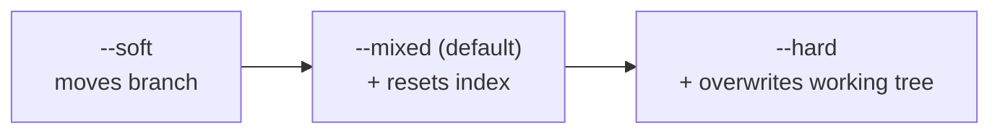

# Rewriting, recovering, and investigating history
[← Overview](00-overview.md)

## Why it matters
- A PR with 40 commits named "wip", "fix", "fix again" can't be reviewed commit by commit, and `bisect` stops on commits that don't build.
- Someone runs `reset --hard` on the wrong branch and thinks a day of work is gone. It almost never is.
- A regression shipped somewhere in the last 200 commits. Guessing takes an afternoon; `git bisect run` takes minutes.

## Concepts

### Interactive rebase
`git rebase -i origin/main` opens a todo list of your branch's commits, oldest first. Edit the verbs, reorder lines, save, close.

| Verb | Effect |
|:--|:--|
| `pick` | keep as-is |
| `reword` | keep changes, edit message |
| `edit` | stop after applying, so you can amend or split it |
| `squash` | fold into the previous commit, combine messages |
| `fixup` | fold into the previous commit, discard this message (`fixup -C` keeps this one) |
| `drop` | remove the commit |
| `exec <cmd>` | run a command; the rebase stops if it fails |

### Fixup commits: fix now, squash later
```bash
git commit --fixup=a1b2c3d          # creates "fixup! <subject of a1b2c3d>"
git commit --fixup=reword:a1b2c3d   # "amend!" commit: only change the message
git rebase --autosquash origin/main # moves each fixup under its target and folds it in
```
`--autosquash` works without `-i`. Set `rebase.autoSquash = true` and every `rebase -i` does it too.

also seen: `git history fixup|reword|split|drop` (Git 2.54+), still marked experimental.

### Reset modes

`--soft` and `--mixed` never touch your files. `--hard` does, and uncommitted changes it throws away are **not** in the reflog.

### The reflog
Every time `HEAD` or a branch moves, Git appends a line to that ref's reflog: commit, reset, rebase, switch, merge, pull.
- `git reflog` (HEAD), `git reflog show feat/x`, `feat/x@{1}`, `main@{2.hours.ago}`.
- Local only, never pushed. Defaults: entries kept 90 days, entries for commits no longer on any branch 30 days.
- `ORIG_HEAD` is set before dangerous moves (reset, rebase, merge): `git reset --hard ORIG_HEAD` undoes the last one.

## Example: split a commit that does two things
```bash
git rebase -i origin/main
# change "pick 4e5f6a7 wip" to "edit 4e5f6a7 wip", save

git reset HEAD~           # undo the commit, keep its changes unstaged
git add -p src/pricing.ts
git commit -m "feat(pricing): validate discount codes"
git add README.md
git commit -m "docs: fix typo in setup steps"
git rebase --continue
```
Then prove every commit still builds and passes:
```bash
git rebase -i --exec "node --test" origin/main
```

## The undo table
| Situation | Command |
|:--|:--|
| Unstage a file | `git restore --staged <file>` |
| Throw away edits to a file | `git restore <file>` |
| Fix the last commit (not pushed) | `git commit --amend` |
| Undo last commit, keep changes staged | `git reset --soft HEAD~1` |
| Undo last commit, keep changes unstaged | `git reset HEAD~1` |
| Undo last commit and its changes | `git status`, then `git reset --hard HEAD~1` |
| Undo a commit that is already pushed to a shared branch | `git revert <sha>` |
| Undo a pushed merge commit | `git revert -m 1 <merge-sha>` |
| Undo the rebase or reset you just did | `git reset --hard ORIG_HEAD` |
| Get back a branch you reset or deleted | `git reflog`, then `git branch rescue <sha>` |
| Get back a dropped stash | use the SHA printed by `stash drop`, or `git fsck --unreachable \| grep commit` |
| Get back a file that was staged, then lost to `reset --hard` | `git fsck --lost-found` (dangling blobs) |

## Investigating history
```bash
git log --oneline --graph --decorate --all     # the shape of things
git log -S 'MAX_DISCOUNT' --oneline            # commits that added/removed this string
git log -G 'discount\w*\(' --oneline           # commits whose diff lines match a regex
git log -L :applyDiscount:src/pricing.ts       # history of one function
git log --follow -- src/pricing.ts             # through renames
git blame -w -C -C -C -L 40,60 src/pricing.ts  # ignore whitespace, track moved/copied lines
git show --stat <sha>
```
**Hide formatting commits from blame.** List their SHAs in `.git-blame-ignore-revs`, then `git config blame.ignoreRevsFile .git-blame-ignore-revs`. GitHub's blame view reads that file automatically.

### git bisect
Binary search over history: about 8 steps for 200 commits.

`bisect-check.sh` — kept **outside** the repo, because bisect checks out old commits.
```bash
#!/usr/bin/env bash
# Exit 0 = good, 1-127 = bad, 125 = this commit can't be tested (skip)
pnpm install --frozen-lockfile >/dev/null 2>&1 || exit 125
pnpm build >/dev/null 2>&1 || exit 125

# Drop the test in, run it, remove it so the next checkout is clean
cp ../regression.test.ts test/zz-regression.test.ts
pnpm vitest run test/zz-regression.test.ts
status=$?
rm -f test/zz-regression.test.ts
exit $status
```
```bash
git bisect start HEAD v1.3.0     # <bad> <good>
git bisect run ../bisect-check.sh
# "a1b2c3d is the first bad commit"
git bisect log > ../bisect.log   # keep the evidence for the postmortem
git bisect reset                 # back to where you started
```
- Write the regression test first. It is the oracle, and it becomes part of the fix PR.
- Never let "doesn't build" look like "bad". That points bisect at the wrong commit. Return 125.
- Not hunting a bug? `git bisect start --term-old=fast --term-new=slow` for performance regressions.
- Exit codes 126/127 mean "not executable" / "not found" and count as bad. `chmod +x` your script.

## Production patterns
- **Clean the branch before you request review**, not after approval. Reviewers read commits.
- **`--exec` the test suite across the branch** once before merging if you rebase-merge; every commit on main should build.
- **Revert first, debug second.** In an incident, `git revert` the suspect PR, deploy, then investigate.
- **Bisect with a script, not by hand.** Manual good/bad marking is where mistakes creep in.
- **Keep formatting-only changes in their own commit** and add them to `.git-blame-ignore-revs`.

## Mistakes
Wrong: "I lost my work", then re-type it from memory.
```bash
git reset --hard HEAD~3   # oops
```
Right:
```bash
git reflog                # find "commit: feat(report): ..." before the reset
git reset --hard HEAD@{1} # or: git branch rescue <sha>
```

Wrong: reset a shared branch to remove a bad commit.
```bash
git switch main && git reset --hard HEAD~1 && git push --force
```
Right:
```bash
git switch main && git revert <bad-sha> && git push
```

Wrong: bisect script that treats a broken build as bad.
```bash
pnpm build && pnpm test   # build failure -> exit 1 -> "bad"
```
Right:
```bash
pnpm build || exit 125
pnpm test
```

Wrong: regression test inside the repo during bisect; it disappears on older checkouts.
Right: keep the test and script in `../` or `/tmp`, copy the test in for each step, and commit it with the fix.

## Check yourself
1. You ran `git rebase -i` and dropped the wrong commit. It finished. How do you get it back?
2. Why can `reset --hard` lose work permanently when a bad rebase can't?
3. Your bisect script runs a build that fails on 3 old commits for unrelated reasons. What goes wrong if it exits 1?

<details>
<summary>Answers</summary>

1. `git reset --hard ORIG_HEAD` right away, or find the pre-rebase tip in `git reflog` (the line before "rebase (start)") and reset or branch to it. Or cherry-pick just the dropped commit from the reflog SHA.
2. A rebase only creates new commits; the old ones stay in the object store and reflog. `reset --hard` overwrites uncommitted working-tree changes that were never stored as objects (staged files survive as dangling blobs).
3. Bisect marks those commits bad. If one is older than the real culprit, bisect blames it. Exit 125 makes bisect skip them.
</details>

## Sources
- [git-rebase](https://git-scm.com/docs/git-rebase) · [git-commit `--fixup`](https://git-scm.com/docs/git-commit)
- [git-reset](https://git-scm.com/docs/git-reset) · [git-reflog](https://git-scm.com/docs/git-reflog) · [git-revert](https://git-scm.com/docs/git-revert)
- [git-bisect](https://git-scm.com/docs/git-bisect) · [git-log](https://git-scm.com/docs/git-log) · [git-blame](https://git-scm.com/docs/git-blame)
- [Pro Git — Rewriting History](https://git-scm.com/book/en/v2/Git-Tools-Rewriting-History)
- [GitHub — Ignore commits in the blame view](https://docs.github.com/en/repositories/working-with-files/using-files/viewing-and-understanding-files#ignore-commits-in-the-blame-view)
