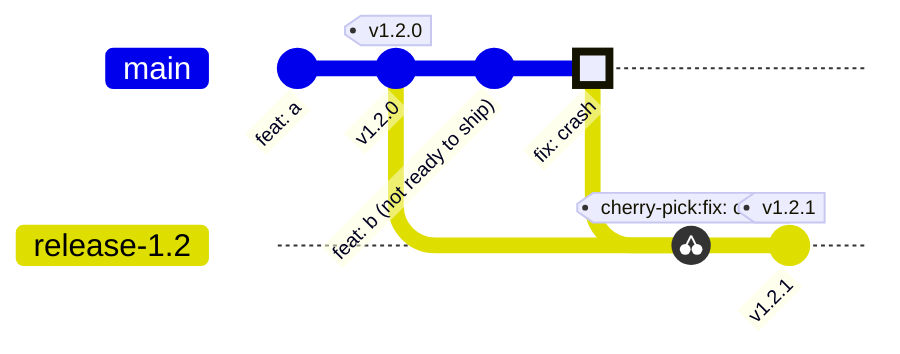

# Signing, tags, and releases
[← Overview](00-overview.md)

## Why it matters
- Anyone can run `git config user.email you@company.com` and push commits that look like yours. Signing proves who made a commit.
- "What's in production?" has no answer when releases are untagged, or when a tag was moved after deploy.
- An attacker who can rewrite a release tag or swap a release asset ships malware under your name.

## Concepts

### Signed commits with SSH
Git can sign with GPG, SSH, or X.509 keys. SSH is the simplest: you already have a key (Git 2.34+).

GitHub shows **Verified** when the signature matches a signing key on your account and the committer email is a verified email on your account. With **vigilant mode** on, your unsigned commits show as **Unverified**, so impersonation stands out.

Gotchas:
- GitHub signs commits made in its web UI (including squash merges) with its own key. They show as Verified.
- **Rebase merges on GitHub are not signed.** With "require signed commits" on, use squash or merge.
- Rewriting history (rebase, filter-repo) drops signatures. Your rebased commits are re-signed only if `commit.gpgSign` is on.

### Tags
| Kind | Command | Use |
|:--|:--|:--|
| lightweight | `git tag v1.2.0` | private bookmarks only |
| annotated | `git tag -a v1.2.0 -m "v1.2.0"` | releases: has tagger, date, message |
| signed | `git tag -s v1.2.0 -m "v1.2.0"` | releases you want verifiable |

- Tags are not pushed by default. `git push origin v1.2.0`, or `push.followTags = true` for annotated tags.
- **Never move or reuse a published tag.** Others have already fetched it, and Git won't update their copy. Ship `v1.2.1`.
- `git describe --tags` prints `v1.2.0-14-g3f2a1c9`: 14 commits after `v1.2.0`. Useful as a build version.

### Semantic Versioning 2.0.0
`MAJOR.MINOR.PATCH`, for example `2.4.1`.
| Change | Bump | Conventional Commit |
|:--|:--|:--|
| breaking API change | MAJOR | `feat!:` or `BREAKING CHANGE:` footer |
| new backward-compatible feature | MINOR | `feat:` |
| backward-compatible bug fix | PATCH | `fix:` |
- `0.y.z`: anything may change; there is no stable API yet.
- Pre-release: `1.0.0-rc.1` sorts before `1.0.0`.
- Use a `v` prefix on tags (`v1.2.0`); the version itself is `1.2.0`.

### GitHub Releases
A release is a tag plus notes plus optional assets.
- `gh release create v1.2.0 --verify-tag --generate-notes` fails if the tag isn't on GitHub (so it never creates one from the wrong commit) and writes notes from merged PRs.
- `.github/release.yml` groups those notes by PR label.
- **Immutable releases** (repo or org setting): once published, the tag can't move and assets can't change; GitHub adds a release attestation. Create the release as a draft, attach assets, then publish.
- A tag ruleset on `v*` that restricts updates and deletions protects tags even without releases.

### Hotfix in trunk-based development

Fix on `main` first (so the fix is never lost), then `git cherry-pick -x <sha>` onto a release branch created from the tag. `-x` records "cherry picked from commit ..." for traceability.

## Example: set up SSH signing
```bash
# 1. Tell Git to sign with your SSH key
git config --global gpg.format ssh
git config --global user.signingkey ~/.ssh/id_ed25519.pub
git config --global commit.gpgSign true
git config --global tag.gpgSign true

# 2. Let Git verify signatures locally
mkdir -p ~/.config/git
echo "$(git config user.email) namespaces=\"git\" $(cat ~/.ssh/id_ed25519.pub)" \
  >> ~/.config/git/allowed_signers
git config --global gpg.ssh.allowedSignersFile ~/.config/git/allowed_signers

# 3. Add the same public key on GitHub as a *signing* key
gh ssh-key add ~/.ssh/id_ed25519.pub --type signing --title "laptop signing"
# (needs the admin:ssh_signing_key scope: gh auth refresh -s admin:ssh_signing_key)

# 4. Check
git commit --allow-empty -m "chore: test signing"
git log --show-signature -1     # Good "git" signature for you@...
git verify-commit HEAD
```
If the key has a passphrase, load it once per session: `eval "$(ssh-agent -s)" && ssh-add`.

## Example: cut a release
`release.sh` — run from an up-to-date `main`.
```bash
#!/usr/bin/env bash
set -euo pipefail
version="${1:?usage: release.sh v1.2.0}"

git switch main
git pull --ff-only
git tag -s "$version" -m "$version"
git push origin "$version"
gh release create "$version" --verify-tag --generate-notes --draft
# Attach assets if any, review the notes, then:
gh release edit "$version" --draft=false
```

`.github/release.yml`
```yaml
changelog:
  exclude:
    labels: [ignore-for-release]
  categories:
    - title: Breaking changes
      labels: [breaking-change]
    - title: Features
      labels: [enhancement]
    - title: Fixes
      labels: [bug]
    - title: Other changes
      labels: ["*"]
```

also seen: release-please and semantic-release, which compute the next version and changelog from Conventional Commits.

## Production patterns
- **Sign everything, turn on vigilant mode, require signed commits on main.** Cheap, and it makes impersonation visible.
- **One annotated, signed tag per deploy to production.** Rollback = redeploy the previous tag.
- **Protect `v*` tags with a ruleset** and enable immutable releases.
- **Fix forward on main, cherry-pick back.** A fix that only lives on a release branch comes back as a regression in the next release.
- **Generate notes from PRs, not by hand.** Good PR titles and labels give you a good changelog for free.

## Mistakes
Wrong: move a tag after it was pushed.
```bash
git tag -f v1.2.0 && git push --force origin v1.2.0
```
Right:
```bash
git tag -s v1.2.1 -m "v1.2.1" && git push origin v1.2.1
```

Wrong: lightweight tag for a release, created by the release command from whatever `main` is now.
```bash
gh release create v1.3.0 --generate-notes
```
Right: tag the commit you tested, then release that tag.
```bash
git tag -s v1.3.0 <tested-sha> -m "v1.3.0"
git push origin v1.3.0
gh release create v1.3.0 --verify-tag --generate-notes
```

Wrong: fix on the release branch only.
```bash
git switch release-1.2 && git commit -m "fix: crash" && git tag -s v1.2.1 -m v1.2.1
```
Right:
```bash
# PR to main first, then:
git switch release-1.2 && git cherry-pick -x <fix-sha-on-main> && git tag -s v1.2.1 -m v1.2.1
```

Wrong: added the SSH key on GitHub as an *authentication* key only. Commits show "Unverified".
Right: add it again as a **signing** key (`--type signing`).

## Check yourself
1. Your signed commits show "Unverified" on GitHub. Name two likely causes.
2. Since the last release (`v2.3.4`): two `fix:` PRs, one `feat:` PR. What is the next version? And if one `fix!:` is added?
3. Why fix on `main` first and cherry-pick to the release branch, not the other way round?

<details>
<summary>Answers</summary>

1. The key isn't added on GitHub as a signing key, or the commit email isn't a verified email on your account (for example a work email or a typo). Also possible: the commit was rebase-merged on GitHub, which strips the signature.
2. `v2.4.0` (a feature means MINOR, which resets PATCH). With a breaking change: `v3.0.0`.
3. `main` is where all future releases come from. A fix made only on the release branch is easy to forget and comes back as a regression. Fixing `main` first guarantees it ships in every later release.
</details>

## Sources
- [GitHub — About commit signature verification](https://docs.github.com/en/authentication/managing-commit-signature-verification/about-commit-signature-verification)
- [GitHub — Telling Git about your signing key](https://docs.github.com/en/authentication/managing-commit-signature-verification/telling-git-about-your-signing-key)
- [Pro Git — Tagging](https://git-scm.com/book/en/v2/Git-Basics-Tagging) · [git-tag](https://git-scm.com/docs/git-tag) · [git-cherry-pick](https://git-scm.com/docs/git-cherry-pick)
- [Semantic Versioning 2.0.0](https://semver.org/)
- [GitHub — Automatically generated release notes](https://docs.github.com/en/repositories/releasing-projects-on-github/automatically-generated-release-notes)
- [GitHub — Immutable releases](https://docs.github.com/en/code-security/supply-chain-security/understanding-your-software-supply-chain/immutable-releases)
- [gh release create](https://cli.github.com/manual/gh_release_create) · [gh ssh-key add](https://cli.github.com/manual/gh_ssh-key_add)
