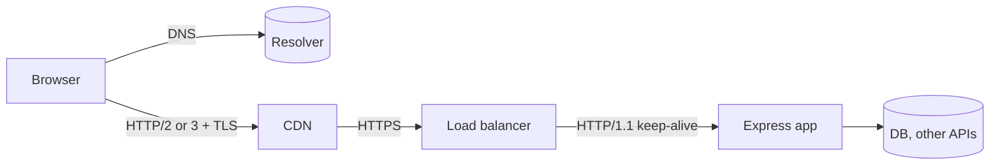

# HTTP & Networking — Overview
[← Topic](../README.md)

**TECH:** HTTP/1.1, HTTP/2, HTTP/3 · Node.js 26 LTS · Express 5.2 · curl 8 · Chrome DevTools
**LEVEL:** intermediate (mid-level, has shipped production code)

## Why this matters in production
- Many incident "backend bugs" are HTTP bugs: wrong status codes, missing timeouts, broken caching, CORS, or cookies.
- Latency is mostly round trips, not CPU. Knowing where time goes tells you what to fix.
- HTTPS, cookie flags, and CORS are HTTP settings. One wrong header can leak every session.
- Every layer you add later (CDN, load balancer, cache, auth) speaks HTTP.

## Mental model
HTTP is requests and responses, carried over connections that are expensive to open. Everything between the client and your app can cache, rewrite headers, or time out.

- Headers are the control plane: caching, auth, cookies, CORS, compression.
- Each hop has its own timeouts and may cache. Most bugs live at the boundaries between hops.

## Prerequisites
- You have built a small Express or Node HTTP server and used `fetch`.
- Node.js 26 in WSL2 (`node -v`), curl (`curl -V`), and Chrome.
- Node 26 runs `.ts` files directly (`node server.ts`). Use erasable TypeScript only: no `enum`, no parameter properties.

## Lesson map
| Lesson | Checklist items |
|:--|:--|
| [01 · What happens on a request](01-request-lifecycle.md) | 1, 4, 11 |
| [02 · Methods, status codes, and headers](02-methods-status-headers.md) | 2, 3 |
| [03 · HTTPS, TLS, and cookies](03-https-and-cookies.md) | 5, 6 |
| [04 · CORS and proxies](04-cors-and-proxies.md) | 7, 10 |
| [05 · HTTP caching and compression](05-caching-and-compression.md) | 8, 9 |
| [06 · Debugging HTTP and real-time options](06-debugging-and-real-time.md) | 12, 13 |
| [Cheatsheet](cheatsheet.md) | all |

## Suggested order
1. 01 and 02 first: they are the vocabulary for everything else.
2. 03 and 04 before [06-security](../../06-security/README.md) and [03-backend/04-auth](../../../03-backend/04-auth/README.md).
3. 05 before [03-backend/06-caching](../../../03-backend/06-caching/README.md) and [02-frontend/07-performance](../../../02-frontend/07-performance/README.md).
4. 06 any time. Keep the [cheatsheet](cheatsheet.md) open while debugging.
5. Ready to build: `/learn 01-foundations/02-http-networking mode=tasks`.

## Version notes
- Node.js 26 is the active LTS ("Lithium", LTS since October 2026). Its built-in `fetch` uses Undici 8. From Node 27, majors ship yearly.
- Express 5.2 is current. Rejected promises in handlers reach the error handler automatically. Route syntax changed: `/*splat`, `{/:optional}`.
- HTTP/3 is on by default in major browsers and CDNs. curl needs an HTTP/3-enabled build for `--http3`.
- Public TLS certificate lifetimes are shrinking: 200 days max since March 2026, 100 days from March 2027, 47 days from March 2029. Automate renewal.

## Sources
- [MDN — HTTP](https://developer.mozilla.org/en-US/docs/Web/HTTP)
- [RFC 9110 — HTTP Semantics](https://www.rfc-editor.org/rfc/rfc9110)
- [Node.js 26.0.0 release post](https://nodejs.org/en/blog/release/v26.0.0)
- [Express — Migrating to Express 5](https://expressjs.com/en/guide/migrating-5.html)
- [Everything curl](https://everything.curl.dev/)
