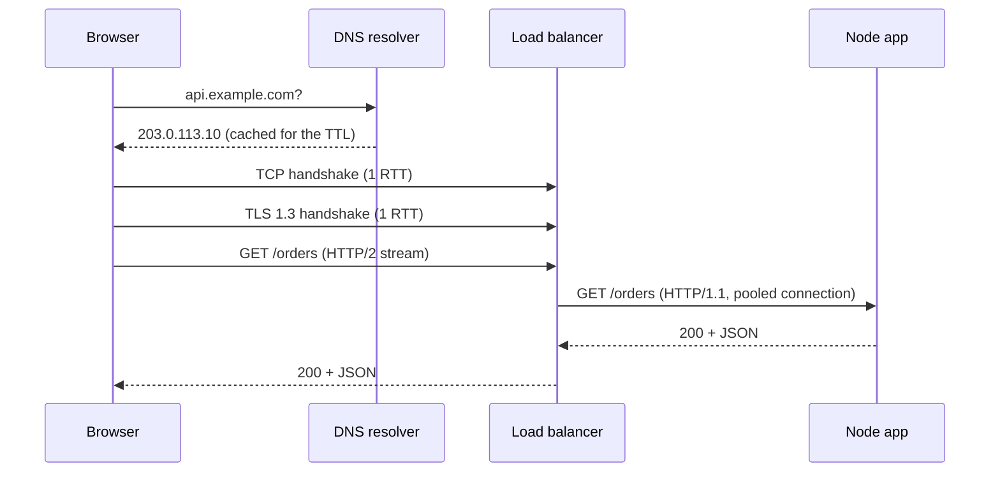

# What happens on a request
[← Overview](00-overview.md)

## Why it matters
- A page is slow and the team tunes SQL, but 400 ms goes to DNS and a fresh TLS handshake on every request because connections are not reused.
- Random `502 Bad Gateway` under load: the load balancer reuses a connection the Node server just closed, because Node's keep-alive timeout is shorter than the balancer's.
- An upstream call with no timeout hangs, holds the request, and sockets pile up until the process falls over.

## Concepts

### The steps


| Step | Typical cost | Paid when |
|:--|:--|:--|
| DNS lookup | 0–100 ms | first request to a host, then cached for the TTL |
| TCP handshake | 1 round trip (RTT) | every new connection |
| TLS 1.3 handshake | 1 RTT (0 with resumption) | every new connection |
| Request + response | 1 RTT + server time + transfer | every request |

On mobile, RTT dominates: 100 ms × 3 round trips = 300 ms before your code even runs. Reusing a connection skips the first three rows.

### HTTP versions
| | HTTP/1.1 | HTTP/2 | HTTP/3 |
|:--|:--|:--|:--|
| Transport | TCP | TCP | QUIC over UDP |
| Requests per connection | one at a time | many streams, multiplexed | many streams, independent |
| Head-of-line blocking | per connection | at TCP level: one lost packet stalls all streams | none between streams |
| Header compression | none | HPACK | QPACK |
| Handshake | TCP + TLS | TCP + TLS | combined (1 RTT, 0-RTT on resume) |
| Where you meet it | app servers behind a proxy | browser ↔ CDN or load balancer | browser ↔ CDN |

In production the browser speaks HTTP/2 or HTTP/3 to a CDN or load balancer, which usually speaks HTTP/1.1 with keep-alive to your Node app. Your Express app rarely terminates TLS or HTTP/2 itself.

### Timeouts that line up
Every hop has idle timeouts (how long an unused connection stays open) and request timeouts (how long one request may take). Two rules:
1. **Idle:** each inner hop keeps idle connections open *longer* than the hop in front of it, so the outer hop always closes first.
2. **Request:** each inner call gets a *shorter* deadline than its caller, so errors surface instead of the caller timing out blind.

| Hop | Setting | Example |
|:--|:--|:--|
| AWS ALB | idle timeout | 60 s (default) |
| Node `http.Server` | `keepAliveTimeout` | 65 s (longer than the ALB) |
| Node `http.Server` | `headersTimeout` | 66 s (longer than `keepAliveTimeout`) |
| Node `http.Server` | `requestTimeout` | 30 s for the whole request |
| Outgoing `fetch` | `AbortSignal.timeout()` | 5 s per upstream call |

## Example: server timeouts and a client deadline
`server.ts` — run with `node server.ts`.
```ts
import express from 'express';

const app = express();

app.get('/orders', async (_req, res) => {
  // A deadline on every outgoing call. Express 5 sends the TimeoutError to the error handler.
  const upstream = await fetch('https://inventory.example.com/stock', {
    signal: AbortSignal.timeout(5_000),
  });
  res.json({ stock: await upstream.json() });
});

const server = app.listen(3000, () => console.log('listening on :3000'));

server.keepAliveTimeout = 65_000; // Node default is 5 s: far below a 60 s load balancer
server.headersTimeout = 66_000;   // must be greater than keepAliveTimeout
server.requestTimeout = 30_000;   // whole request including body; limits slow clients
```

Measure where the time goes:
```bash
curl -o /dev/null -s -w 'dns  %{time_namelookup}\ntcp  %{time_connect}\ntls  %{time_appconnect}\nttfb %{time_starttransfer}\nall  %{time_total}\n' https://example.com/
curl -sI --http2 https://example.com/ | head -1    # HTTP/2 200
dig +short example.com                              # what DNS returns
```
Each `time_*` value is cumulative from the start, so TLS time is `time_appconnect - time_connect`.

## Production patterns
- **Terminate TLS and HTTP/2/3 at the edge** (CDN or load balancer). App servers speak plain HTTP inside a private network.
- **Reuse connections.** Browsers do it for you. Node's `fetch` (Undici) pools connections per origin; create clients once, not per request.
- **Put a deadline on every outgoing call.** Base it on the upstream's p99 latency, not a round number.
- **Lower DNS TTLs (60–300 s) only before a planned change**, like a migration. Long TTLs make lookups cheaper the rest of the time.
- **Serve static assets from a CDN** near users. Fewer milliseconds of RTT beat more bandwidth.

## Mistakes
Wrong: Node defaults behind a load balancer with a 60 s idle timeout.
```ts
app.listen(3000); // keepAliveTimeout = 5 s: Node closes first, the ALB returns 502s
```
Right:
```ts
const server = app.listen(3000);
server.keepAliveTimeout = 65_000;
server.headersTimeout = 66_000;
```

Wrong: no deadline on an upstream call.
```ts
const res = await fetch(url); // waits as long as the upstream wants
```
Right:
```ts
const res = await fetch(url, { signal: AbortSignal.timeout(5_000) });
```

Wrong: "our API answers in 40 ms" measured only on the server.
Right: measure from the client too (`curl -w`, DevTools Timing tab, real-user TTFB). Users feel DNS, TCP, TLS, and transfer time.

## Check yourself
1. Why does a server `keepAliveTimeout` shorter than the load balancer's idle timeout cause 502s?
2. What does HTTP/3 fix that HTTP/2 does not?
3. A user on 150 ms RTT opens your API on a cold connection with TLS 1.3. Roughly how long before the first response byte, ignoring DNS and server time?

<details>
<summary>Answers</summary>

1. The balancer thinks its pooled connection is still open and sends a request just as Node closes it. The request fails and the balancer answers 502.
2. TCP head-of-line blocking. With HTTP/2 one lost packet stalls every stream on the connection. QUIC streams are independent, and QUIC merges the transport and TLS handshakes.
3. About 3 round trips: TCP (1), TLS (1), request and response (1), so roughly 450 ms.
</details>

## Sources
- [MDN — Evolution of HTTP](https://developer.mozilla.org/en-US/docs/Web/HTTP/Guides/Evolution_of_HTTP)
- [Node.js — `server.keepAliveTimeout`](https://nodejs.org/api/http.html#serverkeepalivetimeout)
- [AWS — ALB connection idle timeout](https://docs.aws.amazon.com/elasticloadbalancing/latest/application/edit-load-balancer-attributes.html)
- [MDN — `AbortSignal.timeout()`](https://developer.mozilla.org/en-US/docs/Web/API/AbortSignal/timeout_static)
- [Everything curl — write-out variables](https://everything.curl.dev/usingcurl/verbose/writeout.html)
