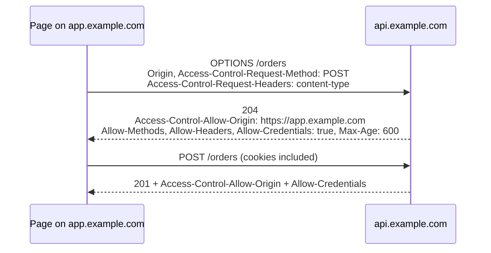

# CORS and proxies
[← Overview](00-overview.md)

## Why it matters
- An API reflects any `Origin` back with credentials allowed. Any website can now read your users' data through their own browsers.
- Rate limiting keys on `req.ip`, but behind a load balancer every request has the balancer's IP. One abusive client gets everyone blocked.
- `trust proxy` set to `true` lets attackers fake `X-Forwarded-For` and skip rate limits or forge audit logs.

## Concepts

### Same-origin policy and CORS
An **origin** is scheme + host + port. A page may *send* requests anywhere, but the browser blocks JavaScript from *reading* a cross-origin response unless the server opts in with CORS headers.

CORS is a browser rule. curl, servers, and attackers' scripts ignore it. It is not access control for your API: you still authenticate and authorize every request.

**Simple requests** (GET, HEAD, or POST with only safelisted headers and a `Content-Type` of `text/plain`, `multipart/form-data`, or `application/x-www-form-urlencoded`) go straight out. Anything else, such as a JSON body, an `Authorization` header, or PUT/PATCH/DELETE, triggers a **preflight**:



| Header | Sent by | Meaning |
|:--|:--|:--|
| `Origin` | browser | who is asking |
| `Access-Control-Allow-Origin` | server | the exact origin, or `*` (never `*` with credentials) |
| `Access-Control-Allow-Credentials` | server | `true` lets cookies flow and the response be read |
| `Access-Control-Allow-Methods` / `-Headers` | server, preflight | what the real request may use |
| `Access-Control-Max-Age` | server, preflight | seconds to cache the preflight (Chrome caps at 7200) |
| `Access-Control-Expose-Headers` | server | response headers JS may read, e.g. `Location` |
| `Vary: Origin` | server | caches must store one copy per origin |

The browser side needs `fetch(url, { credentials: 'include' })` to send cookies cross-origin.

The best CORS setup is none: serve the frontend and the API from one origin, with the CDN or Next.js routing `/api/*` to the backend.

### Proxies and forwarded headers
Behind a load balancer, the TCP peer of your app is the balancer. The balancer passes the original details in headers:

| Header | Meaning |
|:--|:--|
| `X-Forwarded-For` | `client, proxy1, proxy2`; each proxy appends the address it saw. Left entries are client-controlled |
| `X-Forwarded-Proto` | original scheme (`https`) |
| `X-Forwarded-Host` | original `Host` |
| `Forwarded` | RFC 7239 standard version: `for=203.0.113.7;proto=https` |

Express's `trust proxy` setting decides how many hops to believe when it computes `req.ip`, `req.ips`, `req.protocol`, `req.secure`, and `req.hostname`. It reads `X-Forwarded-For` from the right and skips the trusted hops.

| `trust proxy` | Effect |
|:--|:--|
| `false` (default) | ignore forwarded headers; `req.ip` is the socket peer |
| `1` | trust one hop (an ALB); `req.ip` is the address that hop saw |
| `2` | CloudFront + ALB |
| `'loopback, 10.0.0.0/8'` | trust these addresses or subnets |
| `true` | trust everything: client can spoof `req.ip`. Avoid |

## Example
`api.ts` — an allowlist CORS middleware and correct proxy trust.
```ts
import express, { type NextFunction, type Request, type Response } from 'express';

const app = express();
app.set('trust proxy', 1); // exactly one proxy (the load balancer) in front

const allowedOrigins = new Set(
  (process.env.CORS_ORIGINS ?? 'http://localhost:5173').split(','),
);

function cors(req: Request, res: Response, next: NextFunction) {
  res.vary('Origin');
  const origin = req.get('origin');
  if (!origin || !allowedOrigins.has(origin)) return next(); // no CORS headers: browser blocks reads
  res.set({
    'Access-Control-Allow-Origin': origin,
    'Access-Control-Allow-Credentials': 'true',
    'Access-Control-Expose-Headers': 'Location, X-Request-Id',
  });
  if (req.method === 'OPTIONS') {
    res.set({
      'Access-Control-Allow-Methods': 'GET, POST, PATCH, DELETE',
      'Access-Control-Allow-Headers': 'Content-Type, Authorization',
      'Access-Control-Max-Age': '600',
    });
    return res.status(204).end();
  }
  next();
}

app.use(cors); // before auth, so preflights don't get 401
app.get('/whoami', (req, res) => res.json({ ip: req.ip, protocol: req.protocol }));
app.listen(3000);
```
Test it:
```bash
curl -i -X OPTIONS localhost:3000/whoami -H 'Origin: http://localhost:5173' -H 'Access-Control-Request-Method: POST'
curl -i localhost:3000/whoami -H 'Origin: https://evil.example'      # no Access-Control-* headers
curl -s localhost:3000/whoami -H 'X-Forwarded-For: 6.6.6.6, 198.51.100.9' -H 'X-Forwarded-Proto: https'
# {"ip":"198.51.100.9","protocol":"https"}: the rightmost entry, added by the one trusted hop
```
also seen: the `cors` package (`cors({ origin: [...], credentials: true })`).

## Production patterns
- **Allowlist exact origins from config, per environment.** Never echo back whatever `Origin` arrives.
- **Prefer one origin** (`/api` behind the same domain) and skip CORS entirely.
- **Always send `Vary: Origin`** when `Access-Control-Allow-Origin` changes per request, or a CDN serves one origin's answer to another.
- **Set `trust proxy` to the real hop count or the proxy subnets.** Test it by sending a fake `X-Forwarded-For` and checking `req.ip`.
- **CORS is not security for your API.** Authenticate every request; handle CSRF separately.

## Mistakes
Wrong: reflect any origin with credentials.
```ts
res.set('Access-Control-Allow-Origin', req.get('origin') ?? '*');
res.set('Access-Control-Allow-Credentials', 'true'); // every site can read user data
```
Right: check the origin against an allowlist, as in the example.

Wrong: `Access-Control-Allow-Origin: *` with credentials. The browser rejects it, and teams then "fix" it by reflecting the origin.
Right: the exact origin, plus `Vary: Origin`.

Wrong: trust every proxy.
```ts
app.set('trust proxy', true); // X-Forwarded-For: 1.2.3.4 from the client becomes req.ip
```
Right:
```ts
app.set('trust proxy', 1);
```

Wrong: CORS middleware after authentication. Preflights carry no cookies or tokens, get a 401, and the browser reports a CORS error.
Right: answer `OPTIONS` before auth runs.

## Check yourself
1. Why does a POST with `Content-Type: application/json` need a preflight when a plain form POST does not?
2. Your API sets `Access-Control-Allow-Origin` per request and sits behind a CDN. What header must you add, and why?
3. With `trust proxy` = 1 behind an ALB, a client sends `X-Forwarded-For: 6.6.6.6`. What is `req.ip`?

<details>
<summary>Answers</summary>

1. JSON is not a safelisted content type. Forms could always be posted across sites (which is why CSRF exists), so they stay "simple"; new kinds of requests must ask first.
2. `Vary: Origin`. Without it the CDN caches the response for the first origin and serves its CORS header to everyone, which breaks other origins or leaks access.
3. The client's real address. The ALB appends the IP it saw, Express trusts only that one hop and reads the rightmost entry, so the fake `6.6.6.6` is ignored.
</details>

## Sources
- [MDN — Cross-Origin Resource Sharing](https://developer.mozilla.org/en-US/docs/Web/HTTP/CORS)
- [Fetch Standard — CORS protocol](https://fetch.spec.whatwg.org/#http-cors-protocol)
- [Express — Behind proxies](https://expressjs.com/en/guide/behind-proxies.html)
- [MDN — X-Forwarded-For](https://developer.mozilla.org/en-US/docs/Web/HTTP/Headers/X-Forwarded-For)
- [RFC 7239 — Forwarded HTTP Extension](https://www.rfc-editor.org/rfc/rfc7239)
