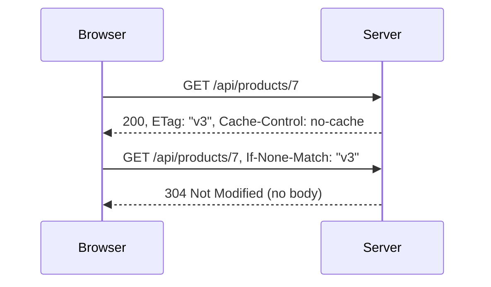

# HTTP caching and compression
[← Overview](00-overview.md)

## Why it matters
- A deploy ships a new `app.js` under the same URL. Browsers keep the cached old one for a day and users see a white screen.
- A CDN caches `/account` and shows one user's data to everyone.
- A 2 MB JSON response takes seconds on mobile; with Brotli it would be a tenth of the size.

## Concepts

### Cache-Control directives
| Directive | Meaning |
|:--|:--|
| `max-age=N` | fresh for N seconds, in browser and shared caches |
| `s-maxage=N` | overrides `max-age` for shared caches (CDN, proxy) |
| `no-cache` | may store, but must revalidate before every use |
| `no-store` | never store anywhere |
| `private` | only the user's browser may store it |
| `public` | shared caches may store it, even with `Authorization` |
| `immutable` | never revalidate while fresh |
| `must-revalidate` | never serve stale once expired |
| `stale-while-revalidate=N` | serve stale up to N s while refreshing in the background |
| `stale-if-error=N` | serve stale up to N s if the origin errors |

### Validators and conditional requests
The server labels a response with a version (`ETag`) or a date (`Last-Modified`). The client asks "has it changed?" with `If-None-Match` or `If-Modified-Since`. If not, the server answers `304 Not Modified` with no body.


On writes, `If-Match: "v3"` gives optimistic concurrency: if someone else changed the resource, the server answers `412 Precondition Failed`.

### Recipes
| Content | Cache-Control |
|:--|:--|
| Fingerprinted assets (`app.3f2a1c.js`) | `public, max-age=31536000, immutable` |
| HTML documents | `no-cache` |
| Public API data that may be a little stale | `public, max-age=60, stale-while-revalidate=300` |
| Personalized API responses | `private, no-cache` |
| Tokens, secrets, PII exports | `no-store` |

### Vary
`Vary` lists request headers that change the response, so caches store one copy per value: `Vary: Accept-Encoding`, `Vary: Origin`, `Vary: Accept-Language`. `Vary: Cookie` or `Vary: Authorization` effectively turns shared caching off.

### Compression
| Encoding | Notes |
|:--|:--|
| `br` (Brotli) | best ratio for text; all modern browsers |
| `gzip` | universal fallback |
| `zstd` | fast with a good ratio; Chrome and Firefox (2024+); CDN support growing |

The client sends `Accept-Encoding: gzip, br, zstd`. The server picks one and answers with `Content-Encoding` plus `Vary: Accept-Encoding`. Compress text formats (HTML, CSS, JS, JSON, SVG). Images, video, and archives are already compressed.

BREACH: compressing a response that contains both a secret (like a CSRF token) and attacker-controlled input can leak the secret, even over HTTPS. Don't reflect user input next to secrets, or mask tokens per request.

## Example
`cache.ts` — long-lived assets, a revalidated API resource, and a private one.
```ts
import express from 'express';
import { createHash } from 'node:crypto';

const app = express();

// Vite and Next.js put a content hash in asset names, so they can be cached for a year.
app.use('/assets', express.static('dist/assets', { immutable: true, maxAge: '1y' }));

const product = { id: 7, name: 'Desk', priceCents: 25_900, updatedAt: '2026-11-01T10:00:00Z' };

app.get('/api/products/7', (req, res) => {
  const body = JSON.stringify(product);
  const etag = `"${createHash('sha256').update(body).digest('base64url').slice(0, 16)}"`;
  res.set({ ETag: etag, 'Cache-Control': 'public, max-age=60, stale-while-revalidate=300' });
  if (req.fresh) return res.status(304).end(); // compares If-None-Match with the ETag set above
  res.type('json').send(body);
});

app.get('/api/me', (_req, res) => {
  res.set('Cache-Control', 'private, no-store');
  res.json({ email: 'user@example.com' });
});

app.listen(3000);
```
Express also adds a weak ETag to `res.send` and `res.json` responses by default and answers 304 on its own; the explicit version shows the mechanism.

```bash
curl -si localhost:3000/api/products/7 | grep -iE 'etag|cache-control'
curl -si localhost:3000/api/products/7 -H 'If-None-Match: "<etag from above>"' | head -1   # 304
curl -sI -H 'Accept-Encoding: br, gzip' https://example.com/ | grep -i content-encoding
```

## Production patterns
- **Fingerprinted assets forever, HTML always revalidated.** New deploys take effect at once, and assets never download twice.
- **Personalized responses are `private` or `no-store`.** Check that the CDN never caches responses carrying `Set-Cookie`.
- **Let the CDN or load balancer compress.** Pre-compress static assets at build time; keep app servers simple.
- **ETags for resources clients poll.** A 304 saves bandwidth, and server time if the ETag is cheap to compute (for example from `updated_at`).
- **CDN purges are for emergencies.** Design URLs so you never need them.

## Mistakes
Wrong: cache the HTML entry point for a day.
```ts
res.set('Cache-Control', 'max-age=86400'); // on index.html: old HTML points at deleted assets
```
Right:
```ts
res.set('Cache-Control', 'no-cache');
```

Wrong: `no-cache` used to mean "don't store this". It means "revalidate first".
Right: `no-store` for anything that must never be written to disk or a shared cache.

Wrong: `Cache-Control: public` on `/api/me`. Right: `private, no-store`.

Wrong: gzip every response, including JPEGs and ZIPs. It wastes CPU and can make files bigger.
Right: compress text types only.

## Check yourself
1. What is the difference between `no-cache` and `no-store`?
2. Why can fingerprinted assets use `immutable` while HTML cannot?
3. What goes wrong without `Vary: Accept-Encoding`?

<details>
<summary>Answers</summary>

1. `no-cache` may store but must check with the server before each use (a cheap 304 if unchanged). `no-store` must not store at all.
2. A fingerprinted URL changes whenever the content changes, so the old URL's content is final. HTML keeps its URL across deploys, so it must be revalidated.
3. A shared cache can store the Brotli version and serve it to a client that only understands gzip (or the reverse), which then shows garbage.
</details>

## Sources
- [MDN — HTTP caching](https://developer.mozilla.org/en-US/docs/Web/HTTP/Caching)
- [RFC 9111 — HTTP Caching](https://www.rfc-editor.org/rfc/rfc9111)
- [web.dev — Prevent unnecessary network requests with the HTTP Cache](https://web.dev/articles/http-cache)
- [MDN — Compression in HTTP](https://developer.mozilla.org/en-US/docs/Web/HTTP/Compression)
- [Express — `express.static` options](https://expressjs.com/en/5x/api.html#express.static)
