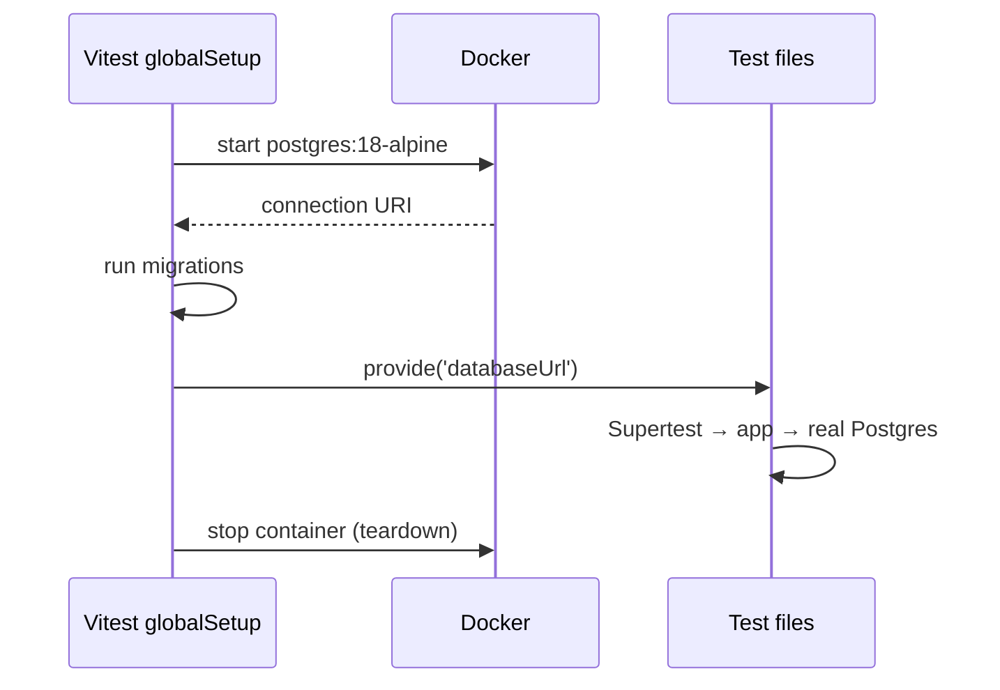

# Integration tests: Supertest and Testcontainers
[← Overview](00-overview.md)

## Why it matters
- Unit tests pass, but the endpoint returns 500 because the SQL column is `created_at`, not `createdAt`. Only a test that runs real SQL catches it.
- Tests use SQLite for speed while production runs Postgres. `ON CONFLICT`, JSONB, and time zone behavior differ, and the bug ships.
- Tests share one database and leave rows behind. They pass alone and fail together.

## Concepts

### Test through the HTTP boundary
Supertest calls your Express app in-process, without opening a real port. You exercise routing, middleware, validation, serialization, status codes, and your SQL in one test.

Requirement: export the app separately from `listen()`.
```text
src/app.ts     createApp(deps) → express app       (imported by tests)
src/server.ts  createApp(realDeps).listen(port)    (started in production)
```

### Real dependencies in containers
Testcontainers starts a throwaway Docker container (Postgres, Redis, MongoDB) from your test code and gives you its connection string. Same engine and version as production, no shared dev database, and cleanup is automatic.



### Isolation strategies
| Strategy | How | Trade-off |
|:--|:--|:--|
| Truncate between tests | `TRUNCATE ... RESTART IDENTITY CASCADE` in `beforeEach` | simple; run files sequentially |
| Transaction per test | begin before, roll back after | fast; hard when the app opens its own transactions |
| Database per worker | create `test_<worker id>` from a template | parallel files; more setup |

Start with truncation and sequential integration files. Move to a database per worker when the suite gets slow.

## Example
`src/app.ts`
```ts
import express from 'express';
import type { Pool } from 'pg';

export function createApp(db: Pool) {
  const app = express();
  app.use(express.json());

  app.post('/users', async (req, res) => {
    const { email } = req.body ?? {};
    if (typeof email !== 'string' || !email.includes('@')) {
      return res.status(400).json({ error: 'A valid email is required' });
    }
    try {
      const { rows } = await db.query(
        'INSERT INTO users (email) VALUES ($1) RETURNING id, email',
        [email.toLowerCase()],
      );
      res.status(201).json(rows[0]);
    } catch (err) {
      if ((err as { code?: string }).code === '23505') { // unique_violation
        return res.status(409).json({ error: 'Email already registered' });
      }
      throw err; // Express 5 forwards it to the error handler
    }
  });

  return app;
}
```
`test/global-setup.ts`
```ts
import { PostgreSqlContainer, type StartedPostgreSqlContainer } from '@testcontainers/postgresql';
import pg from 'pg';
import type { TestProject } from 'vitest/node';

let container: StartedPostgreSqlContainer;

export async function setup(project: TestProject) {
  container = await new PostgreSqlContainer('postgres:18-alpine').start();
  const url = container.getConnectionUri();

  const client = new pg.Client({ connectionString: url });
  await client.connect();
  await client.query(`CREATE TABLE users (
    id bigint GENERATED ALWAYS AS IDENTITY PRIMARY KEY,
    email text NOT NULL UNIQUE
  )`); // in a real project: run your migrations here
  await client.end();

  project.provide('databaseUrl', url);
}

export async function teardown() {
  await container?.stop();
}

declare module 'vitest' {
  export interface ProvidedContext { databaseUrl: string }
}
```
`test/users.test.ts`
```ts
import { afterAll, beforeEach, describe, expect, inject, it } from 'vitest';
import request from 'supertest';
import pg from 'pg';
import { createApp } from '../src/app.ts';

const pool = new pg.Pool({ connectionString: inject('databaseUrl') });
const app = createApp(pool);

beforeEach(() => pool.query('TRUNCATE users RESTART IDENTITY'));
afterAll(() => pool.end());

describe('POST /users', () => {
  it('creates a user and stores the email in lowercase', async () => {
    const res = await request(app).post('/users').send({ email: 'Ada@Example.com' }).expect(201);

    expect(res.body).toMatchObject({ email: 'ada@example.com' });
    const { rows } = await pool.query('SELECT email FROM users');
    expect(rows).toEqual([{ email: 'ada@example.com' }]); // check the database, not just the response
  });

  it('returns 409 when the email is taken, ignoring case', async () => {
    await request(app).post('/users').send({ email: 'ada@example.com' }).expect(201);
    const res = await request(app).post('/users').send({ email: 'ADA@example.com' }).expect(409);
    expect(res.body.error).toMatch(/already registered/);
  });

  it('returns 400 for an invalid email', async () => {
    await request(app).post('/users').send({ email: 'nope' }).expect(400);
  });
});
```
`vitest.config.ts` — unit tests in parallel, integration files one at a time.
```ts
import { defineConfig } from 'vitest/config';

export default defineConfig({
  test: {
    projects: [
      { test: { name: 'unit', include: ['src/**/*.test.ts'] } },
      {
        test: {
          name: 'integration',
          include: ['test/**/*.test.ts'],
          globalSetup: ['test/global-setup.ts'],
          fileParallelism: false, // all files share one database
          testTimeout: 30_000,
        },
      },
    ],
  },
});
```
Run one project: `pnpm vitest --project integration`.

## Production patterns
- **Assert on the response and on the side effect** (rows written, job queued), not just the status code.
- **Run the same migrations as production** in `globalSetup`. Migrations get tested for free.
- **Pin the container image to production's major version** (`postgres:18-alpine`).
- **Sessions and cookies:** `request.agent(app)` keeps cookies between calls, so you can log in once and call protected routes.
- **Speed:** start containers once per run (global setup), and reuse them locally with `.withReuse()` plus `TESTCONTAINERS_REUSE_ENABLE=true`.

## Mistakes
Wrong: starting the server in tests.
```ts
import './server.ts'; // listens on :3000; parallel runs clash, and the process never exits
```
Right: `request(createApp(pool))` — Supertest binds an ephemeral port internally.

Wrong: SQLite or an in-memory fake in place of Postgres for "integration" tests.
Right: the same engine and version as production, in a container.

Wrong: tests depending on rows created by earlier tests.
```ts
it('lists users', async () => {
  const res = await request(app).get('/users');
  expect(res.body).toHaveLength(3); // only true if the three tests above ran first
});
```
Right: each test creates its own data (factories) after a clean `TRUNCATE`.

Wrong: only checking the status code: `.expect(201)` and nothing else.
Right: also check the body shape and the database state.

## Check yourself
1. Why export `createApp()` instead of the server?
2. What does `fileParallelism: false` protect against here?
3. A test passes alone but fails in the full run. What are the first two things to check?

<details>
<summary>Answers</summary>

1. Tests need the app without a listening port, and with their own dependencies (a test database pool). Production wires real dependencies and calls `listen()`.
2. Several test files truncating and inserting into the same database at once, deleting each other's rows mid-test.
3. Shared state left by other tests (rows, module-level variables, mocks not restored), and order dependence (run with `--sequence.shuffle` to expose it).
</details>

## Sources
- [Supertest — README](https://github.com/forwardemail/supertest)
- [Testcontainers for Node.js — PostgreSQL module](https://node.testcontainers.org/modules/postgresql/)
- [Vitest — `globalSetup` and `provide`/`inject`](https://vitest.dev/config/globalsetup)
- [Vitest — Test projects](https://vitest.dev/guide/projects)
- [PostgreSQL — Error codes (23505)](https://www.postgresql.org/docs/current/errcodes-appendix.html)
