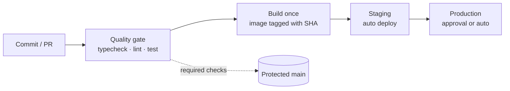

# CI/CD — Overview
[← Topic](../README.md)

**TECH:** GitHub Actions · pnpm · Docker (Buildx, GHCR)
**LEVEL:** intermediate (mid-level, has shipped production code)

## Why this matters in production
- CI is the only reviewer that checks every change, every time. A green main is what makes small, frequent deploys safe.
- A slow pipeline makes people batch changes, and big batches cause big incidents.
- CI holds the keys to production. A compromised workflow can leak secrets or push a poisoned image.
- Deploying from CI, not laptops, gives you an audit trail and repeatable releases.

## Mental model
A pipeline turns a commit into evidence (checks) and an artifact (an image), then promotes that same artifact through environments.

- **Build once, promote many times.** The image tested in staging is the image in production.
- Workflows are code: reviewed, versioned, least-privilege.

## Prerequisites
- [01-git](../../01-git/README.md): PRs, rulesets, protected main.
- [03-testing](../../03-testing/README.md): a test suite worth running.
- A GitHub repo you can configure. Docker basics help for lesson 04 ([04-shipping/01-containers](../../../04-shipping/01-containers/README.md)).

## Lesson map
| Lesson | Checklist items |
|:--|:--|
| [01 · Pipelines and GitHub Actions anatomy](01-pipelines-and-actions.md) | 1, 2, 5 |
| [02 · A fast PR pipeline with pnpm](02-fast-pr-pipeline.md) | 3, 4, 12 |
| [03 · Secrets, OIDC, and hardened workflows](03-secure-workflows.md) | 6, 7 |
| [04 · Docker images and reusable workflows](04-docker-and-reuse.md) | 8, 9 |
| [05 · Green main, environments, and approvals](05-green-main-and-environments.md) | 10, 11 |
| [Cheatsheet](cheatsheet.md) | all |

## Suggested order
1. 01 and 02, then set up the PR pipeline in a real repo.
2. 03 before you add any secret to a repository.
3. 04 after [04-shipping/01-containers](../../../04-shipping/01-containers/README.md) if Docker is new.
4. 05 together with [01-git lesson 05](../../01-git/docs/05-pull-requests-and-protection.md). Deployment strategies (rolling, blue/green) are in [04-shipping/04-deployments](../../../04-shipping/04-deployments/README.md).
5. Ready to build: `/learn 01-foundations/04-ci-cd mode=tasks`.

## Version notes
- Node 20 is gone from GitHub Actions runners (September 2026). JavaScript actions run on `node24`; old action majors that declare `node20` fail. Update to current majors.
- Action tags in these lessons (`@v5`, `@v6`) were the current majors when written. In real workflows pin each action to a full commit SHA with the version in a comment, and let Dependabot update them.
- pnpm 10 is current. Node 25+ no longer bundles Corepack, so install pnpm with `pnpm/action-setup` (reads `packageManager` from `package.json`).
- The March 2025 `tj-actions/changed-files` compromise (tags repointed to malicious code that dumped secrets) is why SHA pinning is the norm.

## Sources
- [GitHub Actions documentation](https://docs.github.com/en/actions)
- [GitHub — Security hardening for GitHub Actions](https://docs.github.com/en/actions/security-for-github-actions/security-guides/security-hardening-for-github-actions)
- [GitHub changelog — Node 20 is no longer available in GitHub Actions](https://github.blog/changelog/2026-09-23-node-20-is-no-longer-available-in-github-actions)
- [pnpm — Continuous integration](https://pnpm.io/continuous-integration)
- [Docker — GitHub Actions](https://docs.docker.com/build/ci/github-actions/)
