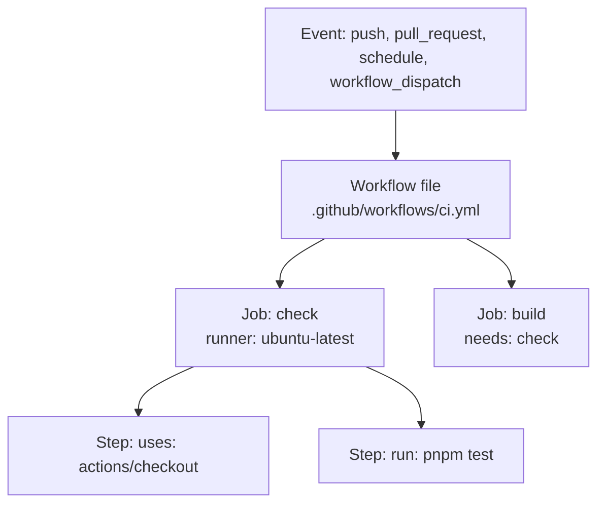

# Pipelines and GitHub Actions anatomy
[← Overview](00-overview.md)

## Why it matters
- "Works on my machine" merges break main for everyone, because nothing ran the tests on a clean machine before merging.
- Two deploy workflows run at once on back-to-back merges, and the older commit finishes last. Production now runs old code.
- A matrix over 4 Node versions × 3 OSes runs on every push: 12 jobs, 40 minutes, for a web service that only ever runs on Linux with Node 26.

## Concepts

### CI, delivery, deployment
| Term | Means | Gate to production |
|:--|:--|:--|
| Continuous integration | every change is merged to main often and verified automatically | — |
| Continuous delivery | main is always deployable; a release is one click | human decision |
| Continuous deployment | every green main commit deploys automatically | the pipeline itself |

A pipeline exists to give **fast, trustworthy feedback** and to produce **one artifact** that moves through environments unchanged.

### Anatomy

| Piece | What it is |
|:--|:--|
| Workflow | YAML file in `.github/workflows/`; one or more triggers |
| Event (`on:`) | what starts it: `push`, `pull_request`, `merge_group`, `schedule`, `workflow_dispatch`, `workflow_call` |
| Job | steps on one fresh runner VM; jobs run in parallel unless `needs:` orders them |
| Step | `uses:` an action, or `run:` a shell command; shares the job's filesystem |
| Runner | the machine: GitHub-hosted (`ubuntu-latest`, `ubuntu-24.04-arm`) or self-hosted |
| Action | reusable step: JavaScript, Docker, or composite |
| Expression | `${{ ... }}`: contexts (`github`, `env`, `secrets`, `matrix`, `needs`) and functions |

Jobs don't share files. Pass data with `outputs` (small strings) or artifacts (files).

### Matrix, needs, and concurrency
- **`strategy.matrix`** runs a job per combination. Use it for real variation (library supporting several Node versions, test shards), not by habit.
- **`needs:`** orders jobs and exposes `needs.<job>.outputs` and `needs.<job>.result`.
- **`concurrency:`** allows only one run per group. `cancel-in-progress: true` for PR checks (newer push wins). For deploys keep `cancel-in-progress: false`, so a running deploy finishes and the newest waits.

## Example
`.github/workflows/ci.yml`
```yaml
name: ci
on:
  pull_request:
  push:
    branches: [main]

permissions:
  contents: read

concurrency:
  group: ci-${{ github.ref }}
  cancel-in-progress: ${{ github.event_name == 'pull_request' }} # never cancel runs on main

jobs:
  check:
    runs-on: ubuntu-latest
    timeout-minutes: 10
    steps:
      - uses: actions/checkout@v5
      - uses: pnpm/action-setup@v4
      - uses: actions/setup-node@v5
        with:
          node-version-file: .nvmrc
          cache: pnpm
      - run: pnpm install --frozen-lockfile
      - run: pnpm typecheck
      - run: pnpm lint

  test:
    runs-on: ubuntu-latest
    timeout-minutes: 15
    strategy:
      fail-fast: false
      matrix:
        shard: [1, 2]
    steps:
      - uses: actions/checkout@v5
      - uses: pnpm/action-setup@v4
      - uses: actions/setup-node@v5
        with:
          node-version-file: .nvmrc
          cache: pnpm
      - run: pnpm install --frozen-lockfile
      - run: pnpm vitest run --shard=${{ matrix.shard }}/2

  build:
    needs: [check, test]
    runs-on: ubuntu-latest
    outputs:
      version: ${{ steps.meta.outputs.version }}
    steps:
      - uses: actions/checkout@v5
      - id: meta
        run: echo "version=$(git rev-parse --short HEAD)" >> "$GITHUB_OUTPUT"
      - run: echo "Building ${{ steps.meta.outputs.version }}"
```
Lint workflow files locally before pushing: `actionlint` catches typos in keys, expressions, and shell scripts.

## Production patterns
- **One workflow for PR checks, one for deploys.** Different triggers, permissions, and concurrency rules.
- **`timeout-minutes` on every job.** The default is 6 hours of billed runner time.
- **Pin the toolchain from the repo**: `node-version-file: .nvmrc` and `packageManager` in `package.json`, so CI and laptops match.
- **Run the same commands locally and in CI** (`pnpm typecheck`, `pnpm lint`, `pnpm test`). CI calls scripts; it doesn't contain logic.
- **Use matrices for real variation only.** A service that deploys on Linux with Node 26 tests on Linux with Node 26.

## Mistakes
Wrong: cancel in-progress runs on main.
```yaml
concurrency:
  group: ci-${{ github.ref }}
  cancel-in-progress: true # merges cancel each other; main may never get a green run
```
Right: cancel only on PRs, as in the example.

Wrong: logic inlined in YAML.
```yaml
- run: |
    npx tsc --noEmit -p tsconfig.build.json && npx eslint . --max-warnings 0 && ...
```
Right: `pnpm typecheck` and `pnpm lint` scripts that developers run too.

Wrong: expecting files from another job.
```yaml
build:
  needs: test
  steps:
    - run: ls coverage/ # empty: each job is a fresh machine
```
Right: `actions/upload-artifact` in `test`, `actions/download-artifact` in `build`, or job `outputs` for small values.

## Check yourself
1. What is the difference between continuous delivery and continuous deployment?
2. Why should deploy workflows use `cancel-in-progress: false`?
3. How do two jobs share a 2 MB coverage report? A short version string?

<details>
<summary>Answers</summary>

1. Delivery keeps main always deployable and releases on a human decision. Deployment releases every green main commit automatically.
2. Cancelling a deploy halfway can leave infrastructure half-updated. Letting the current one finish and queueing the newest keeps releases ordered and complete.
3. The report as an artifact (`upload-artifact` / `download-artifact`); the string as a job output via `$GITHUB_OUTPUT` and `needs.<job>.outputs`.
</details>

## Sources
- [GitHub — Workflow syntax](https://docs.github.com/en/actions/writing-workflows/workflow-syntax-for-github-actions)
- [GitHub — Events that trigger workflows](https://docs.github.com/en/actions/writing-workflows/choosing-when-your-workflow-runs/events-that-trigger-workflows)
- [GitHub — Control concurrency](https://docs.github.com/en/actions/writing-workflows/choosing-what-your-workflow-does/control-the-concurrency-of-workflows-and-jobs)
- [Martin Fowler — Continuous Integration](https://martinfowler.com/articles/continuousIntegration.html)
- [actionlint](https://github.com/rhysd/actionlint)
