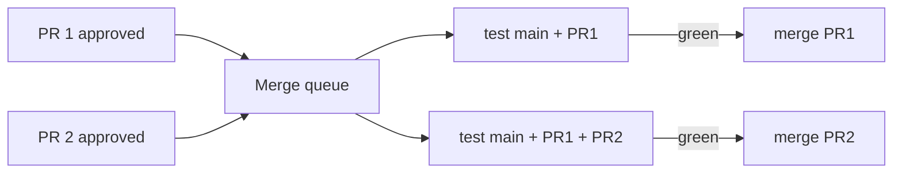

# Green main, environments, and approvals
[← Overview](00-overview.md)

## Why it matters
- Two PRs each pass CI alone, but together break the build. Both merge, main is red, and every open PR now fails for reasons unrelated to it.
- Production secrets are available to any workflow on any branch. A test branch deploys to production by accident.
- A docs-only PR can never merge, because a required check lives in a workflow that `paths-ignore` skipped.

## Concepts

### Keeping main green
| Tool | What it does |
|:--|:--|
| Required status checks (ruleset) | named checks must pass before merge |
| "Require branches to be up to date" | PR must include latest main; forces constant rebases on busy repos |
| Merge queue | GitHub tests each PR combined with those ahead of it, then merges in order |
| `merge_group` trigger | runs your checks on the queue's temporary branch |
| Aggregator job | one always-running job that is the only required check |



### Aggregator job
Required checks match by job name. Jobs skipped by `if:` or path filters, or renamed in a refactor, leave PRs waiting. One `ci-ok` job that `needs:` everything and runs with `if: always()` reports a single, stable result.

### Environments
| Feature | Use |
|:--|:--|
| Required reviewers | a person approves each deployment |
| Wait timer | delay (e.g. 10 min) before deploying, to abort if needed |
| Deployment branches/tags | only `main` (or `v*` tags) may deploy to production |
| Environment secrets and variables | credentials only that environment's jobs can read |
| Prevent self-review | the person who triggered can't approve |
| Deployment history and URL | who deployed what, when, and where it runs |

Typical promotion: **preview** per PR (optional) → **staging** on every merge → **production** after approval or automatic once staging smoke tests pass.

## Example
`.github/workflows/ci.yml` with merge queue support and an aggregator:
```yaml
name: ci
on:
  pull_request:
  merge_group:            # required for the merge queue

permissions:
  contents: read

jobs:
  changes:
    runs-on: ubuntu-latest
    outputs:
      code: ${{ steps.filter.outputs.code }}
    steps:
      - uses: actions/checkout@v5
      - id: filter
        uses: dorny/paths-filter@v3
        with:
          filters: |
            code: ['src/**', 'package.json', 'pnpm-lock.yaml']

  test:
    needs: changes
    if: needs.changes.outputs.code == 'true' || github.event_name == 'merge_group'
    runs-on: ubuntu-latest
    steps:
      - uses: actions/checkout@v5
      - uses: ./.github/actions/setup
      - run: pnpm test

  ci-ok:                  # the ONLY required status check
    needs: [changes, test]
    if: always()
    runs-on: ubuntu-latest
    steps:
      - run: |
          echo '${{ toJSON(needs) }}'
          if [[ "${{ contains(needs.*.result, 'failure') || contains(needs.*.result, 'cancelled') }}" == "true" ]]; then
            exit 1
          fi
```
Skipped `test` (docs-only PR) counts as success; failed or cancelled jobs fail `ci-ok`.

Deploy with environments:
```yaml
name: deploy
on:
  push:
    branches: [main]
  workflow_dispatch:

concurrency:
  group: deploy-production
  cancel-in-progress: false

permissions: {}

jobs:
  staging:
    runs-on: ubuntu-latest
    environment:
      name: staging
      url: https://staging.example.com
    permissions: { contents: read, id-token: write }
    steps:
      - run: echo "deploy sha-${GITHUB_SHA::7} to staging, then run smoke tests"

  production:
    needs: staging
    runs-on: ubuntu-latest
    environment:
      name: production            # required reviewers configured in Settings → Environments
      url: https://example.com
    permissions: { contents: read, id-token: write }
    steps:
      - run: echo "deploy the same image digest to production"
```

## Production patterns
- **Merge queue on busy repos** instead of "require up to date": no rebase races, main stays green.
- **One required check (`ci-ok`)**, so refactoring jobs never blocks merging.
- **Production deploys only from `main` or release tags**, enforced by environment branch rules, not by convention.
- **Environment-scoped secrets and OIDC roles** (`sub` includes `environment:production`).
- **Run smoke tests after each deploy** and stop the promotion if they fail.
- **Main broken? Revert first, debug second.** The fix-forward can wait; everyone else is blocked.

## Mistakes
Wrong: making every job a required check.
```text
Required: check, test (1), test (2), build, e2e
```
Rename one, add a shard, or skip one by path, and PRs hang.
Right: require only `ci-ok`.

Wrong: forgetting `merge_group` after enabling the queue. Queued PRs wait for checks that never start.
Right: add `merge_group:` to the workflow's triggers.

Wrong: production secrets as repository secrets. Any workflow on any branch can read them.
Right: environment secrets on `production`, with deployment branch rules and reviewers.

Wrong: a deploy job with `cancel-in-progress: true`. A newer push cancels a deploy midway.
Right: `cancel-in-progress: false` for deploys.

## Check yourself
1. What problem does a merge queue solve that required checks alone do not?
2. Why does a skipped job not block `ci-ok`, but a failed one does?
3. What three environment settings make production deploys safe?

<details>
<summary>Answers</summary>

1. Semantic conflicts between PRs: each passes against an older main, but not combined. The queue tests each PR on top of main plus the PRs ahead of it before merging.
2. The aggregator checks `needs.*.result` for `failure` or `cancelled`; `skipped` is neither, so docs-only PRs pass while real failures still fail it.
3. Deployment branch rules (only main or tags), required reviewers (with prevent self-review), and environment-scoped secrets or OIDC roles.
</details>

## Sources
- [GitHub — Managing a merge queue](https://docs.github.com/en/repositories/configuring-branches-and-merges-in-your-repository/configuring-pull-request-merges/managing-a-merge-queue)
- [GitHub — Managing environments for deployment](https://docs.github.com/en/actions/managing-workflow-runs-and-deployments/managing-deployments/managing-environments-for-deployment)
- [GitHub — About rulesets](https://docs.github.com/en/repositories/configuring-branches-and-merges-in-your-repository/managing-rulesets/about-rulesets)
- [dorny/paths-filter](https://github.com/dorny/paths-filter)
- [GitHub — `merge_group` event](https://docs.github.com/en/actions/writing-workflows/choosing-when-your-workflow-runs/events-that-trigger-workflows#merge_group)
