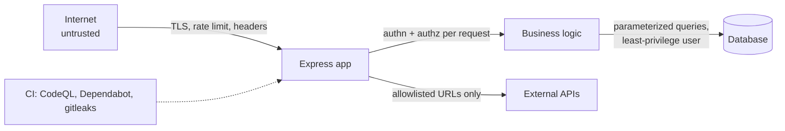

# Security Fundamentals — Overview
[← Topic](../README.md)

**TECH:** Node.js 26 · Express 5.2 · Helmet 8 · express-rate-limit 8 · Dependabot · CodeQL · gitleaks
**LEVEL:** intermediate (mid-level, has shipped production code)

> STACK.md marks the security tooling row as **tentative**. These lessons use it as recorded. Change it with `/stack revisit Security tooling`.

## Why this matters in production
- Most breaches use boring bugs: missing authorization checks, injection, leaked secrets, vulnerable dependencies.
- Attackers automate. A public endpoint gets credential-stuffed and scanned within hours of launch.
- Security fixes after launch cost far more than secure defaults at the start.
- Customers, auditors, and laws (GDPR, the EU Cyber Resilience Act) expect basic controls you can show.

## Mental model
Security is about **trust boundaries**: every place where data or control crosses from less trusted to more trusted. Validate, authenticate, authorize, and limit at each boundary, and assume each layer can fail (defense in depth).

## Prerequisites
- [02-http-networking](../../02-http-networking/README.md) lessons 03–04: HTTPS, cookies, CORS, proxies.
- A small Express 5 app with a database (any).
- [05-code-quality](../../05-code-quality/README.md) for strict types and lint rules that catch unsafe code.

## Lesson map
| Lesson | Checklist items |
|:--|:--|
| [01 · Threat modeling and the OWASP Top 10](01-threat-modeling-and-owasp.md) | 1, 2 |
| [02 · Injection and broken access control](02-injection-and-access-control.md) | 3, 4 |
| [03 · XSS, CSRF, and security headers](03-xss-csrf-headers.md) | 5, 6, 7 |
| [04 · Rate limits, SSRF, paths, and uploads](04-abuse-and-server-side-pitfalls.md) | 8, 9 |
| [05 · Secrets, supply chain, and response](05-secrets-supply-chain-response.md) | 10, 11, 12, 13 |
| [Cheatsheet](cheatsheet.md) | all |

## Suggested order
1. STACK.md's learn order starts here. Read 01 and 02 first.
2. 03 and 04 before building APIs in [03-backend](../../../03-backend/README.md).
3. 05 alongside [04-ci-cd](../../04-ci-cd/README.md) lesson 03.
4. Deeper follow-ups: [03-backend/04-auth](../../../03-backend/04-auth/README.md), [03-backend/05-validation-abuse](../../../03-backend/05-validation-abuse/README.md), [02-frontend/11-security](../../../02-frontend/11-security/README.md).
5. Ready to build: `/learn 01-foundations/06-security mode=tasks`.

## Version notes
- OWASP Top 10:2025 is the current list. New: **A03 Software Supply Chain Failures** and **A10 Mishandling of Exceptional Conditions**; SSRF folded into A01 Broken Access Control.
- Helmet 8 defaults HSTS to one year and sets a strict CSP; express-rate-limit 8 groups IPv6 clients by `/56` subnet by default (`ipv6Subnet`).
- pnpm 10 no longer runs dependency install scripts unless allowed (`onlyBuiltDependencies`), and `minimumReleaseAge` can delay brand-new versions. Both answer the September 2025 npm worm attacks.
- gitleaks 8.19+ uses `gitleaks git` and `gitleaks dir`; the old `detect`/`protect` commands are deprecated.

## Sources
- [OWASP Top 10:2025](https://owasp.org/Top10/2025/)
- [OWASP Cheat Sheet Series](https://cheatsheetseries.owasp.org/)
- [Express — Security best practices](https://expressjs.com/en/advanced/best-practice-security.html)
- [Node.js — Security best practices](https://nodejs.org/en/learn/getting-started/security-best-practices)
- [Helmet](https://helmetjs.github.io/)
