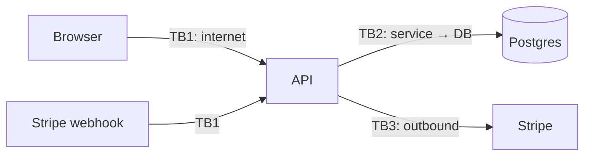

# Threat modeling and the OWASP Top 10
[← Overview](00-overview.md)

## Why it matters
- A team adds "export all invoices as CSV" and never asks who can call it. A support account with read access downloads every customer's data.
- An admin panel is "hidden" at `/admin-7f3a`. A crawler finds it in a JavaScript bundle on day one.
- Security work happens only after a pentest, so findings arrive when changing the design is most expensive.

## Concepts

### Threat modeling in 30 minutes
Four questions (Shostack):
1. **What are we building?** Draw the data flow: users, services, stores, and the trust boundaries between them.
2. **What can go wrong?** Walk each boundary with STRIDE.
3. **What are we going to do about it?** Mitigate, accept, or transfer each risk.
4. **Did we do a good job?** Revisit when the design changes.

| STRIDE threat | Violates | Example | Typical mitigation |
|:--|:--|:--|:--|
| **S**poofing | authentication | stolen session cookie | `HttpOnly` cookies, MFA, short sessions |
| **T**ampering | integrity | changing `price` in a request body | server-side calculation, signatures |
| **R**epudiation | accountability | "I never deleted that" | audit logs with actor and time |
| **I**nformation disclosure | confidentiality | stack traces, IDOR | generic errors, object-level authz |
| **D**enial of service | availability | huge JSON bodies, expensive queries | body limits, rate limits, timeouts |
| **E**levation of privilege | authorization | user flips `role: admin` | allowlisted fields, role checks |


Each arrow crossing a trust boundary (TB) is where you validate, authenticate, authorize, and limit.

### OWASP Top 10:2025
| # | Category | In a Node/Express app |
|:--|:--|:--|
| A01 | Broken Access Control | missing ownership checks (IDOR), unprotected admin routes, SSRF |
| A02 | Security Misconfiguration | debug errors in prod, default credentials, permissive CORS, missing headers |
| A03 | Software Supply Chain Failures | malicious or vulnerable npm packages, compromised CI actions |
| A04 | Cryptographic Failures | weak password hashing, no TLS, secrets in code |
| A05 | Injection | SQL, NoSQL, command injection, XSS |
| A06 | Insecure Design | no rate limit on password reset, trusting client-side prices |
| A07 | Authentication Failures | credential stuffing, weak sessions, no MFA for admins |
| A08 | Software or Data Integrity Failures | unsigned updates, unsafe deserialization, unverified webhooks |
| A09 | Security Logging and Alerting Failures | no record of failed logins or permission denials |
| A10 | Mishandling of Exceptional Conditions | errors that fail open, leak details, or leave state half-written |

### Principles
| Principle | Means |
|:--|:--|
| Defense in depth | several independent controls; one failing isn't a breach |
| Least privilege | every user, service, and DB account gets only what it needs |
| Deny by default | access is refused unless a rule allows it |
| Fail closed | on error, deny (A10) |
| Minimize attack surface | fewer endpoints, ports, dependencies, and admin features |
| Don't roll your own crypto | use vetted libraries and platform primitives |

## Example
A lightweight threat model kept next to the code, `docs/threat-model.md`:
```md
## Feature: invoice CSV export (GET /accounts/:accountId/invoices.csv)
Assets: invoice data (PII, amounts). Actors: account members, support staff, attackers.
| Threat | STRIDE | Mitigation | Status |
|:--|:--|:--|:--|
| Member exports another account | I, E | query scoped by req.user.accountId; 404 otherwise | done |
| Support exports without reason | R | audit log: actor, account, row count, reason | todo |
| Huge export exhausts memory | D | stream rows; max 100k; rate limit 5/hour/user | done |
| CSV formula injection (=HYPERLINK) | T | prefix cells starting with = + - @ with ' | done |
```
And an error handler that fails closed without leaking details (A02, A10), `src/errors.ts`:
```ts
import type { ErrorRequestHandler } from 'express';

export const errorHandler: ErrorRequestHandler = (err, req, res, _next) => {
  req.log?.error({ err }, 'unhandled error'); // full detail goes to logs only
  if (res.headersSent) return res.end();
  res.status(500).json({ error: 'Internal Server Error', requestId: req.id }); // no stack, no SQL
};
```

## Production patterns
- **Threat-model each feature that touches money, PII, auth, or file handling**, in the design doc, in 30 minutes.
- **Keep a short security requirements list** in the PR template: authz checked, input validated, secrets not logged.
- **Map findings to OWASP categories** in tickets; it shows patterns across incidents.
- **Production errors are generic**; details go to logs with a request ID the user can quote.
- **Review the model when the architecture changes**: new third party, new public endpoint, new data store.

## Mistakes
Wrong: security by obscurity.
```ts
app.use('/admin-7f3a', adminRouter); // the path is in the client bundle
```
Right:
```ts
app.use('/admin', requireAuth, requireRole('admin'), adminRouter);
```

Wrong: failing open.
```ts
try {
  allowed = await authz.check(user, 'invoice:read', id);
} catch {
  allowed = true; // the authz service is down, so everyone may read
}
```
Right: on error, deny and alert.

Wrong: leaking internals.
```ts
res.status(500).json({ error: err.message, stack: err.stack }); // SQL, paths, versions
```
Right: generic message plus a request ID; details in logs.

## Check yourself
1. Which STRIDE category does "a user changes `role` in the update-profile request" belong to, and what stops it?
2. Name two OWASP Top 10:2025 categories that are new or reshaped compared to 2021.
3. What does "fail closed" mean for an authorization check that throws?

<details>
<summary>Answers</summary>

1. Elevation of privilege (and tampering). Accept only an allowlist of editable fields (a schema that strips `role`) and enforce role changes in an admin-only path.
2. A03 Software Supply Chain Failures (expanded from vulnerable components) and A10 Mishandling of Exceptional Conditions (new). SSRF moved into A01.
3. Treat the error as "not allowed": deny the request, log it, and alert. Never grant access because the check failed.
</details>

## Sources
- [OWASP Top 10:2025](https://owasp.org/Top10/2025/)
- [OWASP — Threat Modeling Cheat Sheet](https://cheatsheetseries.owasp.org/cheatsheets/Threat_Modeling_Cheat_Sheet.html)
- [Threat Modeling Manifesto](https://www.threatmodelingmanifesto.org/)
- [Microsoft — STRIDE threats](https://learn.microsoft.com/en-us/azure/security/develop/threat-modeling-tool-threats)
- [OWASP — CSV Injection](https://owasp.org/www-community/attacks/CSV_Injection)
