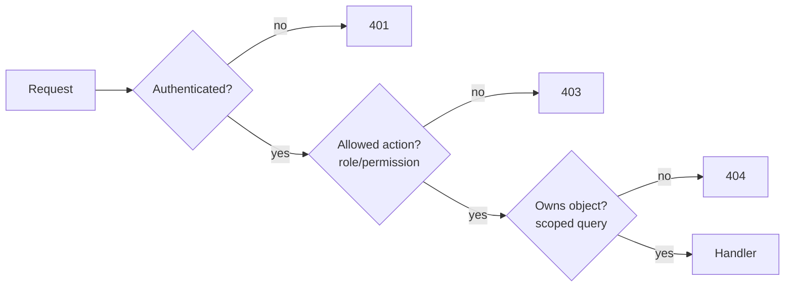

# Injection and broken access control
[← Overview](00-overview.md)

## Why it matters
- `GET /api/invoices/1043` returns invoice 1043 to any logged-in user. Changing the number walks through every customer's invoices. This IDOR pattern is the most common serious API bug.
- A search box builds SQL with string concatenation. `' OR 1=1 --` dumps the users table.
- A login endpoint passes `req.body` straight into a MongoDB query. `{"email": {"$ne": null}, "password": {"$ne": null}}` logs in as the first user.

## Concepts

### Injection: data treated as code
Injection happens whenever untrusted input is concatenated into something an interpreter parses: SQL, MongoDB queries, shell commands, HTML, LDAP, templates.

| Kind | Vulnerable | Safe |
|:--|:--|:--|
| SQL | `` `... WHERE email = '${email}'` `` | parameters: `WHERE email = $1`, `[email]` |
| SQL identifiers | `` `ORDER BY ${sort}` `` | allowlist: `{ newest: 'created_at DESC' }[sort]` |
| MongoDB operators | `User.findOne(req.body)` | validate types first; `sanitizeFilter: true` |
| Shell | `` exec(`convert ${file} out.png`) `` | `execFile('convert', [file, 'out.png'])` |
| HTML | `innerHTML = name` | escaping by default (lesson 03) |

Parameters are sent separately from the query text, so the database never parses them as SQL. Validation (lesson 01 of 05-code-quality) is a second layer, not a replacement.

### Broken access control
**Authentication** answers "who are you?". **Authorization** answers "may you do this, to this object?". Most breaches are authorization gaps:

| Gap | Example | Fix |
|:--|:--|:--|
| Object level (IDOR / BOLA) | `/invoices/:id` without an ownership check | scope every query by the caller's account |
| Function level | regular user calls `DELETE /admin/users/:id` | role or permission check per route |
| Property level (mass assignment) | `PATCH /me` with `{ "role": "admin" }` | allowlist editable fields |
| Tenant isolation | data of tenant A visible to tenant B | `tenant_id` in every query; Postgres row-level security as backup |
| Forced browsing | unlinked URLs assumed private | deny by default |

Rule: **every** handler that touches data checks permission on the server, for that specific object. Hiding a button in the UI is not access control.



## Example
`src/invoices.ts` — parameterized, scoped queries and allowlisted fields.
```ts
import express from 'express';
import { z } from 'zod';
import type { Pool } from 'pg';

type User = { id: string; accountId: string; role: 'member' | 'admin' };
declare module 'express-serve-static-core' {
  interface Request { user?: User }
}

const SORTS = { newest: 'created_at DESC', amount: 'amount_cents DESC' } as const;
const ListQuery = z.object({
  q: z.string().max(100).optional(),
  sort: z.enum(['newest', 'amount']).default('newest'),
});
const UpdateInvoice = z.object({ note: z.string().max(500) }).strict(); // unknown keys → 400

export function invoiceRoutes(db: Pool) {
  const router = express.Router();

  router.get('/invoices', async (req, res) => {
    const user = req.user!; // set by auth middleware (03-backend/04-auth)
    const { q, sort } = ListQuery.parse(req.query);
    const { rows } = await db.query(
      `SELECT id, number, amount_cents FROM invoices
       WHERE account_id = $1 AND ($2::text IS NULL OR number ILIKE '%' || $2 || '%')
       ORDER BY ${SORTS[sort]} LIMIT 50`, // identifier from an allowlist, values as parameters
      [user.accountId, q ?? null],
    );
    res.json(rows);
  });

  router.get('/invoices/:id', async (req, res) => {
    const { rows } = await db.query(
      'SELECT * FROM invoices WHERE id = $1 AND account_id = $2', // ownership in the query itself
      [req.params.id, req.user!.accountId],
    );
    if (!rows[0]) return res.status(404).json({ error: 'Invoice not found' }); // 404 hides existence
    res.json(rows[0]);
  });

  router.patch('/invoices/:id', async (req, res) => {
    const body = UpdateInvoice.parse(req.body); // only `note` can change
    const { rowCount } = await db.query(
      'UPDATE invoices SET note = $1 WHERE id = $2 AND account_id = $3',
      [body.note, req.params.id, req.user!.accountId],
    );
    if (!rowCount) return res.status(404).json({ error: 'Invoice not found' });
    res.status(204).end();
  });

  return router;
}
```
MongoDB with Mongoose 9: validate types, and let Mongoose strip operators from filters.
```ts
import mongoose from 'mongoose';
mongoose.set('sanitizeFilter', true); // wraps `$`-keys in filters with $eq

const Login = z.object({ email: z.string().email(), password: z.string().min(1) });
const { email } = Login.parse(req.body); // an object here fails validation
const user = await UserModel.findOne({ email });
```

## Production patterns
- **Scope queries by tenant/owner in the query**, not by fetching and checking afterwards. A forgotten `if` can't leak data that was never selected.
- **Central authorization helpers** (`can(user, 'invoice:update', invoice)`) used by every route; test them with a permission matrix.
- **Integration tests for access control:** user A requests user B's resource and must get 404/403. Write one per endpoint.
- **UUIDs or random IDs make enumeration harder**, but they are not authorization.
- **Defense in depth for multi-tenant data:** Postgres row-level security as a backstop for application checks.
- **Least-privilege database user:** the app user can't `DROP`, `ALTER`, or read other schemas.

## Mistakes
Wrong: string-built SQL.
```ts
await db.query(`SELECT * FROM users WHERE email = '${req.query.email}'`);
```
Right:
```ts
await db.query('SELECT * FROM users WHERE email = $1', [req.query.email]);
```

Wrong: fetch, then forget to check ownership.
```ts
const invoice = await getInvoice(req.params.id);
res.json(invoice); // any user, any invoice
```
Right: `WHERE id = $1 AND account_id = $2` (or an explicit check that returns 404).

Wrong: mass assignment.
```ts
await db.query('UPDATE users SET ... ', buildUpdate(req.body)); // body may include role, account_id
```
Right: a strict schema that lists the editable fields.

Wrong: `exec` with input.
```ts
exec(`zip -r out.zip ${req.query.folder}`); // folder = "x; rm -rf /"
```
Right:
```ts
execFile('zip', ['-r', 'out.zip', folder], { cwd: SAFE_BASE });
```

## Check yourself
1. Why do parameterized queries prevent SQL injection when escaping strings by hand often fails?
2. Why return 404 instead of 403 when a user requests another account's invoice?
3. Which access-control gap does `PATCH /me {"role":"admin"}` exploit, and how do you prevent it?

<details>
<summary>Answers</summary>

1. Parameters travel separately from the SQL text; the database parses the query first and treats parameters only as values. Manual escaping depends on getting every context (quotes, encodings, identifiers) right every time.
2. A 403 confirms the invoice exists, which leaks information and helps enumeration. A 404 reveals nothing.
3. Property-level authorization (mass assignment). Accept only an allowlist of editable fields with a strict schema; change roles only through an admin-only endpoint.
</details>

## Sources
- [OWASP — SQL Injection Prevention Cheat Sheet](https://cheatsheetseries.owasp.org/cheatsheets/SQL_Injection_Prevention_Cheat_Sheet.html)
- [OWASP API Security Top 10 — API1 Broken Object Level Authorization](https://owasp.org/API-Security/editions/2023/en/0xa1-broken-object-level-authorization/)
- [OWASP — Authorization Cheat Sheet](https://cheatsheetseries.owasp.org/cheatsheets/Authorization_Cheat_Sheet.html)
- [node-postgres — Parameterized queries](https://node-postgres.com/features/queries#parameterized-query)
- [Mongoose — `sanitizeFilter`](https://mongoosejs.com/docs/api/mongoose.html#Mongoose.prototype.set())
- [Node.js — `child_process.execFile`](https://nodejs.org/api/child_process.html#child_processexecfilefile-args-options-callback)
