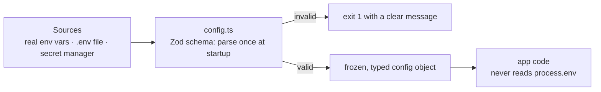

# Config & Environments — Overview
[← Topic](../README.md)

**TECH:** Node.js 26 (`--env-file`) · Zod 4 · Docker Compose v2
**LEVEL:** intermediate (mid-level, has shipped production code)

## Why this matters in production
- A missing env var should stop the deploy, not crash the first checkout request at 2 a.m.
- "Works on staging" means nothing if staging runs a different Postgres version, different flags, or a different build.
- Config mistakes (wrong database URL, debug mode on, a secret in a frontend bundle) cause outages and leaks without a single code bug.
- Building one artifact and configuring it per environment is what makes rollbacks and promotions safe.

## Mental model
Code is the same everywhere; **configuration is the only thing that changes** between environments. It enters at one door, is validated once, and the rest of the app uses a typed object.

## Prerequisites
- Basic Node and TypeScript; [05-code-quality](../../05-code-quality/README.md) lesson 01 for Zod and boundaries.
- Docker Desktop with WSL2 for lesson 01's Compose setup ([04-shipping/01-containers](../../../04-shipping/01-containers/README.md) goes deeper).

## Lesson map
| Lesson | Checklist items |
|:--|:--|
| [01 · Twelve-factor config, environments, and Compose](01-twelve-factor-and-environments.md) | 1, 2, 8 |
| [02 · Env vars and validated config in Node 26](02-env-vars-and-validation.md) | 3, 4, 5, 6 |
| [03 · Secrets, flags, frontend config, and safe changes](03-secrets-flags-frontend.md) | 7, 9, 10, 11 |
| [Cheatsheet](cheatsheet.md) | all |

## Suggested order
1. 01 → 02 → 03. Then build every later project on the `config.ts` pattern from lesson 02.
2. Secret managers in AWS come back in [04-shipping/02-cloud](../../../04-shipping/02-cloud/README.md).
3. Ready to build: `/learn 01-foundations/07-config-environments mode=tasks`.

## Version notes
- Node.js 26 loads `.env` files natively: `--env-file`, `--env-file-if-exists` (22.9+), and `process.loadEnvFile()`. Values already in the real environment win over the file. No `${VAR}` expansion.
- Zod 4 adds top-level formats (`z.url()`, `z.email()`), `z.stringbool()` for `"true"/"false"` env values, and `z.prettifyError()` for readable startup errors. Zod 4.4 tightened some edge cases; pin the minor version.
- Docker Compose v2 is `docker compose` (no hyphen). The `version:` key in `compose.yaml` is obsolete.

## Sources
- [The Twelve-Factor App — Config](https://12factor.net/config)
- [Node.js — Environment variables and `--env-file`](https://nodejs.org/api/environment_variables.html)
- [Zod 4 — Release notes](https://zod.dev/v4)
- [Docker Compose — File reference](https://docs.docker.com/reference/compose-file/)
