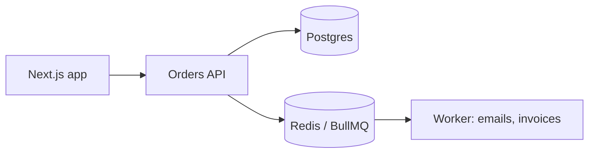

# Docs that work: Diátaxis, README, Markdown
[← Overview](00-overview.md)

## Why it matters
- A new hire spends three days getting the app running because the README says "run the usual setup" and the required Postgres extension is mentioned nowhere.
- A 40-page "documentation" wiki mixes tutorials, API details, and design debates. Nobody finds anything, so nobody reads it.
- Docs live in a separate wiki, are never updated in PRs, and describe a system that stopped existing a year ago.

## Concepts

### Diátaxis: four kinds of docs
| Kind | Reader wants to | Shape | Example |
|:--|:--|:--|:--|
| Tutorial | learn by doing | guided steps, guaranteed success | "Build your first endpoint" |
| How-to guide | do a specific task | goal-focused steps, assumes knowledge | "Rotate the session secret" |
| Reference | look something up | complete, accurate, dry | API reference, config keys, CLI flags |
| Explanation | understand why | discussion, context, trade-offs | "Why we use Postgres for jobs" (ADR) |

Most bad docs mix kinds. Keep them separate and link between them. (This course follows the same split: lessons explain, cheatsheets are reference.)

### A README that gets someone running
| Section | Contents |
|:--|:--|
| What and why | one or two sentences; who it's for |
| Quick start | prerequisites with versions, then copy-paste commands to a running app |
| Configuration | link to `.env.example`; required external services |
| Common tasks | test, lint, migrate, seed, run one service |
| Architecture | one diagram, links to deeper docs and ADRs |
| Deploy and operate | how it ships, link to runbooks |
| Troubleshooting | the errors people actually hit |
| Contributing | branch, commit, PR rules (link CONTRIBUTING.md) |

Test it: a teammate follows it on a clean machine while you watch silently. Every question they ask is a missing line.

### Markdown that reads well
| Feature | Syntax | Use |
|:--|:--|:--|
| Headings | `#`, `##`, `###` in order | structure; GitHub builds an outline from them |
| Relative links | `[Config](docs/config.md#database)` | survive forks and branches |
| Code fences with language | ` ```ts ` | highlighting; copyable commands |
| Tables | pipes + `:--` alignment | reference data |
| Task lists | `- [ ] item` | checklists |
| Collapsible | `<details><summary>…</summary>…</details>` | long logs, answers |
| Alerts | `> [!NOTE]`, `> [!WARNING]`, `> [!IMPORTANT]` | callouts on GitHub |
| Mermaid | ` ```mermaid ` | diagrams that live in the repo and diff |
| Footnotes | `text[^1]` + `[^1]: note` | sources |

Writing rules: short sentences, active voice, one idea per paragraph, commands that can be pasted as-is, and real error messages people can search for.

## Example
`README.md` skeleton for a service:
````md
# Orders API
Creates and tracks customer orders for the web shop. Express 5 + PostgreSQL 18 + Redis 8.

## Quick start
Needs: Node 26, pnpm 10, Docker Desktop (WSL2 on Windows).

```bash
cp .env.example .env
docker compose up -d --wait      # Postgres + Redis
pnpm install
pnpm db:migrate && pnpm db:seed
pnpm dev                         # http://localhost:3000, API docs at /docs
```

## Common tasks
| Task | Command |
|:--|:--|
| Tests | `pnpm test` |
| Lint and types | `pnpm lint && pnpm typecheck` |
| New migration | `pnpm db:generate --name add_orders_status` |

## Architecture

Decisions: [docs/adr](docs/adr). Operations: [docs/runbooks](docs/runbooks).

## Troubleshooting
> [!TIP]
> `ECONNREFUSED 127.0.0.1:5432`: Postgres isn't up. Run `docker compose ps` and check its health.
````

## Production patterns
- **Docs in the repo, next to the code.** Changed in the same PR as the behavior they describe.
- **README for getting started, `docs/` for the rest**, organized by Diátaxis kind.
- **Generate reference docs** (API, config keys, CLI help) from the source of truth; write tutorials and explanations by hand.
- **Diagrams as code (Mermaid)** so they're reviewed and updated like code.
- **Measure by questions:** repeated questions in chat mean a doc is missing or hard to find.

## Mistakes
Wrong: a vague quick start.
```md
Install dependencies and set up the database, then start the server.
```
Right: exact commands with versions, as in the example.

Wrong: absolute links to one branch.
```md
[Config](https://github.com/acme/orders/blob/feature-x/docs/config.md)
```
Right: `[Config](docs/config.md)`.

Wrong: a screenshot of a terminal command or error. It can't be copied or searched.
Right: the command and the error text in code blocks.

Wrong: one document that teaches, lists every option, and argues design choices at once.
Right: a tutorial, a reference page, and an ADR that link to each other.

## Check yourself
1. Which Diátaxis kind is "How do I add a new environment variable?" and which is "Why do we validate config at startup?"
2. How do you test whether a README's quick start works?
3. Why prefer Mermaid diagrams over exported images?

<details>
<summary>Answers</summary>

1. The first is a how-to guide (a specific task); the second is explanation (understanding a decision).
2. Have someone follow it on a clean machine (or run it in a fresh container) without help; every question or failure is a doc bug. CI can run the commands too.
3. They are text in the repo: reviewed in PRs, diffable, editable by anyone, and rendered by GitHub. Images go stale because nobody has the source file.
</details>

## Sources
- [Diátaxis framework](https://diataxis.fr/)
- [GitHub — Basic writing and formatting syntax](https://docs.github.com/en/get-started/writing-on-github/getting-started-with-writing-and-formatting-on-github/basic-writing-and-formatting-syntax)
- [GitHub — Creating diagrams (Mermaid)](https://docs.github.com/en/get-started/writing-on-github/working-with-advanced-formatting/creating-diagrams)
- [Google developer documentation style guide](https://developers.google.com/style)
- [Make a README](https://www.makeareadme.com/)
