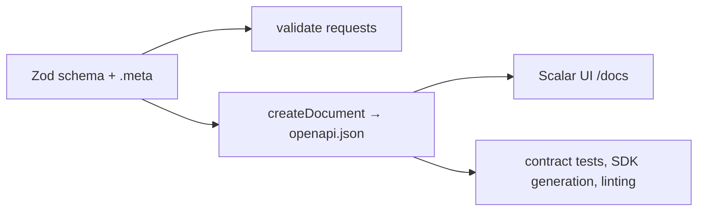

# OpenAPI 3.1 from Zod, served with Scalar
[← Overview](00-overview.md)

## Why it matters
- Hand-written API docs say `amount` is a number; the code expects integer cents. A partner integrates against the docs and charges customers 100× too little.
- The docs list success responses only. Integrators don't know a 409 exists, so duplicate signups crash their app.
- A field is renamed in the code; the docs page is updated two months later, after support tickets pile up.

## Concepts

### One schema, three uses
The Zod schema that validates a request also generates its OpenAPI description. Validation and documentation can't disagree.



### OpenAPI document structure
| Part | Contents |
|:--|:--|
| `openapi`, `info` | spec version (`3.1.0`), API title, version, description |
| `servers` | base URLs per environment |
| `paths` | each path + method: parameters, request body, responses |
| `components.schemas` | reusable schemas, referenced with `$ref` |
| `components.securitySchemes` | how auth works (cookie, bearer) |
| `security` | which scheme applies (globally or per operation) |
| `tags` | group operations in the UI |

### What good API reference documents
| Topic | Document |
|:--|:--|
| Every response | success **and** error codes: 400, 401, 403, 404, 409, 422, 429 |
| Error shape | one shared Problem Details schema (`application/problem+json`) |
| Auth | security scheme and which operations need it |
| Pagination | parameters (`cursor`, `limit`), response metadata, max page size |
| Idempotency | which operations accept `Idempotency-Key` |
| Rate limits | headers and 429 behavior |
| Versioning and deprecation | `deprecated: true` on operations/fields, sunset dates |
| Examples | realistic request and response examples |

## Example
```bash
pnpm add zod zod-openapi @scalar/express-api-reference
```
`src/schemas.ts`
```ts
import { z } from 'zod';

export const Order = z
  .object({
    id: z.uuid(),
    status: z.enum(['pending', 'paid', 'shipped']),
    totalCents: z.number().int().nonnegative().meta({ description: 'Total in cents', example: 2599 }),
    createdAt: z.iso.datetime(),
  })
  .meta({ id: 'Order' }); // becomes components.schemas.Order, referenced via $ref

export const CreateOrder = z
  .object({
    items: z.array(z.object({ sku: z.string().min(1), qty: z.number().int().min(1) })).min(1),
  })
  .meta({ id: 'CreateOrder' });

export const Problem = z
  .object({
    type: z.string().meta({ example: 'https://api.example.com/problems/validation' }),
    title: z.string(),
    status: z.number().int(),
    detail: z.string().optional(),
  })
  .meta({ id: 'Problem' });
```
`src/openapi.ts`
```ts
import { createDocument } from 'zod-openapi';
import { z } from 'zod';
import { CreateOrder, Order, Problem } from './schemas.ts';

const problem = (description: string) => ({
  description,
  content: { 'application/problem+json': { schema: Problem } },
});

export const openApiDocument = createDocument({
  openapi: '3.1.0',
  info: { title: 'Orders API', version: '2.3.0' },
  servers: [{ url: 'https://api.example.com' }],
  components: {
    securitySchemes: { session: { type: 'apiKey', in: 'cookie', name: '__Host-sid' } },
  },
  security: [{ session: [] }],
  paths: {
    '/orders': {
      post: {
        tags: ['Orders'],
        summary: 'Create an order',
        parameters: [{ name: 'Idempotency-Key', in: 'header', required: true, schema: { type: 'string' } }],
        requestBody: { content: { 'application/json': { schema: CreateOrder } } },
        responses: {
          '201': { description: 'Created', content: { 'application/json': { schema: Order } } },
          '400': problem('Invalid request body'),
          '401': problem('Not logged in'),
          '409': problem('Idempotency key reused with a different body'),
          '429': problem('Too many requests'),
        },
      },
    },
    '/orders/{id}': {
      get: {
        tags: ['Orders'],
        summary: 'Get one order',
        requestParams: { path: z.object({ id: z.uuid() }) },
        responses: {
          '200': { description: 'OK', content: { 'application/json': { schema: Order } } },
          '404': problem('Order not found, or not yours'),
        },
      },
    },
  },
});
```
`src/app.ts` (excerpt) — serve the JSON and the Scalar UI.
```ts
import { apiReference } from '@scalar/express-api-reference';
import { openApiDocument } from './openapi.ts';

app.get('/openapi.json', (_req, res) => res.json(openApiDocument));
app.use('/docs', apiReference({ url: '/openapi.json' }));
```
Scalar loads its UI from a CDN by default; if your CSP (Helmet) blocks it, allow that origin on the `/docs` route only, or serve docs from a separate docs site.

Write the spec to a file in CI so changes show up in PR diffs:
```ts
// scripts/write-openapi.ts — run with: node scripts/write-openapi.ts
import { writeFileSync } from 'node:fs';
import { openApiDocument } from '../src/openapi.ts';

writeFileSync('openapi.json', `${JSON.stringify(openApiDocument, null, 2)}\n`);
```

## Production patterns
- **Generate, commit, and diff `openapi.json`.** CI regenerates it and fails if the committed file differs, so API changes are visible in review.
- **Document every error response** with one shared Problem schema.
- **Reuse schemas via `.meta({ id })`** so the UI and generated clients get named types.
- **Mark deprecations in the spec** (`deprecated: true`) with a replacement and a removal date in the description.
- **Protect internal docs:** public APIs get public docs; internal ones sit behind auth or VPN.
- **Lint the spec in CI** (also seen: Redocly CLI, Spectral) for missing descriptions, examples, and error responses.

## Mistakes
Wrong: hand-maintained YAML next to code that validates with different rules. They drift within weeks.
Right: validation schemas generate the document.

Wrong: only the happy path.
```ts
responses: { '200': { description: 'OK' } }
```
Right: every status the endpoint can return, with the error schema.

Wrong: floats for money in schemas (`z.number()` for `price`). Right: integer cents (`z.number().int()`) and a currency field.

Wrong: serving `/docs` with the production CSP disabled globally to make the UI load.
Right: a route-specific CSP for `/docs`, or host docs elsewhere.

## Check yourself
1. What does `.meta({ id: 'Order' })` change in the generated document?
2. Why commit the generated `openapi.json` instead of generating it only at runtime?
3. Name four things an endpoint's reference should document besides the success body.

<details>
<summary>Answers</summary>

1. The schema is placed in `components.schemas.Order` and referenced with `$ref` wherever it's used, instead of being inlined repeatedly; UIs and SDK generators show it as a named type.
2. Changes to the API contract appear as diffs in PRs, where reviewers can spot breaking changes; tools and partners can consume the file without running the server.
3. Error responses with their schema, auth requirements, pagination parameters and limits, idempotency, rate limits, deprecation status, and examples.
</details>

## Sources
- [OpenAPI Specification 3.1.0](https://spec.openapis.org/oas/v3.1.0)
- [zod-openapi — README](https://github.com/samchungy/zod-openapi)
- [Zod 4 — Metadata and registries](https://zod.dev/metadata)
- [Scalar — Express integration](https://github.com/scalar/scalar/tree/main/integrations/express)
- [RFC 9457 — Problem Details for HTTP APIs](https://www.rfc-editor.org/rfc/rfc9457)
