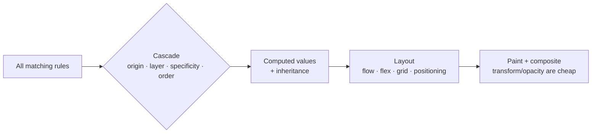

# CSS — Overview
[← Topic](../README.md)

**TECH:** modern CSS (checked against Baseline), then Tailwind CSS 4.3
**LEVEL:** intermediate (mid-level, has shipped production code)

## Why this matters in production
- Layout bugs, overflow on small screens, and broken dark mode are what users notice first.
- Specificity wars and `!important` chains make every change risky; cascade layers end them.
- CSS is render-blocking: its size and structure affect how fast every page paints.
- Tailwind is fast once you know CSS; without CSS knowledge it becomes guesswork with long class lists.

## Mental model
The browser collects every rule that matches an element and resolves conflicts with the **cascade** (layers, specificity, order). Layout comes from the element's **formatting context** (flow, flex, grid), sized by the box model and units.

## Prerequisites
- [01-html](../../01-html/README.md); basic selectors and properties.
- A Vite or Next.js project to try Tailwind in lesson 04.

## Lesson map
| Lesson | Checklist items |
|:--|:--|
| [01 · Cascade, box model, units, and stacking](01-cascade-box-units.md) | 1, 2, 7 |
| [02 · Flexbox, Grid, and responsive design](02-layout-and-responsive.md) | 3, 4 |
| [03 · Modern selectors, tokens, color, and motion](03-modern-css.md) | 5, 6, 8 |
| [04 · Tailwind CSS 4, architecture, and performance](04-tailwind-and-architecture.md) | 9, 10, 11 |
| [Cheatsheet](cheatsheet.md) | all |

## Suggested order
1. Lessons 01–03 with plain CSS first (STACK.md: learn CSS before Tailwind).
2. Lesson 04 when you start the React projects; Tailwind is the styling layer for the rest of the course.
3. Ready to build: `/learn 02-frontend/02-css mode=tasks`.

## Version notes
- Widely available: nesting, `:has()`, container size queries, cascade layers, `@property`, `@starting-style`, `light-dark()`, `color-mix()`, `oklch()`, subgrid, `dvh` units, same-document view transitions (Baseline October 2025).
- Newer or partial: `@scope`, anchor positioning, scroll-driven animations, `field-sizing`, `interpolate-size`, `if()`, container style queries. Check Baseline before relying on them; use `@supports`.
- Tailwind CSS 4 is configured in CSS (`@import "tailwindcss"` + `@theme`), detects content automatically, and needs Safari 16.4+, Chrome 111+, Firefox 128+. 4.2 added logical-property utilities and a webpack plugin; 4.3 added scrollbar and zoom utilities.

## Sources
- [MDN — CSS](https://developer.mozilla.org/en-US/docs/Web/CSS)
- [web.dev — Learn CSS](https://web.dev/learn/css)
- [web.dev — Baseline](https://web.dev/baseline)
- [Tailwind CSS docs](https://tailwindcss.com/docs)
- [Tailwind CSS v4.3 release](https://tailwindcss.com/blog/tailwindcss-v4-3)
