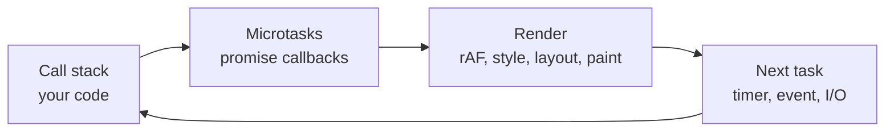

# JavaScript — Overview
[← Topic](../README.md)

**TECH:** modern JavaScript (ES2025 + Baseline web APIs) and TypeScript 6.0
**LEVEL:** intermediate (mid-level, has shipped production code)

## Why this matters in production
- React, Next.js, Express, and every tool in the stack are JavaScript. Framework bugs are often language bugs: stale closures, unhandled rejections, mutated shared objects.
- The event loop explains why a page freezes, why INP is bad, and why `await` in a loop is slow.
- Money stored as floats, dates parsed from strings, and `fetch` not throwing on 500 cause real incidents.
- TypeScript turns many of these into compile errors, if you use it well.

## Mental model
JavaScript runs one task at a time on a single thread. Values are either primitives (copied) or references to objects (shared). Async code schedules work for later; it never runs in parallel with your code on the same thread.

## Prerequisites
- You have written JavaScript for real projects; you know functions, objects, arrays, and classes.
- [01-foundations/05-code-quality](../../../01-foundations/05-code-quality/README.md) for TypeScript strict mode and lint rules.

## Lesson map
| Lesson | Checklist items |
|:--|:--|
| [01 · Values, scope, closures, and modern syntax](01-values-scope-closures.md) | 1, 2, 6 |
| [02 · Event loop, async, and errors](02-event-loop-async-errors.md) | 3, 4, 7 |
| [03 · Modules, DOM, browser APIs, and memory](03-modules-dom-browser-apis.md) | 5, 8, 9, 12 |
| [04 · TypeScript for app code, dates, and numbers](04-typescript-dates-numbers.md) | 10, 11 |
| [Cheatsheet](cheatsheet.md) | all |

## Suggested order
1. 01 → 02 → 03 → 04. Lesson 02 is the one most worth rereading.
2. Then [04-framework](../../04-framework/README.md): React makes heavy use of closures, references, and the event loop.
3. Ready to build: `/learn 02-frontend/03-javascript mode=tasks`.

## Version notes
- Baseline 2024–2025: `Object.groupBy`, `Promise.withResolvers`, `toSorted`/`toReversed`/`with`, Set methods (`union`, `intersection`…), iterator helpers (`.map`, `.filter`, `.take` on iterators), `Promise.try`, `RegExp.escape`, `AbortSignal.any`, `URL.parse`.
- Newer, check support: `Temporal` (Firefox, Chrome 144+, on by default in Node 26; Safari pending), `using` declarations for resource cleanup, `Uint8Array.fromBase64`, `Math.sumPrecise`, `Error.isError`, `scheduler.yield()`.
- TypeScript 6.0 is the stack's compiler (STACK.md); `erasableSyntaxOnly` rules out `enum` and `namespace`.

## Sources
- [MDN — JavaScript Guide](https://developer.mozilla.org/en-US/docs/Web/JavaScript/Guide)
- [MDN — The event loop](https://developer.mozilla.org/en-US/docs/Web/JavaScript/Event_loop)
- [TC39 — Finished proposals](https://github.com/tc39/proposals/blob/main/finished-proposals.md)
- [TypeScript Handbook](https://www.typescriptlang.org/docs/handbook/intro.html)
- [web.dev — Baseline](https://web.dev/baseline)
