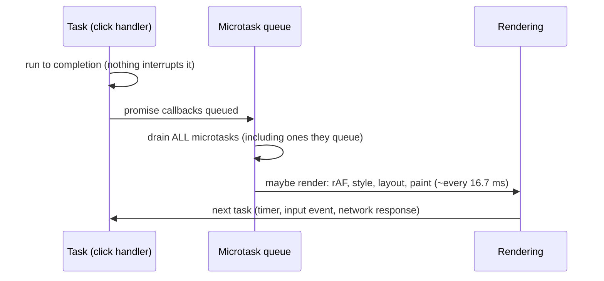

# Event loop, async, and errors
[← Overview](00-overview.md)

## Why it matters
- A search box filters 20,000 rows on every keystroke. Each filter takes 120 ms on the main thread, typing lags, and INP fails.
- `fetch('/api/orders')` gets a 500. `fetch` doesn't throw, the code parses an error page as JSON, and the UI shows "Unexpected token <".
- Ten API calls run one after another with `await` in a `for` loop: 10 × 200 ms = 2 seconds that could have been 200 ms.

## Concepts

### The event loop

| Queue | Gets | Runs |
|:--|:--|:--|
| Tasks (macrotasks) | `setTimeout`, events, network callbacks, `MessageChannel` | one per loop turn |
| Microtasks | promise reactions, `await` continuations, `queueMicrotask`, `MutationObserver` | all, after the current task |
| Animation frames | `requestAnimationFrame` callbacks | before the next paint |

Consequences:
- A task longer than **50 ms** is a "long task": input waits, which hurts INP.
- Microtasks can starve rendering if they keep queueing more.
- `setTimeout(fn, 0)` runs after rendering opportunities; `await` continues before them.
- Break up heavy work: chunks with `await scheduler.yield()` (where supported) or `setTimeout`, or move it to a Web Worker.

Node's loop has phases (timers, poll, check) and `process.nextTick` runs before promise microtasks; the mental model of "one task, then all microtasks" still applies.

### Promises and async/await
| API | Resolves when | Rejects when |
|:--|:--|:--|
| `Promise.all(ps)` | all fulfill (array of values) | the first rejects |
| `Promise.allSettled(ps)` | all settle (array of `{status, value \| reason}`) | never |
| `Promise.any(ps)` | the first fulfills | all reject (`AggregateError`) |
| `Promise.race(ps)` | the first settles | the first settles with a rejection |
| `Promise.withResolvers()` | gives `{ promise, resolve, reject }` | wrap callback APIs |
| `Promise.try(fn)` | wraps sync-or-async functions uniformly | sync throws become rejections |

- `await` pauses the async function, not the thread.
- Independent work runs in parallel: start all promises, then `await Promise.all`.
- Unhandled rejections fire `unhandledrejection` in browsers and crash Node processes by default.

### Cancellation
`AbortController` creates a `signal`; pass it to `fetch`, event listeners, and your own functions. `AbortSignal.timeout(ms)` gives a deadline; `AbortSignal.any([a, b])` combines them. Cancel stale requests (typeahead), and requests of components that unmounted.

### Errors
| Practice | Why |
|:--|:--|
| Throw `Error` objects (or subclasses) | stack traces, `instanceof` checks |
| Subclass with a `name` and extra fields | `class HttpError extends Error { status }` |
| `new Error('msg', { cause: err })` | keep the original error when wrapping |
| Catch where you can handle | boundaries: request handler, UI error boundary, job runner |
| Never swallow silently | log or rethrow with context |
| `finally` for cleanup | runs on success and failure |

## Example
`api.ts` — a fetch wrapper that throws on HTTP errors, supports cancellation, and keeps the cause.
```ts
export class HttpError extends Error {
  override name = 'HttpError';
  readonly status: number;
  constructor(status: number, message: string, options?: ErrorOptions) {
    super(message, options);
    this.status = status; // a field, not a parameter property: erasable syntax (Node type stripping)
  }
}

export async function getJson<T>(url: string, signal?: AbortSignal): Promise<T> {
  let res: Response;
  try {
    res = await fetch(url, {
      headers: { Accept: 'application/json' },
      signal: signal ? AbortSignal.any([signal, AbortSignal.timeout(8_000)]) : AbortSignal.timeout(8_000),
    });
  } catch (err) {
    throw new Error(`Network error for ${url}`, { cause: err }); // offline, DNS, timeout, abort
  }
  if (!res.ok) throw new HttpError(res.status, `GET ${url} failed with ${res.status}`);
  return (await res.json()) as T;
}
```

Parallel vs sequential, and partial failure:
```ts
// Slow: 3 round trips one after another
const user = await getJson('/api/me');
const orders = await getJson('/api/orders');
const flags = await getJson('/api/flags');

// Fast: all at once; fails if any fails
const [user2, orders2, flags2] = await Promise.all([
  getJson('/api/me'), getJson('/api/orders'), getJson('/api/flags'),
]);

// Independent widgets: show what loaded, report what didn't
const results = await Promise.allSettled([getJson('/api/news'), getJson('/api/weather')]);
for (const r of results) if (r.status === 'rejected') console.error(r.reason);
```
Cancel stale typeahead requests:
```ts
let current: AbortController | undefined;
input.addEventListener('input', async () => {
  current?.abort();                       // cancel the previous request
  current = new AbortController();
  try {
    const hits = await getJson<string[]>(`/api/search?q=${encodeURIComponent(input.value)}`, current.signal);
    render(hits);
  } catch (err) {
    const cause = err instanceof Error ? err.cause : undefined;
    if (cause instanceof DOMException && cause.name === 'AbortError') return; // superseded by a newer search
    showError(err);
  }
});
```
Yield during heavy work:
```ts
async function processAll(rows: Row[]) {
  for (let i = 0; i < rows.length; i++) {
    process(rows[i]!);
    if (i % 500 === 0) await new Promise((r) => setTimeout(r)); // let input and rendering run
  }
}
```

## Production patterns
- **One HTTP helper** that checks `res.ok`, sets timeouts, parses errors, and throws typed errors. In React apps TanStack Query calls it ([05-state-management](../../05-state-management/README.md)).
- **Parallelize independent requests**; use `allSettled` when partial results are useful.
- **Cancel what the user no longer needs** (navigated away, typed more).
- **Global handlers as a safety net**: `window.addEventListener('unhandledrejection', ...)` reports to Sentry ([13-testing-monitoring](../../13-testing-monitoring/README.md)).
- **Keep tasks under 50 ms**; move heavy computation to Web Workers.

## Mistakes
Wrong: trusting `fetch` to throw.
```ts
const data = await (await fetch('/api/orders')).json(); // 500 page parsed as JSON
```
Right: check `res.ok` (see `getJson`).

Wrong: `await` in a loop for independent calls.
```ts
for (const id of ids) results.push(await getJson(`/api/items/${id}`));
```
Right: `` await Promise.all(ids.map((id) => getJson(`/api/items/${id}`))) ``, with a concurrency limit for large lists.

Wrong: swallowing errors.
```ts
try { await save(); } catch {}
```
Right: handle (show a message, retry) or rethrow with `cause`; always log.

Wrong: `forEach` with async callbacks; nothing waits, errors escape. Right: `for...of` with `await`, or `Promise.all` with `map`.

## Check yourself
1. In what order do these log: `setTimeout(() => log('A'))`, `Promise.resolve().then(() => log('B'))`, `log('C')`?
2. When is `Promise.allSettled` better than `Promise.all`?
3. Why can a long-running microtask chain freeze the page even without long synchronous code?

<details>
<summary>Answers</summary>

1. C, B, A: synchronous code first, then the microtask, then the timer task.
2. When each result is independent and partial success is useful (dashboard widgets, batch notifications); `all` would discard all results on the first rejection.
3. The browser drains the entire microtask queue before rendering or handling the next input; if microtasks keep queueing more, rendering and input wait.
</details>

## Sources
- [MDN — In depth: Microtasks and the JavaScript runtime](https://developer.mozilla.org/en-US/docs/Web/API/HTML_DOM_API/Microtask_guide/In_depth)
- [Jake Archibald — Tasks, microtasks, queues and schedules](https://jakearchibald.com/2015/tasks-microtasks-queues-and-schedules/)
- [MDN — Using promises](https://developer.mozilla.org/en-US/docs/Web/JavaScript/Guide/Using_promises)
- [MDN — AbortController](https://developer.mozilla.org/en-US/docs/Web/API/AbortController)
- [web.dev — Optimize long tasks](https://web.dev/articles/optimize-long-tasks)
- [MDN — Error `cause`](https://developer.mozilla.org/en-US/docs/Web/JavaScript/Reference/Global_Objects/Error/cause)
