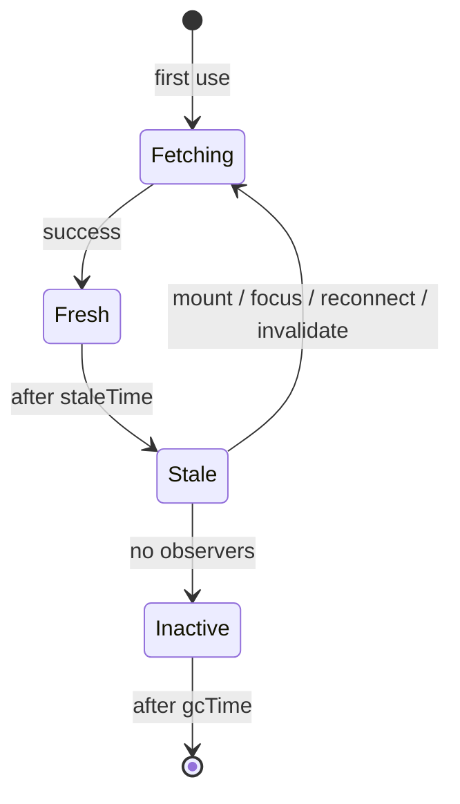

# Queries, keys, and caching
[← Overview](00-overview.md)

## Why it matters
- Two components fetch `/api/me` on mount. Without a shared cache, every page view makes duplicate requests, and they can disagree.
- A query key omits the `status` filter. Switching filters shows the previous filter's cached orders.
- Every tab switch refetches everything because `staleTime` is 0 and nobody knew; the API bill doubles.

## Concepts

### How the cache works
- A **query key** (an array) identifies a piece of server data. Same key = same cache entry, shared by every component.
- The **query function** fetches it; it receives an `AbortSignal` for cancellation.
- Data is **fresh** for `staleTime` (default 0), then **stale**: still shown, but refetched on mount, window focus, reconnect, or invalidation.
- When no component uses an entry, it's **garbage-collected** after `gcTime` (default 5 minutes).



### Status flags
| Flag | Means |
|:--|:--|
| `status: 'pending'` / `isPending` | no data yet |
| `status: 'error'` / `isError` | the last fetch failed (data may still exist) |
| `status: 'success'` / `isSuccess` | data available |
| `fetchStatus: 'fetching'` / `isFetching` | a request is in flight (also background refetches) |
| `isLoading` | `isPending && isFetching`: first load in progress |
| `isPlaceholderData` | showing `placeholderData`, not real data for this key |

### Keys and options
| Option | Use |
|:--|:--|
| `queryKey` | include **every** variable the function uses: `['orders', { status, sort }]` |
| `staleTime` | how long data is good enough (seconds for lists, minutes for reference data) |
| `gcTime` | how long unused data stays in memory |
| `enabled` / `skipToken` | don't run until inputs exist |
| `select` | transform or pick from data for this component (memoized) |
| `placeholderData: keepPreviousData` | keep showing old data while new filter/page loads |
| `initialData` | seed from data you already have |
| `refetchInterval` | polling |

### Parallel and dependent queries
- **Parallel:** several `useQuery` calls run at the same time; `useQueries` for a dynamic list.
- **Dependent:** query B needs data from A: pass `enabled: !!a` or `skipToken` until A resolves.

### `queryOptions` factories and prefetching
`queryOptions({ queryKey, queryFn, ... })` bundles key and fetcher once, type-safe. Reuse it in `useQuery`, `useSuspenseQuery`, `prefetchQuery`, `ensureQueryData`, and `getQueryData`. Prefetch on hover or before navigation, so the next screen renders from cache.

## Example
`api.ts` and `orders-queries.ts`
```ts
// api.ts: one fetch helper; throws on HTTP errors so Query sees failures
export async function api<T>(path: string, init: RequestInit & { signal?: AbortSignal } = {}): Promise<T> {
  const res = await fetch(`/api${path}`, { ...init, headers: { Accept: 'application/json', ...init.headers } });
  if (!res.ok) throw new Error(`${init.method ?? 'GET'} ${path} → ${res.status}`);
  return res.status === 204 ? (undefined as T) : ((await res.json()) as T);
}
```
```ts
// orders-queries.ts: key factory + queryOptions in one place
import { keepPreviousData, queryOptions, skipToken } from '@tanstack/react-query';
import { api } from './api.ts';

export type Order = { id: string; status: 'paid' | 'shipped'; totalCents: number; customerId: string };
type Filters = { status: string; sort: 'newest' | 'total' };

export const orderKeys = {
  all: ['orders'] as const,
  lists: () => [...orderKeys.all, 'list'] as const,
  list: (f: Filters) => [...orderKeys.lists(), f] as const,
  detail: (id: string) => [...orderKeys.all, 'detail', id] as const,
};

export const ordersQuery = (filters: Filters) =>
  queryOptions({
    queryKey: orderKeys.list(filters),
    queryFn: ({ signal }) =>
      api<{ items: Order[] }>(`/orders?${new URLSearchParams(filters)}`, { signal }),
    staleTime: 30_000,
    placeholderData: keepPreviousData, // no flash to "loading" when filters change
  });

export const orderQuery = (id: string | undefined) =>
  queryOptions({
    queryKey: orderKeys.detail(id ?? ''),
    queryFn: id ? ({ signal }) => api<Order>(`/orders/${id}`, { signal }) : skipToken,
  });
```
`main.tsx` and usage
```tsx
import { QueryClient, QueryClientProvider, useQuery, useQueryClient } from '@tanstack/react-query';

const queryClient = new QueryClient({
  defaultOptions: { queries: { staleTime: 10_000 } }, // a sane global default
});

export function Root() {
  return <QueryClientProvider client={queryClient}><App /></QueryClientProvider>;
}

function OrderRow({ order }: { order: Order }) {
  const qc = useQueryClient();
  return (
    <a href={`/orders/${order.id}`} onMouseEnter={() => void qc.prefetchQuery(orderQuery(order.id))}>
      #{order.id}
    </a>
  );
}

function OrderDetail({ id }: { id: string }) {
  const { data: order } = useQuery(orderQuery(id));
  const { data: customer } = useQuery({                       // dependent query
    queryKey: ['customers', order?.customerId],
    queryFn: order ? ({ signal }) => api<{ name: string }>(`/customers/${order.customerId}`, { signal }) : skipToken,
  });
  const { data: total } = useQuery({ ...orderQuery(id), select: (o) => o.totalCents }); // only re-renders if total changes
  return <p>{customer?.name} · {total}</p>;
}
```

## Production patterns
- **Key factories + `queryOptions` per feature**; never type keys inline in components.
- **Every input of the query function is in the key**; the TanStack ESLint plugin (`@tanstack/eslint-plugin-query`) checks it.
- **Set `staleTime` deliberately**: a global default (10–60 s) and longer values for reference data.
- **Pass the `signal`** to fetch, so unmounting or superseded queries cancel their requests.
- **Prefetch likely next views** (hover, route loaders) for instant navigation.

## Mistakes
Wrong: a key missing a variable.
```ts
useQuery({ queryKey: ['orders'], queryFn: () => api(`/orders?status=${status}`) }); // all statuses share one entry
```
Right: `queryKey: ['orders', 'list', { status }]`.

Wrong: `enabled: !!id` with a function that still uses `id!`. TypeScript can't help.
Right: `queryFn: id ? () => fetchOrder(id) : skipToken`.

Wrong: a fetcher that doesn't throw on HTTP errors; a 500 becomes "successful" data.
Right: throw when `!res.ok` (the `api` helper).

Wrong: treating `isLoading` as "no data yet" in v5. Right: `isPending` means no data; `isFetching` means a request is running.

## Check yourself
1. What is the difference between `staleTime` and `gcTime`?
2. Why must every variable used by the query function be part of the query key?
3. What does `placeholderData: keepPreviousData` improve when paging?

<details>
<summary>Answers</summary>

1. `staleTime` decides how long data counts as fresh (no automatic refetch). `gcTime` decides how long unused data stays in memory before it's removed.
2. The key identifies the cache entry. If a variable isn't in it, different inputs share one entry, so components see data for the wrong inputs and changes don't trigger refetches.
3. The previous page stays on screen (with `isPlaceholderData` true) while the next page loads, instead of switching to a loading state and back.
</details>

## Sources
- [TanStack Query — Query keys](https://tanstack.com/query/latest/docs/framework/react/guides/query-keys)
- [TanStack Query — Query options](https://tanstack.com/query/latest/docs/framework/react/guides/query-options)
- [TanStack Query — Dependent queries](https://tanstack.com/query/latest/docs/framework/react/guides/dependent-queries)
- [TanStack Query — Prefetching](https://tanstack.com/query/latest/docs/framework/react/guides/prefetching)
- [TkDodo — Effective React Query keys](https://tkdodo.eu/blog/effective-react-query-keys)
