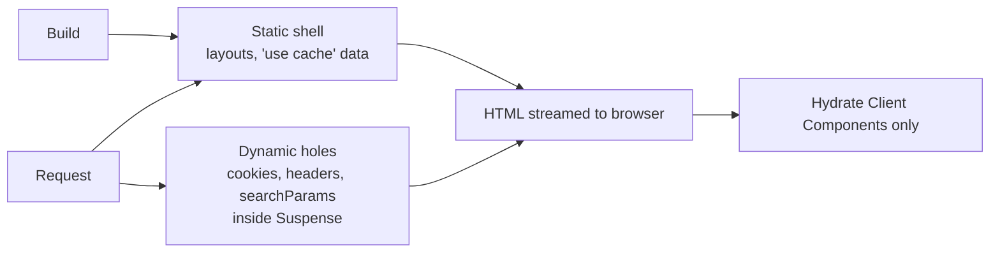

# Rendering Strategies — Overview
[← Topic](../README.md)

**TECH:** Next.js 16 (App Router, Turbopack, Cache Components) · React 19.2 · Express 5 as the API
**LEVEL:** intermediate (mid-level, has shipped production code)

## Why this matters in production
- Where and when HTML is rendered decides TTFB, LCP, SEO, server cost, and how fresh data is.
- Next.js caching is the most common source of "why is my data stale?" and "why is this page slow?" bugs.
- Server Components keep data access and secrets on the server and ship less JavaScript, but the client boundary must be placed deliberately.
- STACK.md uses Next.js as the frontend only: Express owns the API and auth, Next.js renders and calls it, self-hosted in Docker.

## Mental model
A route is a tree of Server Components (render on the server, no client JS) with Client Component islands (hydrate in the browser). With **Cache Components**, Next.js prerenders a **static shell** from cached parts and **streams dynamic parts** (anything per-request) inside Suspense boundaries.

## Prerequisites
- [04-framework](../../04-framework/README.md) (Suspense, Actions) and [05-state-management](../../05-state-management/README.md).
- [01-foundations/02-http-networking](../../../01-foundations/02-http-networking/README.md) lesson 05 (HTTP caching).
- An Express API reachable from Next.js server code (an internal URL).

## Lesson map
| Lesson | Checklist items |
|:--|:--|
| [01 · Rendering strategies and hydration](01-rendering-strategies.md) | 1, 9 |
| [02 · App Router, Server and Client Components, streaming](02-app-router-and-components.md) | 2, 3, 6 |
| [03 · Data fetching and caching in Next.js 16](03-data-and-caching.md) | 4, 5, 8 |
| [04 · Server Functions, route handlers, and proxy.ts](04-server-functions-handlers-proxy.md) | 7, 10 |
| [05 · Metadata, SEO, and self-hosting](05-metadata-and-self-hosting.md) | 11, 12 |
| [Cheatsheet](cheatsheet.md) | all |

## Suggested order
1. 01 → 05 in order; 03 is the one to reread.
2. Then [07-performance](../../07-performance/README.md) and [11-security](../../11-security/README.md), which build on this.
3. Ready to build: `/learn 02-frontend/06-rendering mode=tasks`.

## Version notes
- Next.js 16 (October 2025): Turbopack is the default bundler; **Cache Components** (`cacheComponents: true`) replace the experimental PPR/`dynamicIO` flags, with `'use cache'`, `cacheLife`, and `cacheTag`; `revalidateTag(tag, profile)` needs a profile; new `updateTag()` and `refresh()` for Server Actions; `middleware.ts` is renamed `proxy.ts` (Node runtime); `params`, `searchParams`, `cookies()`, `headers()` are async only; `next lint` is removed; React Compiler support is stable.
- Next.js 16.2 (March 2026) improved dev startup, added a hydration diff in the error overlay, `next start --inspect`, and an `AGENTS.md` for coding agents. Stay on the latest 16.x patch: several 2025 releases fixed security issues.
- Next.js 16 needs Node.js 20.9+ (the stack uses Node 26).

## Sources
- [Next.js 16 release](https://nextjs.org/blog/next-16)
- [Next.js docs — App Router](https://nextjs.org/docs/app)
- [Next.js — Cache Components](https://nextjs.org/docs/app/getting-started/cache-components)
- [Next.js — Upgrading to version 16](https://nextjs.org/docs/app/guides/upgrading/version-16)
- [Next.js 16.2 release](https://nextjs.org/blog/next-16-2)
