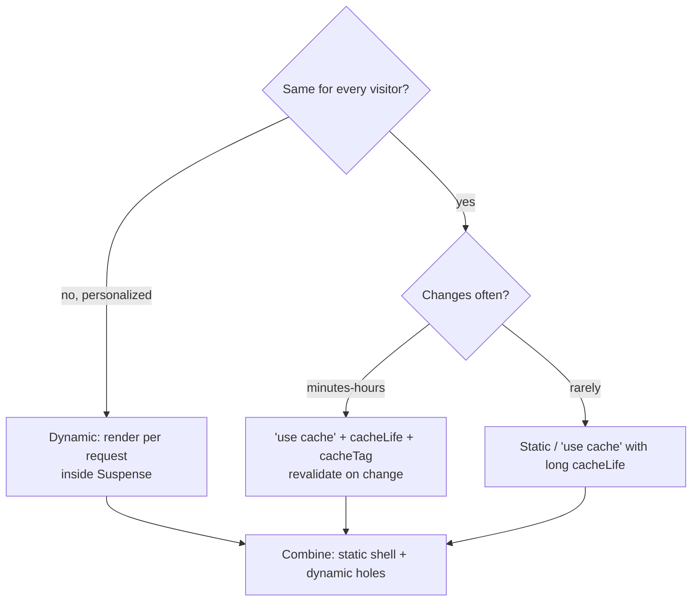

# Rendering strategies and hydration
[← Overview](00-overview.md)

## Why it matters
- A marketing site built as a client-only SPA shows a blank page until 900 KB of JavaScript runs. Search engines index an empty shell, and mobile LCP is 6 seconds.
- A product page rendered on every request queries the database for data that changes once a day. Black Friday traffic melts the API.
- A timestamp rendered with `new Date()` differs between server and browser; React throws hydration errors and re-renders the page on the client.

## Concepts

### The strategies
| Strategy | HTML produced | Fresh data | Good for | Costs |
|:--|:--|:--|:--|:--|
| CSR (client-side rendering) | in the browser after JS loads | always | logged-in tools behind auth, highly interactive apps | slow first paint, weak SEO, big JS |
| SSR (server-side rendering) | on the server per request | always | personalized pages, frequently changing data | server work per request, TTFB depends on data |
| SSG (static generation) | at build time | as of the build | docs, marketing, blogs | rebuild to update |
| ISR / revalidation | static, refreshed in the background | within a time window or on demand | catalogs, news, product pages | brief staleness |
| Streaming SSR | shell first, then chunks as data arrives | always | pages with slow parts | needs Suspense boundaries |
| Partial prerendering (Cache Components) | static shell + streamed dynamic holes | mix | most pages: fast shell, personalized parts | must think per component |

React Server Components (RSC) are orthogonal: they render on the server (at build or request time) and send **no component JavaScript** to the browser. Client Components still render to HTML on the server, then **hydrate**.

### Choosing

In Next.js 16 with Cache Components you rarely pick one strategy per page; you choose per component: cached parts join the static shell, request-specific parts stream in.

### Hydration
The server sends HTML; the browser downloads Client Component JavaScript and React **attaches** to the existing DOM. If the first client render produces different HTML, React reports a **hydration mismatch** and re-renders that part on the client (slower, may flicker).

| Cause | Fix |
|:--|:--|
| `Date.now()`, `new Date()`, `Math.random()` during render | compute on the server and pass down, or set in `useEffect` |
| `window`, `localStorage`, `matchMedia` during render | read in `useEffect`, or render the widget client-only |
| Locale/time zone formatting differs | format with an explicit locale and `timeZone` |
| Invalid nesting (`<div>` inside `<p>`, `<a>` inside `<a>`) | fix the HTML |
| Browser extensions changing the DOM | usually harmless; test in a clean profile |
| Intentionally different text (timestamps) | `suppressHydrationWarning` on that element only |

## Example
`components/LocalTime.tsx` — a client-only value without a mismatch.
```tsx
'use client';
import { useEffect, useState } from 'react';

export function LocalTime({ iso }: { iso: string }) {
  const [text, setText] = useState<string | null>(null);
  useEffect(() => {
    setText(new Intl.DateTimeFormat(undefined, { dateStyle: 'medium', timeStyle: 'short' }).format(new Date(iso)));
  }, [iso]);
  // Server and first client render match (the ISO string); the local format appears after hydration.
  return <time dateTime={iso}>{text ?? iso.slice(0, 10)}</time>;
}
```
`components/Chart.tsx` — a browser-only widget loaded on the client.
```tsx
'use client';
import dynamic from 'next/dynamic';

const SalesChart = dynamic(() => import('./SalesChart'), {
  ssr: false,                                 // never rendered on the server
  loading: () => <div className="h-64 animate-pulse rounded bg-gray-100" />,
});

export function Chart() {
  return <SalesChart />;
}
```

## Production patterns
- **Static by default, dynamic where needed.** Most of a page (layout, navigation, product info) can be cached; only user-specific parts need request-time rendering.
- **Push personalization down** into small components inside Suspense, so it doesn't make the whole route dynamic.
- **CSR only behind login** for app-like screens where SEO doesn't matter; even then, server-render the shell.
- **Fix hydration warnings**; never blanket-suppress them. Each one means extra client work and a potential visual jump.
- **Measure real users** (TTFB, LCP) per route after changing strategies ([07-performance](../../07-performance/README.md)).

## Mistakes
Wrong: browser APIs during render.
```tsx
'use client';
export function Greeting() {
  const name = localStorage.getItem('name'); // throws on the server; mismatch on the client
  return <p>Hi {name}</p>;
}
```
Right: read it in `useEffect` (or `useSyncExternalStore` with a server snapshot).

Wrong: making a whole page dynamic because a header shows the user's name.
Right: cache the page content; render the user menu in a Suspense boundary.

Wrong: `suppressHydrationWarning` on `<body>` to make errors go away. Right: fix the cause; suppress only on a single element whose text must differ.

## Check yourself
1. What's the difference between SSR and Server Components?
2. Why is partial prerendering usually better than choosing SSR for a whole page?
3. Name three common causes of hydration mismatches.

<details>
<summary>Answers</summary>

1. SSR is *when/where HTML is produced* (on the server per request) and includes Client Components, which then hydrate. Server Components are a *kind of component* that renders only on the server and sends no JS; they can render at build time or request time.
2. The cached shell is served immediately (fast TTFB and LCP), and only the personalized parts wait for request-time data, streamed into Suspense boundaries.
3. Time or randomness in render, browser-only APIs during render, locale/time-zone formatting differences, invalid HTML nesting, and extensions modifying the DOM.
</details>

## Sources
- [web.dev — Rendering on the web](https://web.dev/articles/rendering-on-the-web)
- [Next.js — Server and Client Components](https://nextjs.org/docs/app/getting-started/server-and-client-components)
- [Next.js — Cache Components (partial prerendering)](https://nextjs.org/docs/app/getting-started/cache-components)
- [react.dev — `hydrateRoot` and hydration errors](https://react.dev/reference/react-dom/client/hydrateRoot)
- [Next.js — Text content does not match server-rendered HTML](https://nextjs.org/docs/messages/react-hydration-error)
