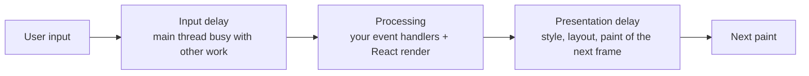

# Runtime performance: INP, CLS, and React rendering
[← Overview](00-overview.md)

## Why it matters
- Clicking "Add to cart" takes 450 ms to show anything, because the handler re-renders the whole product grid and recalculates totals synchronously.
- A cookie banner is inserted at the top of the page after load; everything jumps down just as the user taps a link, and they open the wrong product.
- A table with 5,000 rows renders every row; scrolling stutters and typing in its filter lags.

## Concepts

### INP: the three phases of an interaction

| Phase | Fixes |
|:--|:--|
| Input delay | break up long tasks; defer third-party scripts; less work during load (hydration) |
| Processing | do less in handlers; give feedback first, then do the rest; `startTransition` for heavy updates |
| Presentation | smaller DOM, fewer elements re-rendered, avoid layout thrashing, `content-visibility` |

Yielding: split long work so the browser can paint between chunks (`await scheduler.yield()` where supported, else `setTimeout`). The Long Animation Frames API (LoAF) attributes slow frames to scripts in field data.

### CLS: what moves and why
| Cause | Fix |
|:--|:--|
| Images, videos, iframes without size | `width`/`height` or `aspect-ratio` |
| Ads, embeds, async widgets | reserve space with fixed dimensions or `min-height` |
| Content injected above existing content (banners, "new posts") | overlay it, or insert on user action |
| Web fonts with different metrics | `next/font` or metric-adjusted fallbacks |
| Animating `top`/`height` | animate `transform` |
| Skeletons that don't match final size | same dimensions as the content |

Shifts within 500 ms after a user interaction don't count (expected movement, like opening an accordion).

### React rendering performance
| Cause | Fix |
|:--|:--|
| State too high in the tree | colocate state; split components |
| Context values changing often | split contexts; keep fast-changing state local |
| New objects/functions as props | React Compiler memoizes them; otherwise `useMemo`/`useCallback` |
| Expensive computation in render | memoize (compiler) or move to the server |
| Huge lists | virtualization (render only visible rows; also seen: TanStack Virtual) or pagination |
| Urgent and heavy updates mixed | `useTransition` / `useDeferredValue` (04-framework lesson 04) |
| Too much hydration | Server Components, smaller client islands |

Profile first: React DevTools Profiler ("why did this render?"), "Highlight updates", and the React tracks in Chrome's Performance panel (React 19.2).

## Example
`AddToCartButton.tsx` — feedback first, heavy work deferred.
```tsx
'use client';
import { useState, useTransition } from 'react';

export function AddToCartButton({ productId, onAdded }: { productId: string; onAdded: () => void }) {
  const [added, setAdded] = useState(false);
  const [isPending, startTransition] = useTransition();

  async function handleClick() {
    setAdded(true);                          // urgent: the button changes on the next frame
    startTransition(async () => {
      await fetch('/api/cart', { method: 'POST', body: JSON.stringify({ productId }) });
      onAdded();                             // non-urgent: cart badge, recommendations re-render
    });
  }

  return (
    <button onClick={handleClick} disabled={isPending}>
      {added ? 'Added' : 'Add to cart'}
    </button>
  );
}
```
Yielding in a long loop:
```ts
async function processRows(rows: Row[]) {
  let lastYield = performance.now();
  for (const row of rows) {
    process(row);
    if (performance.now() - lastYield > 40) {            // keep tasks under ~50 ms
      await ('scheduler' in globalThis && 'yield' in scheduler
        ? scheduler.yield()
        : new Promise((r) => setTimeout(r, 0)));
      lastYield = performance.now();
    }
  }
}
```
Reserving space against CLS (Tailwind):
```tsx
<div className="aspect-video w-full overflow-hidden rounded-lg bg-gray-100">
  <iframe src={videoUrl} title="Product video" className="h-full w-full" loading="lazy" />
</div>

<aside className="min-h-[250px]">                          {/* ad slot: space reserved before the ad loads */}
  <AdSlot id="sidebar" />
</aside>
```
Rendering only what's visible with CSS for long, static sections:
```css
.review-list > li { content-visibility: auto; contain-intrinsic-size: auto 120px; }
```

## Production patterns
- **Instant feedback on every interaction** (pressed state, optimistic update), then the expensive part in a transition.
- **Keep main-thread tasks under 50 ms**; yield in loops; move heavy computation to a Web Worker.
- **Reserve space** for everything that loads late: images, embeds, ads, banners, skeletons.
- **Virtualize lists over a few hundred rows**, or paginate.
- **Profile on a throttled CPU** before and after a fix; confirm INP improvement in field data.

## Mistakes
Wrong: doing everything synchronously in a click handler.
```tsx
onClick={() => { addToCart(id); recalcRecommendations(); trackAnalytics(); rerenderGrid(); }}
```
Right: update the visible state first; defer the rest (`startTransition`, `requestIdleCallback`, background requests).

Wrong: a banner inserted at the top after load.
```tsx
{showBanner && <PromoBanner />} {/* pushes the page down when it appears */}
```
Right: reserve its space from the first render, or show it as an overlay/toast.

Wrong: rendering 5,000 rows "because React is fast". Right: virtualization or pagination.

Wrong: adding `memo` everywhere without profiling. Right: measure; with the React Compiler most of it is automatic.

## Check yourself
1. What are the three phases of INP, and which one does third-party JavaScript usually hurt?
2. Why don't layout shifts right after a click count toward CLS?
3. Name three ways to reduce React re-render cost.

<details>
<summary>Answers</summary>

1. Input delay, processing time, presentation delay. Third-party scripts usually hurt input delay by keeping the main thread busy when the user interacts.
2. Movement directly caused by a user action (within 500 ms) is expected, like expanding a section; CLS measures unexpected shifts.
3. Colocate state so fewer components re-render; split or stabilize context values; let the React Compiler (or manual memoization) skip unchanged subtrees; virtualize long lists; defer heavy updates with transitions.
</details>

## Sources
- [web.dev — Optimize INP](https://web.dev/articles/optimize-inp)
- [web.dev — Optimize long tasks](https://web.dev/articles/optimize-long-tasks)
- [web.dev — Optimize CLS](https://web.dev/articles/optimize-cls)
- [react.dev — React Developer Tools / Profiler](https://react.dev/learn/react-developer-tools)
- [Chrome — Long Animation Frames API](https://developer.chrome.com/docs/web-platform/long-animation-frames)
- [MDN — `content-visibility`](https://developer.mozilla.org/en-US/docs/Web/CSS/content-visibility)
