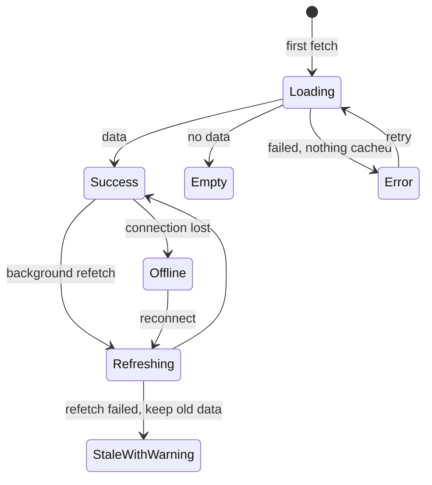

# UX States & Error Handling — Overview
[← Topic](../README.md)

**TECH:** React 19.2 · TanStack Query v5 · Tailwind CSS 4 · Sentry (error reporting)
**LEVEL:** intermediate (mid-level, has shipped production code)

## Why this matters in production
- Real users spend a lot of time in the "unhappy" states: slow networks, empty accounts, failed requests, offline trains.
- A blank screen or endless spinner makes users leave or click again (creating duplicates); a clear state keeps them on track.
- Good error messages cut support tickets; good error reports cut debugging time.
- Designing states up front is cheap; bolting them on after launch is not.

## Mental model
Every data-driven component is a small state machine. Design and build **every state** it can be in, not just the happy path.

## Prerequisites
- [04-framework](../../04-framework/README.md) (Suspense, error boundaries, transitions) and [05-state-management](../../05-state-management/README.md) (TanStack Query).
- [08-accessibility](../../08-accessibility/README.md) lesson 03 (live regions) for announcements.

## Lesson map
| Lesson | Checklist items |
|:--|:--|
| [01 · Screen states, loading, empty states, and Suspense](01-states-and-loading.md) | 1, 2, 4, 8 |
| [02 · Errors, feedback, and reporting](02-errors-and-feedback.md) | 3, 6, 10 |
| [03 · Optimistic UI, offline, and destructive actions](03-optimistic-offline-destructive.md) | 5, 7, 9 |
| [Cheatsheet](cheatsheet.md) | all |

## Suggested order
1. 01 → 02 → 03.
2. Combine with [10-forms](../../10-forms/README.md) for submission states and [13-testing-monitoring](../../13-testing-monitoring/README.md) for Sentry.
3. Ready to build: `/learn 02-frontend/09-ux-states mode=tasks`.

## Version notes
- TanStack Query v5: `isPending` = no data yet, `isFetching` = request in flight, `isPlaceholderData` while showing previous data; `useSuspenseQuery` for Suspense; `throwOnError` to hand errors to boundaries; paused mutations resume after reconnect.
- React 19: `onCaughtError`/`onUncaughtError` root callbacks report boundary errors; transitions keep old UI visible instead of showing fallbacks again.
- Sentry JS SDK 10 is current; capture handled errors with `Sentry.captureException` and context.

## Sources
- [TanStack Query — Queries (status flags)](https://tanstack.com/query/latest/docs/framework/react/guides/queries)
- [react.dev — `<Suspense>`](https://react.dev/reference/react/Suspense)
- [Nielsen Norman Group — Error message guidelines](https://www.nngroup.com/articles/error-message-guidelines/)
- [Nielsen Norman Group — Skeleton screens 101](https://www.nngroup.com/articles/skeleton-screens/)
- [Sentry — React SDK](https://docs.sentry.io/platforms/javascript/guides/react/)
