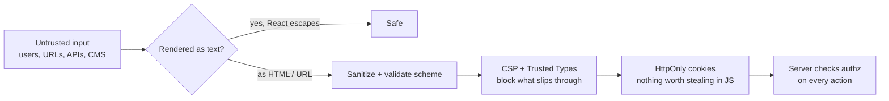

# Frontend Security — Overview
[← Topic](../README.md)

**TECH:** React 19.2 · Next.js 16 (proxy.ts, Server Actions) · Content Security Policy · Trusted Types · DOMPurify
**LEVEL:** intermediate (mid-level, has shipped production code)

## Why this matters in production
- The browser runs every script on your page with the user's full session. One XSS hole or one compromised third-party script is account takeover at scale.
- Server Components and Server Actions blur the client/server line; it's easy to send secrets to the browser or expose an unprotected endpoint.
- Supply-chain attacks hit frontends directly (the 2024 polyfill.io CDN takeover injected malware into 100,000+ sites).
- CSP and good token handling turn many would-be breaches into blocked console errors.

## Mental model
Assume something will eventually inject content into your page. Limit what it can **run** (escaping, sanitizing, CSP, Trusted Types), what it can **steal** (`HttpOnly` cookies, no secrets in bundles), and what it can **do** (server-side authorization on every action).

## Prerequisites
- [01-foundations/06-security](../../../01-foundations/06-security/README.md) (OWASP, XSS/CSRF basics, Helmet).
- [06-rendering](../../06-rendering/README.md) (Server Components, Server Actions, proxy.ts).
- [01-foundations/02-http-networking](../../../01-foundations/02-http-networking/README.md) lesson 03 (cookies).

## Lesson map
| Lesson | Checklist items |
|:--|:--|
| [01 · Browser threats, XSS in React, and safe navigation](01-browser-threats-and-xss.md) | 1, 2, 4, 10 |
| [02 · Content Security Policy and security headers](02-csp-and-headers.md) | 3, 8, 9 |
| [03 · Tokens in the browser and securing Server Actions](03-tokens-and-server-actions.md) | 5, 6 |
| [04 · Data exposure and secrets in the frontend](04-data-exposure-and-secrets.md) | 7, 11 |
| [Cheatsheet](cheatsheet.md) | all |

## Suggested order
1. 01 → 04 in order.
2. Revisit [03-backend/04-auth](../../../03-backend/04-auth/README.md): Express owns sessions; Next.js forwards cookies.
3. Ready to build: `/learn 02-frontend/11-security mode=tasks`.

## Version notes
- Next.js 16 sets CSP nonces per request in `proxy.ts` (formerly middleware). Nonce-based CSP requires dynamic rendering for those pages; static shells can use hashes/SRI instead (check the Next.js CSP guide for the current options).
- Self-hosting several instances: set `NEXT_SERVER_ACTIONS_ENCRYPTION_KEY` so all instances encrypt and decrypt Server Action payloads with the same key.
- Trusted Types are supported in Chromium and, more recently, in other engines; check Baseline before enforcing without a fallback.
- Several React Server Components security fixes shipped in 2025 (React 19.0–19.2 patch releases): stay on the latest 19.2.x and Next.js 16.x patches.

## Sources
- [OWASP — XSS Prevention Cheat Sheet](https://cheatsheetseries.owasp.org/cheatsheets/Cross_Site_Scripting_Prevention_Cheat_Sheet.html)
- [Next.js — Content Security Policy](https://nextjs.org/docs/app/guides/content-security-policy)
- [Next.js — Data security](https://nextjs.org/docs/app/guides/data-security)
- [MDN — Content Security Policy](https://developer.mozilla.org/en-US/docs/Web/HTTP/CSP)
- [web.dev — Trusted Types](https://web.dev/articles/trusted-types)
