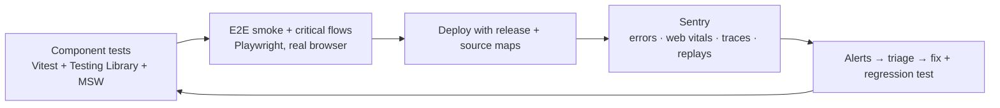

# Frontend Testing & Monitoring — Overview
[← Topic](../README.md)

**TECH:** Vitest 4 · Testing Library + user-event · MSW 2 · Playwright · Sentry (`@sentry/nextjs`, `@sentry/react`)
**LEVEL:** intermediate (mid-level, has shipped production code)

## Why this matters in production
- Frontend bugs reach users directly: a broken button, a blank page on one browser, a checkout that can't submit.
- Tests that mirror implementation break on every refactor; tests that act like users survive and catch real regressions.
- No test suite catches everything. Monitoring tells you what broke in production, for whom, and in which release.
- Fast feedback (component tests) plus a few high-value E2E flows plus monitoring is the practical balance.

## Mental model
Test the way users use the app, mock the network (not your code), keep a thin layer of real end-to-end flows, and watch production with errors, performance, and replays tied to releases.

## Prerequisites
- [01-foundations/03-testing](../../../01-foundations/03-testing/README.md) (Vitest, doubles, CI).
- [04-framework](../../04-framework/README.md), [05-state-management](../../05-state-management/README.md), [08-accessibility](../../08-accessibility/README.md) (role-based queries).

## Lesson map
| Lesson | Checklist items |
|:--|:--|
| [01 · Strategy and component tests](01-strategy-and-component-tests.md) | 1, 2, 5 |
| [02 · MSW, hooks, and TanStack Query in tests](02-msw-hooks-and-query.md) | 3, 4 |
| [03 · End-to-end tests with Playwright](03-playwright-e2e.md) | 6, 7, 8, 12 |
| [04 · Monitoring with Sentry](04-sentry-monitoring.md) | 9, 10, 11 |
| [Cheatsheet](cheatsheet.md) | all |

## Suggested order
1. 01 → 02 for daily work; 03 once the app has real flows; 04 before the first production deploy.
2. Backend observability is in [03-backend/10-observability](../../../03-backend/10-observability/README.md); incidents in [04-shipping/06-incident-response](../../../04-shipping/06-incident-response/README.md).
3. Ready to build: `/learn 02-frontend/13-testing-monitoring mode=tasks`.

## Version notes
- Vitest 4: browser mode is stable; providers are separate packages (`@vitest/browser-playwright`); `toMatchScreenshot` adds visual regression; browser APIs import from `vitest/browser`.
- MSW 2 uses the Fetch API primitives (`http`, `HttpResponse`) and works in Node and the browser.
- Playwright: aria snapshots (`toMatchAriaSnapshot`), clock API (`page.clock`), UI mode, and trace viewer are the tools to know.
- Sentry JS SDK 10 is built on OpenTelemetry v2, removed FID (use INP), and only sends IP addresses/PII when `sendDefaultPii` is true.

## Sources
- [Testing Library — Guiding principles](https://testing-library.com/docs/guiding-principles)
- [Vitest — Browser mode](https://vitest.dev/guide/browser/)
- [MSW documentation](https://mswjs.io/docs)
- [Playwright — Best practices](https://playwright.dev/docs/best-practices)
- [Sentry — Next.js SDK](https://docs.sentry.io/platforms/javascript/guides/nextjs/)
