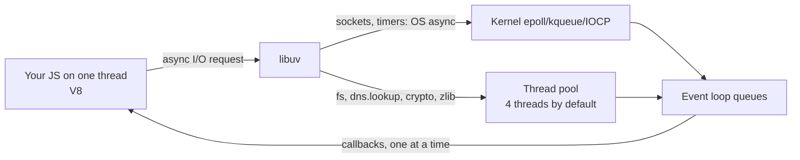

# Language & Runtime — Overview
[← Topic](../README.md)

**TECH:** Node.js 26 LTS · TypeScript 6.0 (strict, run via native type stripping) · V8 · libuv
**LEVEL:** intermediate (mid-level, has shipped production code)

## Why this matters in production
- One synchronous call in a hot path blocks every request on the instance; knowing the event loop prevents most Node performance incidents.
- Unhandled rejections crash processes; bad shutdowns drop in-flight requests on every deploy.
- Memory leaks and wrong heap limits get containers OOM-killed in loops.
- Node 26 runs TypeScript directly; using it well removes a build step but has rules.

## Mental model
Node is a single JavaScript thread (V8) on top of libuv, which does I/O asynchronously and runs some work on a small thread pool. Your code must hand off waiting and keep each callback short.

## Prerequisites
- [02-frontend/03-javascript](../../../02-frontend/03-javascript/README.md) (event loop basics, promises) and [01-foundations/05-code-quality](../../../01-foundations/05-code-quality/README.md) (strict TypeScript).
- Node 26 installed in WSL2 (`node -v`).

## Lesson map
| Lesson | Checklist items |
|:--|:--|
| [01 · Node's architecture, the event loop, and blocking](01-node-architecture-event-loop.md) | 1, 2, 10 |
| [02 · Async errors and the process lifecycle](02-async-errors-lifecycle.md) | 3, 8 |
| [03 · Modules, TypeScript on Node, and release lines](03-modules-typescript-versions.md) | 4, 5, 11 |
| [04 · Streams, built-ins, memory, and runtime security](04-streams-builtins-memory-security.md) | 6, 7, 9, 12 |
| [Cheatsheet](cheatsheet.md) | all |

## Suggested order
1. 01 → 04 in order, before [02-api-design](../../02-api-design/README.md).
2. Revisit lesson 02 with [08-reliability](../../08-reliability/README.md) and lesson 04 with [09-scalability](../../09-scalability/README.md).
3. Ready to build: `/learn 03-backend/01-language-runtime mode=tasks`.

## Version notes
- Node.js 26 ("Lithium") is the active LTS since October 2026, supported until April 2029. It ships V8 14.6, Undici 8 for `fetch`, and enables `Temporal` by default. From Node 27, majors ship once a year.
- TypeScript runs natively: Node strips types from `.ts` files without flags. Only erasable syntax works (no `enum`, no runtime `namespace`, no parameter properties); type-check separately with `tsc`.
- `require(esm)` works for ES modules without top-level await (Node 20.19+/22.12+), easing CommonJS/ESM interop.
- Corepack is no longer bundled (Node 25+); install pnpm explicitly.
- Node 20 reached end of life in April 2026; Node 22 and 24 are in maintenance.

## Sources
- [Node.js 26.0.0 release](https://nodejs.org/en/blog/release/v26.0.0)
- [Node.js — The event loop, timers, and process.nextTick](https://nodejs.org/en/learn/asynchronous-work/event-loop-timers-and-nexttick)
- [Node.js — Running TypeScript natively](https://nodejs.org/en/learn/typescript/run-natively)
- [Node.js — Releases](https://nodejs.org/en/about/previous-releases)
- [Node.js — Don't block the event loop](https://nodejs.org/en/learn/asynchronous-work/dont-block-the-event-loop)
