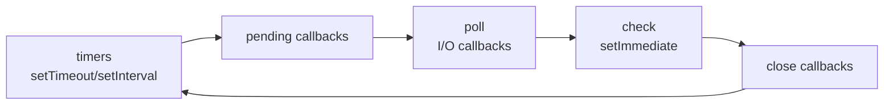

# Node's architecture, the event loop, and blocking
[← Overview](00-overview.md)

## Why it matters
- A report endpoint calls `JSON.parse` on a 200 MB payload. For 3 seconds, the instance answers nothing, health checks fail, and the load balancer kills it.
- Password hashing uses the sync API in the login route; under a login spike, p99 latency for *every* endpoint jumps to seconds.
- A regex with catastrophic backtracking runs on user input; one crafted request pins the CPU (ReDoS).

## Concepts

### What's inside Node
| Part | Role |
|:--|:--|
| V8 | compiles and runs JavaScript (JIT), manages the heap and garbage collection |
| libuv | event loop, async I/O through the OS, thread pool |
| Thread pool | default 4 threads (`UV_THREADPOOL_SIZE`): `fs`, `dns.lookup`, `crypto.pbkdf2/scrypt`, `zlib` |
| Core modules | `http`, `fs`, `crypto`, `stream`, ... (bindings to C++) |
| Your code | runs on **one** main thread |

Network I/O and timers don't use the thread pool; the OS notifies libuv. File system work, DNS lookups via `dns.lookup` (used by `fetch` and `http` by default), and some crypto/zlib do. Saturating the pool (many big file reads + many password hashes) delays all of them.

### Event loop phases

Between every callback, Node drains `process.nextTick` callbacks, then promise microtasks. A callback runs to completion; nothing else on that thread runs meanwhile.

### What blocks the loop
| Blocker | Example | Fix |
|:--|:--|:--|
| Sync APIs in request paths | `readFileSync`, `pbkdf2Sync`, `zlib.gzipSync` | async versions |
| Big JSON | `JSON.parse`/`stringify` of tens of MB | stream, paginate, limit body size |
| CPU-heavy logic | image processing, PDF generation, big sorts | worker threads or a job queue |
| Regex backtracking | `/(a+)+$/` on user input | safe patterns, input length limits |
| Huge loops | processing 1M items in one tick | chunk with `setImmediate`, or a worker |

Rule of thumb: keep every callback under ~10 ms on the main thread for a responsive API.

### Detecting blocking
| Tool | Shows |
|:--|:--|
| `perf_hooks.monitorEventLoopDelay()` | event loop delay histogram (p50/p99): the key health metric |
| OpenTelemetry runtime metrics | `nodejs.eventloop.delay.*` in dashboards ([10-observability](../../10-observability/README.md)) |
| `node --cpu-prof` | CPU profile file to open in Chrome DevTools |
| `node --inspect` + DevTools | live profiling and debugging |
| `--trace-sync-io` | warns when sync I/O runs after the first tick |
| also seen | clinic.js (Doctor, Flame) |

### Diagnostics toolbox
| Flag / API | Use |
|:--|:--|
| `--inspect` / `--inspect-brk` | debugger and profiler (never expose the port publicly) |
| `--cpu-prof`, `--heap-prof` | write profiles on exit |
| `--heapsnapshot-signal=SIGUSR2` | heap snapshot on demand in production |
| `process.report.writeReport()` | diagnostic report (stack, heap, handles, versions) |
| `diagnostics_channel` | subscribe to internal events (HTTP, Undici); OTel uses it |
| `performance.mark/measure` | custom timings |

## Example
`blocking-demo.ts` — the same work, blocking vs offloaded.
```ts
import express from 'express';
import { pbkdf2Sync, pbkdf2 } from 'node:crypto';
import { promisify } from 'node:util';
import { monitorEventLoopDelay } from 'node:perf_hooks';

const pbkdf2Async = promisify(pbkdf2);
const app = express();

app.get('/hash-sync', (_req, res) => {
  const hash = pbkdf2Sync('password', 'salt', 600_000, 32, 'sha256'); // blocks the loop for ~0.5 s
  res.json({ hash: hash.toString('hex') });
});

app.get('/hash-async', async (_req, res) => {
  const hash = await pbkdf2Async('password', 'salt', 600_000, 32, 'sha256'); // runs on the thread pool
  res.json({ hash: hash.toString('hex') });
});

app.get('/health', (_req, res) => res.json({ ok: true }));

const delay = monitorEventLoopDelay({ resolution: 20 });
delay.enable();
setInterval(() => {
  const p99ms = delay.percentile(99) / 1e6;  // nanoseconds → ms
  if (p99ms > 100) console.warn({ p99ms }, 'event loop delay high');
  delay.reset();
}, 10_000).unref();                            // don't keep the process alive just for this

app.listen(3000);
```
Try it: run `curl localhost:3000/hash-sync &` five times, then `curl -w '%{time_total}\n' localhost:3000/health`; the health check waits behind them. Repeat with `/hash-async`: health answers instantly.

CPU-bound work in a worker thread:
```ts
// resize-worker.ts
import { parentPort } from 'node:worker_threads';

parentPort!.on('message', (job: { data: number[] }) => {
  const result = job.data.toSorted((a, b) => a - b);   // stand-in for heavy CPU work
  parentPort!.postMessage(result);
});
```
```ts
// main.ts
import { Worker } from 'node:worker_threads';

export function sortInWorker(data: number[]): Promise<number[]> {
  return new Promise((resolve, reject) => {
    const worker = new Worker(new URL('./resize-worker.ts', import.meta.url));
    worker.once('message', (r) => { resolve(r); void worker.terminate(); });
    worker.once('error', reject);
    worker.postMessage({ data });
  });
}
```
In production use a pool (also seen: Piscina) instead of one worker per call; for long jobs, use BullMQ ([07-background-jobs](../../07-background-jobs/README.md)).

## Production patterns
- **No sync I/O or heavy CPU on request paths.** Lint for `*Sync` in server code (except at startup).
- **Track event loop delay p99** as a first-class metric and alert on it.
- **Limit input sizes** (body size, array lengths, regex input length) so no request can be arbitrarily expensive.
- **CPU-heavy work goes to worker pools or job queues**; keep the API thread for I/O.
- **Size `UV_THREADPOOL_SIZE`** (e.g. 8–16) only after measuring thread-pool saturation from heavy fs/crypto use.

## Mistakes
Wrong: sync crypto in a handler.
```ts
const hash = scryptSync(password, salt, 64); // every request waits
```
Right: `await promisify(scrypt)(password, salt, 64)`, or argon2's async API ([04-auth](../../04-auth/README.md)).

Wrong: reading a config file per request.
```ts
app.get('/x', (_req, res) => res.json(JSON.parse(readFileSync('config.json', 'utf8'))));
```
Right: read once at startup, or `await readFile` with caching.

Wrong: exposing `--inspect=0.0.0.0:9229` in production. Anyone who reaches the port can run code. Right: bind to localhost and tunnel when needed.

Wrong: processing a million items in one loop inside a request. Right: paginate, stream, chunk with `setImmediate`, or queue a job.

## Check yourself
1. Which operations use libuv's thread pool, and why does that matter?
2. What does event loop delay measure, and what's a worrying value?
3. How do you move CPU-heavy work off the main thread?

<details>
<summary>Answers</summary>

1. File system operations, `dns.lookup`, some crypto (`pbkdf2`, `scrypt`, `randomFill`), and zlib. With only 4 threads by default, heavy use of one (many hashes) delays the others (file reads, DNS lookups for outgoing HTTP).
2. How late timers fire compared to schedule, i.e. how long the loop was busy before it could run callbacks. A p99 consistently above ~50–100 ms means requests are queuing behind blocking work.
3. Worker threads (ideally a pool), a separate process, or a background job queue for long tasks.
</details>

## Sources
- [Node.js — The event loop, timers, and process.nextTick](https://nodejs.org/en/learn/asynchronous-work/event-loop-timers-and-nexttick)
- [Node.js — Don't block the event loop (or the worker pool)](https://nodejs.org/en/learn/asynchronous-work/dont-block-the-event-loop)
- [Node.js — `perf_hooks.monitorEventLoopDelay`](https://nodejs.org/api/perf_hooks.html#perf_hooksmonitoreventloopdelayoptions)
- [Node.js — Worker threads](https://nodejs.org/api/worker_threads.html)
- [Node.js — Diagnostics guides](https://nodejs.org/en/learn/diagnostics/user-journey)
