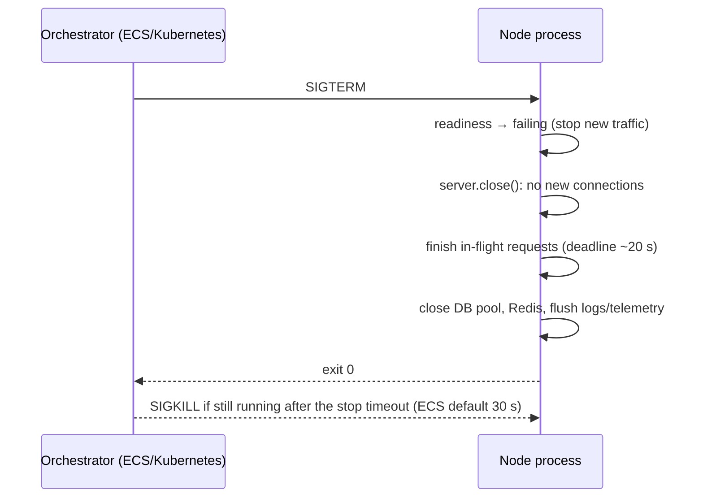

# Async errors and the process lifecycle
[← Overview](00-overview.md)

## Why it matters
- A forgotten `await` on `sendWelcomeEmail()` turns an SMTP timeout into an unhandled rejection, which crashes the process and drops every in-flight request.
- Each deploy kills containers mid-request: users see 502s for 30 seconds because the app ignores `SIGTERM` and gets `SIGKILL`ed.
- After an `uncaughtException`, the process keeps serving with corrupted state, writing half-finished orders for an hour.

## Concepts

### Operational vs programmer errors
| Kind | Examples | Handling |
|:--|:--|:--|
| Operational (expected) | invalid input, timeouts, 404 from an API, DB unavailable | handle: return an error response, retry, fall back |
| Programmer (bugs) | `undefined` access, wrong types, failed assertions | log with context, crash the process, let the orchestrator restart it |

After an uncaught error, the process state is unknown. Restarting is safer than continuing.

### Async error rules
| Rule | Why |
|:--|:--|
| Always `await` or `return` promises | otherwise rejections are unhandled |
| Express 5 forwards rejected async handlers to the error handler | no `try/catch` boilerplate in every route |
| `unhandledRejection` crashes the process by default (`--unhandled-rejections=throw`) | don't change it; fix the code |
| Fire-and-forget only with an explicit `.catch()` | `void task().catch(log)` |
| EventEmitter `'error'` events without a listener throw | add listeners to sockets, streams, clients |
| Use `AbortSignal` for cancellation and deadlines | stops wasted work on timeouts |

`AbortSignal` support: `fetch`, `node:timers/promises` (`setTimeout(ms, value, { signal })`), `events.once(emitter, name, { signal })`, `stream.pipeline(..., { signal })`, `fs/promises` reads, child processes.

### Process lifecycle

| Signal / event | Meaning | Handle by |
|:--|:--|:--|
| `SIGTERM` | please stop (deploys, scale-in) | graceful shutdown |
| `SIGINT` | Ctrl+C | same as SIGTERM locally |
| `SIGKILL` | forced kill | can't be handled |
| `uncaughtException` | a sync error nobody caught | log, flush, exit(1) |
| `unhandledRejection` | a rejected promise nobody handled | (default) crash → treat like uncaughtException |

Exit codes: `0` success, `1` error; `128 + signal` by convention (`143` after SIGTERM, `137` after SIGKILL, often an OOM kill). Set `process.exitCode` and let the process end naturally when possible; `process.exit()` cuts pending writes (logs) short.

In containers, run `node` directly as the main process (not `npm start`/`pnpm start`, which may not forward signals), or use `--init`/tini.

## Example
`src/server.ts` — graceful shutdown with a deadline.
```ts
import { createApp } from './app.ts';
import { config } from './config.ts';
import { pool } from './db.ts';
import { redis } from './redis.ts';
import { logger } from './logger.ts';

const app = createApp();
const server = app.listen(config.http.port, () => logger.info({ port: config.http.port }, 'listening'));
server.keepAliveTimeout = 65_000;
server.headersTimeout = 66_000;

let shuttingDown = false;
app.locals.isShuttingDown = () => shuttingDown;        // readiness probe returns 503 when true

async function shutdown(signal: string) {
  if (shuttingDown) return;
  shuttingDown = true;
  logger.info({ signal }, 'shutting down');

  const force = setTimeout(() => {
    logger.error('shutdown deadline exceeded, forcing exit');
    process.exit(1);
  }, 25_000);                                            // below ECS stopTimeout (30 s)
  force.unref();

  server.close();                                        // stop accepting new connections
  server.closeIdleConnections();                         // drop idle keep-alive sockets now
  await new Promise<void>((resolve) => server.once('close', () => resolve())); // in-flight requests done

  await Promise.allSettled([pool.end(), redis.close()]); // close dependencies (node-redis 5: close, not quit)
  logger.info('shutdown complete');
  logger.flush?.();
  process.exitCode = 0;
}

process.once('SIGTERM', () => void shutdown('SIGTERM'));
process.once('SIGINT', () => void shutdown('SIGINT'));

process.on('uncaughtException', (err) => {
  logger.fatal({ err }, 'uncaught exception');
  process.exitCode = 1;
  void shutdown('uncaughtException');                    // best effort, then the deadline exits
});
process.on('unhandledRejection', (reason) => {
  logger.fatal({ err: reason }, 'unhandled rejection');
  process.exitCode = 1;
  void shutdown('unhandledRejection');
});
```
Deadlines with `AbortSignal`:
```ts
import { setTimeout as sleep } from 'node:timers/promises';

export async function fetchWithRetry(url: string, signal: AbortSignal) {
  for (let attempt = 1; attempt <= 3; attempt++) {
    try {
      const res = await fetch(url, { signal: AbortSignal.any([signal, AbortSignal.timeout(2_000)]) });
      if (res.ok) return res;
      if (res.status < 500) throw new Error(`Upstream ${res.status}`);
    } catch (err) {
      if (signal.aborted) throw err;                     // caller gave up: stop retrying
      if (attempt === 3) throw err;
    }
    await sleep(200 * 2 ** attempt, undefined, { signal }); // backoff, cancellable
  }
  throw new Error('unreachable');
}
```

## Production patterns
- **Crash on programmer errors, handle operational ones.** The orchestrator restarts crashed processes; supervisors and alerts catch crash loops.
- **Graceful shutdown with a deadline** shorter than the platform's stop timeout; readiness fails first ([08-reliability](../../08-reliability/README.md)).
- **`node` as PID 1** with signal handlers, or `docker run --init`.
- **Every fire-and-forget has a `.catch`**, and the lint rule `no-floating-promises` is on.
- **Pass `AbortSignal` through** request-scoped work so timeouts stop downstream calls.

## Mistakes
Wrong: swallowing everything to "stay up".
```ts
process.on('uncaughtException', () => {}); // continues with corrupted state
```
Right: log, shut down gracefully, exit non-zero.

Wrong: `CMD ["pnpm", "start"]` in the Dockerfile; SIGTERM may not reach Node, so every stop becomes a SIGKILL after the timeout.
Right: `CMD ["node", "src/server.ts"]`.

Wrong: `process.exit(0)` right after `server.close()`. In-flight requests and log buffers are cut off. Right: wait for `close`, close dependencies, then end.

Wrong: unhandled `'error'` events on clients.
```ts
const client = createClient(); // no client.on('error', …): a network blip crashes the process
```
Right: always attach error listeners to long-lived emitters (Redis, sockets, streams).

## Check yourself
1. Why should a Node process exit after an uncaught exception?
2. What are the steps of a graceful shutdown?
3. Why can `pnpm start` as the container command cause 502s during deploys?

<details>
<summary>Answers</summary>

1. The error interrupted code at an unknown point; shared state (connections, in-memory data, half-done operations) may be inconsistent. Restarting from a clean state is the only safe option.
2. Stop receiving new traffic (fail readiness, `server.close()`), let in-flight requests finish within a deadline, close idle connections, close dependencies (DB, Redis, queues), flush logs/telemetry, exit with the right code.
3. The package manager may not forward SIGTERM to Node, so Node never starts its shutdown and gets SIGKILLed after the timeout, dropping in-flight requests and open keep-alive connections.
</details>

## Sources
- [Node.js — Process events and signals](https://nodejs.org/api/process.html#signal-events)
- [Node.js — `--unhandled-rejections`](https://nodejs.org/api/cli.html#--unhandled-rejectionsmode)
- [Node.js — `server.close()` and `closeIdleConnections()`](https://nodejs.org/api/http.html#serverclosecallback)
- [Express — Error handling](https://expressjs.com/en/guide/error-handling.html)
- [AWS — ECS task stop timeout](https://docs.aws.amazon.com/AmazonECS/latest/developerguide/task_definition_parameters.html#container_definition_timeout)
