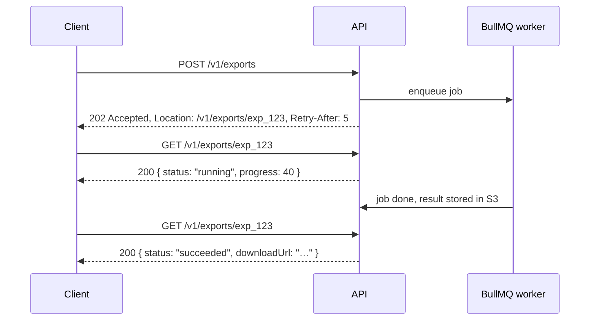

# Evolution, async operations, webhooks, and the contract
[← Overview](00-overview.md)

## Why it matters
- A field is renamed from `total` to `totalAmount` in a "minor" release. The mobile app, which can't be force-updated, shows €0 for every order until users update.
- A report endpoint runs for 90 seconds; the load balancer times out at 60, the client retries, and three copies of the report run.
- Webhooks are sent without signatures; an attacker posts fake `order.paid` events to a partner's endpoint.

## Concepts

### Evolving without breaking
| Non-breaking (additive) | Breaking |
|:--|:--|
| new endpoints | removing or renaming fields/endpoints |
| new optional request fields | new required request fields |
| new response fields | changing a field's type or format |
| new enum values (only if clients were told to tolerate unknowns) | changing semantics (cents → euros) |
| relaxing validation | tightening validation |

Clients should be **tolerant readers**: ignore unknown fields and handle unknown enum values.

| Versioning style | Example | Notes |
|:--|:--|:--|
| URL major version | `/v1/orders` → `/v2/orders` | simple, explicit, cache-friendly; most common |
| Header / media type | `Accept: application/vnd.acme.v2+json` | cleaner URLs, harder to test |
| Date-based | `Api-Version: 2026-11-01` (Stripe style) | fine-grained, needs translation layers |

Deprecation process: announce, add `Deprecation` (RFC 9745) and `Sunset` (RFC 8594) headers plus a `Link` to docs, mark `deprecated: true` in OpenAPI, **measure usage** per client, contact remaining users, remove after the sunset date.

### Long-running operations

Return **202 + a status resource**; notify completion by webhook, SSE, or email; make the start request idempotent (lesson 03).

### Webhooks you send
| Concern | Practice |
|:--|:--|
| Payload | `{ id, type, createdAt, data }` with a stable event `id`; small ("thin") payloads plus IDs to fetch details |
| Signatures | HMAC-SHA256 over `id.timestamp.body` with a per-endpoint secret; headers `webhook-id`, `webhook-timestamp`, `webhook-signature` (Standard Webhooks) |
| Replay protection | consumers reject timestamps older than ~5 minutes |
| Delivery | from a queue, with retries and exponential backoff for ~1–3 days |
| Idempotency | consumers dedupe by event `id`; deliveries can repeat |
| Ordering | not guaranteed; include `createdAt`/versions; consumers fetch current state when order matters |
| Operations | delivery logs, manual redelivery, auto-disable failing endpoints with notification, secret rotation |

### The contract: OpenAPI generated from Zod
- Schemas that validate requests also generate the OpenAPI 3.1 document ([01-foundations/08-documentation](../../../01-foundations/08-documentation/docs/03-openapi-from-zod.md)).
- Commit `openapi.json`; CI regenerates it and fails on drift.
- Detect breaking changes in CI by diffing against `main` (also seen: oasdiff).
- Generate typed clients from the spec for consumers (also seen: openapi-typescript, orval).

## Example
Deprecation headers on an old endpoint:
```ts
router.get('/v1/orders/:id/summary', async (req, res) => {
  res.set({
    Deprecation: '@1767225600',                         // RFC 9745: deprecated since 2026-01-01 (epoch seconds)
    Sunset: 'Wed, 01 Jul 2026 00:00:00 GMT',            // RFC 8594: removal date
    Link: '<https://api.example.com/docs/migrations/orders-summary>; rel="deprecation"',
  });
  req.log.info({ clientId: req.user?.clientId }, 'deprecated endpoint used'); // measure who still calls it
  res.json(await summaries.get(req.params.id));
});
```
202 + status resource:
```ts
router.post('/v1/exports', idempotent(db), async (req, res) => {
  const body = CreateExport.parse(req.body);
  const exp = await exports.create(req.user!.accountId, body);        // row with status 'queued'
  await exportQueue.add('export', { exportId: exp.id }, { jobId: exp.id });
  res.status(202).location(`/v1/exports/${exp.id}`).set('Retry-After', '5').json(toExportDTO(exp));
});

router.get('/v1/exports/:id', async (req, res) => {
  const exp = await exports.getForAccount(req.user!.accountId, req.params.id);
  res.json(toExportDTO(exp)); // { id, status, progress, downloadUrl? }
});
```
Signing webhooks (sender side):
```ts
import { createHmac, randomUUID } from 'node:crypto';

export function signWebhook(secret: string, body: string) {
  const id = `msg_${randomUUID()}`;
  const timestamp = Math.floor(Date.now() / 1000).toString();
  const signature = createHmac('sha256', Buffer.from(secret, 'base64')).update(`${id}.${timestamp}.${body}`).digest('base64');
  return { 'webhook-id': id, 'webhook-timestamp': timestamp, 'webhook-signature': `v1,${signature}` };
}

// delivery runs in a BullMQ worker with attempts + exponential backoff (07-background-jobs)
await fetch(endpoint.url, {
  method: 'POST',
  headers: { 'Content-Type': 'application/json', ...signWebhook(endpoint.secret, body) },
  body,
  signal: AbortSignal.timeout(10_000),
});
```
Breaking-change check in CI (concept):
```bash
node scripts/write-openapi.ts                       # regenerate from Zod
git diff --exit-code openapi.json                    # spec committed and current
# also seen: oasdiff breaking origin/main:openapi.json openapi.json --fail-on ERR
```

## Production patterns
- **Additive changes by default**; a new major version only for unavoidable breaks, run in parallel with the old one.
- **Deprecate with headers, docs, and usage metrics**; remove only when traffic is gone or the sunset date passes.
- **202 + status resource for anything that may exceed a few seconds**; never hold HTTP connections for minutes.
- **Signed, retried, logged webhooks** with dedupe-friendly event IDs; follow the Standard Webhooks conventions.
- **The OpenAPI file is the contract**, generated, committed, diffed for breaking changes.

## Mistakes
Wrong: renaming a field in place.
```diff
- "total": 2599
+ "totalAmount": 2599
```
Right: add `totalAmount`, keep `total` (deprecated) until clients migrate.

Wrong: synchronous long work.
```ts
router.post('/reports', async (_req, res) => res.json(await buildHugeReport())); // 90 s, timeouts, retries
```
Right: enqueue and return 202 with a status URL.

Wrong: unsigned webhooks, or signatures without timestamps (replayable). Right: HMAC over id + timestamp + body; consumers check the timestamp window.

Wrong: assuming webhook consumers process events in order. Right: include versions/timestamps; consumers fetch current state or ignore older events.

## Check yourself
1. Is adding a new enum value to a response field breaking?
2. What do the `Deprecation` and `Sunset` headers communicate?
3. Why should webhook consumers dedupe by event ID?

<details>
<summary>Answers</summary>

1. It can be: clients with exhaustive switches may crash on an unknown value. It's safe only if your API guidelines told clients to tolerate unknown values; otherwise treat it as breaking or announce it.
2. `Deprecation`: this endpoint is deprecated (since a date) and shouldn't be used for new work. `Sunset`: the date after which it may stop working. A `Link` header points to migration docs.
3. Deliveries are retried on timeouts and failures, so the same event can arrive more than once; processing it twice could double-ship or double-credit.
</details>

## Sources
- [RFC 9745 — The Deprecation HTTP Response Header Field](https://www.rfc-editor.org/rfc/rfc9745)
- [RFC 8594 — The Sunset HTTP Header Field](https://www.rfc-editor.org/rfc/rfc8594)
- [Standard Webhooks specification](https://www.standardwebhooks.com/)
- [Microsoft — Long-running operations in REST APIs](https://github.com/microsoft/api-guidelines/blob/vNext/azure/Guidelines.md#long-running-operations--jobs)
- [Stripe — API versioning](https://docs.stripe.com/api/versioning)
- [oasdiff](https://github.com/oasdiff/oasdiff)
