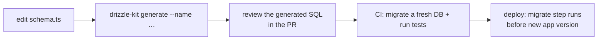

# Drizzle ORM and migrations
[← Overview](00-overview.md)

## Why it matters
- Someone runs `drizzle-kit push` against production; it drops a renamed column instead of renaming it, and a day of data is gone.
- A migration adds a `NOT NULL` column with a default to a 50 GB table during peak hours, takes a lock, and the API is down for minutes.
- The app is deployed before the migration finishes; the new code queries a column that doesn't exist yet.

## Concepts

### Drizzle in one table
| Piece | What it is |
|:--|:--|
| Schema (`pgTable`) | tables, columns, indexes, constraints in TypeScript |
| `drizzle({ client: pool, schema, casing: 'snake_case' })` | the db instance on top of your `pg` pool |
| SQL-like query builder | `db.select().from(orders).where(…)`, `insert`, `update`, `delete`, joins |
| Relational queries | `db.query.orders.findMany({ with: { items: true } })` using `relations()` |
| `sql` template tag | raw SQL with parameters when you need it |
| Type inference | `typeof orders.$inferSelect` / `$inferInsert` |
| Transactions | `db.transaction(async (tx) => …)` |
| drizzle-kit | migration generation and application, introspection, studio |

Drizzle stays close to SQL: if you know the SQL, you can read the query. Drizzle 1.0 (RC) introduces a new relational query API (`defineRelations`, object-style `where`); the SQL-like builder is unchanged.

### Migrations workflow

| Command | Use |
|:--|:--|
| `drizzle-kit generate --name add_order_note` | create a SQL migration from schema changes |
| `drizzle-kit migrate` | apply pending migrations (tracks them in a table) |
| `drizzle-kit push` | apply schema directly, **no migration files**: local prototyping only |
| `drizzle-kit check` | check migration consistency |
| `drizzle-kit pull` | generate a schema from an existing database |
| `drizzle-kit studio` | browse data locally |

### Zero-downtime changes: expand, then contract
Old and new app versions run at the same time during a deploy. Every migration must work with **both**.

| Change | Safe sequence |
|:--|:--|
| Add a column | add nullable (or with a constant default, which is fast in modern Postgres) → deploy code using it → backfill → add constraints |
| Make a column `NOT NULL` | `ADD CONSTRAINT … CHECK (col IS NOT NULL) NOT VALID` → `VALIDATE CONSTRAINT` → `SET NOT NULL` (uses the validated check) |
| Rename a column | add new column → write both → backfill → read new → stop writing old → drop old (several deploys) |
| Drop a column | remove all code usage, deploy → then drop in a later migration |
| Add an index | `CREATE INDEX CONCURRENTLY` (outside a transaction) |
| Change a type | new column + backfill + switch, not `ALTER TYPE` on big tables |
| Any migration | `SET lock_timeout = '5s'` so it fails instead of queueing behind long queries |

Data-heavy backfills run as batched jobs, not inside the migration. More in [04-shipping/05-data-safety](../../../04-shipping/05-data-safety/README.md).

## Example
`src/db/schema.ts`
```ts
import { relations, sql } from 'drizzle-orm';
import { bigint, char, index, integer, jsonb, pgTable, primaryKey, text, timestamp, uuid } from 'drizzle-orm/pg-core';

export const orders = pgTable('orders', {
  id: uuid().primaryKey().default(sql`uuidv7()`),
  accountId: uuid().notNull(),
  customerId: uuid().notNull(),
  status: text({ enum: ['pending', 'paid', 'shipped', 'cancelled'] }).notNull().default('pending'),
  currency: char({ length: 3 }).notNull(),
  totalCents: bigint({ mode: 'number' }).notNull(),
  shipTo: jsonb().$type<{ line1: string; city: string; postalCode: string; country: string }>().notNull(),
  createdAt: timestamp({ withTimezone: true }).notNull().defaultNow(),
}, (t) => [
  index('orders_account_created_idx').on(t.accountId, t.createdAt.desc(), t.id.desc()),
]);

export const orderItems = pgTable('order_items', {
  orderId: uuid().notNull().references(() => orders.id, { onDelete: 'cascade' }),
  sku: text().notNull(),
  quantity: integer().notNull(),
  unitPriceCents: bigint({ mode: 'number' }).notNull(),
}, (t) => [primaryKey({ columns: [t.orderId, t.sku] })]);

export const ordersRelations = relations(orders, ({ many }) => ({ items: many(orderItems) }));
export const orderItemsRelations = relations(orderItems, ({ one }) => ({
  order: one(orders, { fields: [orderItems.orderId], references: [orders.id] }),
}));

export type Order = typeof orders.$inferSelect;
export type NewOrder = typeof orders.$inferInsert;
```
`src/db/index.ts` and queries
```ts
import { drizzle } from 'drizzle-orm/node-postgres';
import { and, desc, eq, sql } from 'drizzle-orm';
import { pool } from '#src/db.ts';
import * as schema from './schema.ts';

export const db = drizzle({ client: pool, schema, casing: 'snake_case' });

export const recentPaidOrders = (accountId: string) =>
  db.select({ id: schema.orders.id, totalCents: schema.orders.totalCents, createdAt: schema.orders.createdAt })
    .from(schema.orders)
    .where(and(eq(schema.orders.accountId, accountId), eq(schema.orders.status, 'paid')))
    .orderBy(desc(schema.orders.createdAt))
    .limit(20);

export const orderWithItems = (accountId: string, id: string) =>
  db.query.orders.findFirst({
    where: and(eq(schema.orders.accountId, accountId), eq(schema.orders.id, id)),
    with: { items: true },                       // one round trip: no N+1
  });

export async function createOrder(order: schema.NewOrder, items: Omit<typeof schema.orderItems.$inferInsert, 'orderId'>[]) {
  return db.transaction(async (tx) => {
    const [created] = await tx.insert(schema.orders).values(order).returning();
    await tx.insert(schema.orderItems).values(items.map((i) => ({ ...i, orderId: created!.id })));
    return created!;
  });
}

export const revenueByStatus = (accountId: string) =>
  db.execute(sql`SELECT status, sum(total_cents) AS cents FROM orders WHERE account_id = ${accountId} GROUP BY status`);
// values in sql`` are sent as parameters; sql.raw() is NOT parameterized
```
`drizzle.config.ts`
```ts
import { defineConfig } from 'drizzle-kit';

export default defineConfig({
  dialect: 'postgresql',
  schema: './src/db/schema.ts',
  out: './drizzle',
  casing: 'snake_case',
  dbCredentials: { url: process.env.DATABASE_URL! },
  strict: true,                                  // ask before destructive changes
  verbose: true,
});
```
A reviewed, hand-edited migration for a safe `NOT NULL`:
```sql
-- drizzle/0007_order_note_not_null.sql
SET lock_timeout = '5s';
ALTER TABLE orders ADD CONSTRAINT orders_note_not_null CHECK (note IS NOT NULL) NOT VALID;
ALTER TABLE orders VALIDATE CONSTRAINT orders_note_not_null;   -- scans without blocking writes
ALTER TABLE orders ALTER COLUMN note SET NOT NULL;             -- fast: uses the validated check
ALTER TABLE orders DROP CONSTRAINT orders_note_not_null;
```

## Production patterns
- **`generate` + review + `migrate`** for every environment beyond your laptop; `push` only for local prototyping.
- **Migrations are code**: reviewed in PRs, tested in CI on a fresh database (Testcontainers), applied by the deploy pipeline before the new app version.
- **Expand/contract** for renames, type changes, and drops, spread over several deploys.
- **`lock_timeout` in risky migrations**, `CONCURRENTLY` for indexes, batched backfills as jobs.
- **Drizzle's builder for typed queries, `sql` for complex SQL**; never `sql.raw` with user input.

## Mistakes
Wrong: `drizzle-kit push` against shared or production databases. A rename can become drop + add. Right: generated migration files, reviewed.

Wrong: renaming a column in one deploy.
```sql
ALTER TABLE orders RENAME COLUMN total TO total_cents; -- old instances still query "total"
```
Right: expand/contract over multiple deploys.

Wrong: deploying app code before its migration. Right: migrate first (backward-compatible), then deploy code; or run migrations as a pre-deploy step.

Wrong: `` sql.raw(`… ORDER BY ${req.query.sort}`) ``. SQL injection. Right: allowlist the column, then use the builder's `orderBy`.

## Check yourself
1. What's the difference between `drizzle-kit push` and `generate` + `migrate`?
2. Why must migrations be compatible with the previous app version?
3. How do you add `NOT NULL` to a big existing column without long locks?

<details>
<summary>Answers</summary>

1. `push` diffs the schema and applies changes directly without migration files or review (fine for local prototyping). `generate` writes SQL migrations you review and commit; `migrate` applies them in order and records them.
2. During a rolling deploy (and on rollback), old and new versions run side by side against the same schema; a migration that only the new code understands breaks the old instances.
3. Add a `CHECK (col IS NOT NULL) NOT VALID` constraint, `VALIDATE` it (scans without blocking writes), then `SET NOT NULL` (which uses the validated constraint and avoids a full scan), and drop the helper check.
</details>

## Sources
- [Drizzle ORM — Schema declaration](https://orm.drizzle.team/docs/sql-schema-declaration)
- [Drizzle ORM — Queries (select, relational queries)](https://orm.drizzle.team/docs/rqb)
- [Drizzle Kit — Migrations](https://orm.drizzle.team/docs/kit-overview)
- [PostgreSQL — ALTER TABLE](https://www.postgresql.org/docs/current/sql-altertable.html)
- [Strong Migrations — safe migration patterns](https://github.com/ankane/strong_migrations#checks)
