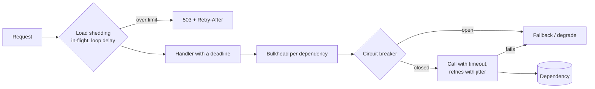

# Reliability & Resilience — Overview
[← Topic](../README.md)

**TECH:** Node.js 26 + Express 5 (timeouts, health checks, shutdown, load shedding) · BullMQ for deferring work · AWS ECS/ALB settings · Vitest + MSW for failure tests
**LEVEL:** intermediate (mid-level, has shipped production code)

## Why this matters in production
- Most outages aren't crashes. One slow dependency ties up sockets, memory, and connections until everything is slow.
- Retries and restarts can turn a small blip into a full outage (retry storms, health checks that kill healthy tasks).
- Deploys cause many production errors. Graceful shutdown and correct health checks make them invisible to users.
- Without SLOs, "reliable enough" is a feeling. With them, reliability work gets a budget and a priority.

## Mental model
Every call can be slow or fail. **Bound it** (timeouts), **retry it carefully** (backoff + jitter, only when safe), **stop calling what's broken** (circuit breakers), **contain the damage** (bulkheads, load shedding), and **degrade** instead of failing the whole request. Measure the result against SLOs.

## Prerequisites
- [01-language-runtime lesson 02](../../01-language-runtime/docs/02-async-errors-lifecycle.md): async errors and the graceful shutdown code this topic builds on.
- [01-foundations/02-http-networking lesson 01](../../../01-foundations/02-http-networking/docs/01-request-lifecycle.md): keep-alive and load balancer timeouts.
- [02-api-design lesson 03](../../02-api-design/docs/03-pagination-idempotency-concurrency.md): idempotency keys (what makes retries safe).
- [07-background-jobs](../../07-background-jobs/README.md): moving work out of the request path.

## Lesson map
| Lesson | Checklist items |
|:--|:--|
| [01 · Failure modes, timeouts, and retries](01-failure-modes-timeouts-retries.md) | 1, 2, 3 |
| [02 · Health checks and graceful shutdown](02-health-checks-and-shutdown.md) | 4, 5 |
| [03 · Circuit breakers, bulkheads, and load shedding](03-breakers-bulkheads-load-shedding.md) | 6, 7, 8 |
| [04 · Degradation, dependency outages, SLOs, and failure testing](04-degradation-slos-failure-testing.md) | 9, 10, 11, 12 |
| [Cheatsheet](cheatsheet.md) | all |

## Suggested order
1. 01 → 04.
2. Then [10-observability](../../10-observability/README.md) to measure the SLIs, and [04-shipping/06-incident-response](../../../04-shipping/06-incident-response/README.md).
3. Ready to build: `/learn 03-backend/08-reliability mode=tasks`.

## Version notes
- Node 26: global `fetch` is undici 8. Use `AbortSignal.timeout()` and `AbortSignal.any()` for deadlines; undici's default headers and body timeouts are 300 s, so always set your own.
- Node HTTP server defaults: `requestTimeout` 300 s, `headersTimeout` 60 s, `keepAliveTimeout` 5 s. `server.close()` also closes idle connections (Node 19+).
- STACK.md has no resilience library, so the lessons build small breakers and bulkheads to show the mechanics. Also seen: cockatiel, opossum, p-retry.
- AWS: ECS `stopTimeout` defaults to 30 s (max 120 s); ALB deregistration delay defaults to 300 s; an ALB fails open when all targets are unhealthy.
- PostgreSQL 17+ adds `transaction_timeout` (available in 18).

## Sources
- [AWS Builders' Library — Timeouts, retries, and backoff with jitter](https://aws.amazon.com/builders-library/timeouts-retries-and-backoff-with-jitter/)
- [AWS Builders' Library — Implementing health checks](https://aws.amazon.com/builders-library/implementing-health-checks/)
- [AWS Builders' Library — Using load shedding to avoid overload](https://aws.amazon.com/builders-library/using-load-shedding-to-avoid-overload/)
- [Google SRE book — Addressing cascading failures](https://sre.google/sre-book/addressing-cascading-failures/)
- [Google SRE workbook — Implementing SLOs](https://sre.google/workbook/implementing-slos/)
