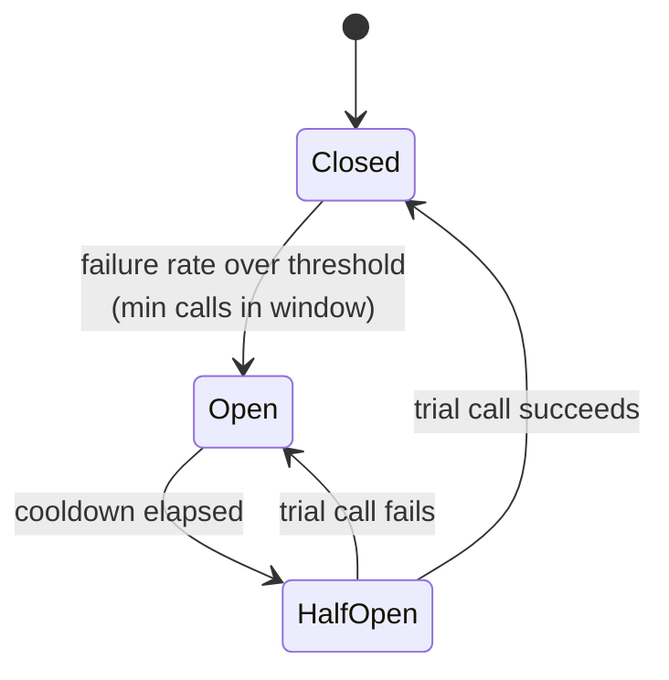

# Circuit breakers, bulkheads, and load shedding
[← Overview](00-overview.md)

## Why it matters
- A partner API is down for an hour. Every request still waits for its 800 ms timeout before failing, p99 latency jumps for an hour, and the partner gets hammered the moment it starts recovering.
- The recommendations service slows to 20-second responses. Product pages wait on it, in-flight requests pile up, and checkout (which doesn't need recommendations) slows down too.
- A marketing email triples traffic. The API accepts everything, event loop delay climbs to 4 seconds, and every request times out, including the ones it could have served.

## Concepts

### Circuit breaker
A breaker wraps calls to one dependency. When too many calls fail, it **opens** and fails fast without calling. After a cooldown it lets a trial call through (**half-open**); success closes it, failure opens it again.


| Setting | Typical |
|:--|:--|
| Trip condition | ≥ 50% failures over ≥ 20 calls in a 10–30 s window |
| What counts as failure | timeouts, connection errors, 5xx, 429; **not** 4xx caused by your input |
| Cooldown (open) | 10–30 s |
| Trial calls (half-open) | 1–3 |
| Scope | one breaker per dependency (or per endpoint), per instance |
| While open | fallback (lesson 04) or a fast 503 |

Breakers need timeouts underneath: a call that hangs forever never counts as a failure.

### Bulkheads
Ships have compartments so one leak doesn't sink the ship. A **bulkhead** gives each dependency or workload its own limited pool of resources.
| Resource | Bulkhead |
|:--|:--|
| Concurrent calls to a dependency | semaphore: max in flight + max waiting, reject beyond |
| Outgoing sockets | separate undici `Agent({ connections })` per dependency (npm `undici`, use its `fetch`) |
| DB connections | separate pools/roles for the API vs reports and jobs |
| Background work | separate BullMQ queues and workers ([07-background-jobs](../../07-background-jobs/README.md)) |
| Services | critical paths (checkout, login) deployed separately from heavy features |
| Tenants | per-tenant rate limits ([05-validation-abuse](../../05-validation-abuse/README.md)) |

### Load shedding and backpressure
Under overload, serving **some** requests well beats serving **all** of them badly. Reject early and cheaply, before doing work.
| Technique | How |
|:--|:--|
| Max in-flight requests per instance | beyond N, reply `503` + `Retry-After` |
| Event loop delay | shed when p99 delay is over a threshold (`monitorEventLoopDelay`) |
| Priorities | never shed health checks; shed low-value traffic (search, analytics) before checkout |
| Deadline check | don't start work that can't finish inside the remaining budget |
| Bounded queues | every in-memory queue has a maximum size |
| Stream backpressure | `pipeline()`; respect `write()` returning false and wait for `drain` |
| Client side | clients back off with jitter on 429/503 |
| Autoscaling | ECS target tracking adds capacity; shedding protects you until it arrives |

## Example
`src/resilience/circuit-breaker.ts`
```ts
type State = 'closed' | 'open' | 'half-open';

export class CircuitOpenError extends Error {
  constructor(name: string) {
    super(`Circuit "${name}" is open`);
    this.name = 'CircuitOpenError';
  }
}

type BreakerOptions = { windowMs?: number; minCalls?: number; failureRate?: number; cooldownMs?: number };

export class CircuitBreaker {
  readonly name: string;
  #opts: Required<BreakerOptions>;
  #state: State = 'closed';
  #openedAt = 0;
  #trialInFlight = false;
  #calls: { at: number; ok: boolean }[] = [];

  constructor(name: string, opts: BreakerOptions = {}) {
    this.name = name;
    this.#opts = { windowMs: 30_000, minCalls: 20, failureRate: 0.5, cooldownMs: 15_000, ...opts };
  }

  get state(): State {
    return this.#state;
  }

  async run<T>(fn: () => Promise<T>, isFailure: (err: unknown) => boolean = () => true): Promise<T> {
    let isTrial = false;
    if (this.#state === 'open') {
      if (Date.now() - this.#openedAt < this.#opts.cooldownMs) throw new CircuitOpenError(this.name);
      this.#state = 'half-open';
    }
    if (this.#state === 'half-open') {
      if (this.#trialInFlight) throw new CircuitOpenError(this.name); // one trial at a time
      this.#trialInFlight = true;
      isTrial = true;
    }
    try {
      const result = await fn();
      this.#record(true, isTrial);
      return result;
    } catch (err) {
      this.#record(!isFailure(err), isTrial);                        // e.g. a 404 is not the dependency's fault
      throw err;
    } finally {
      if (isTrial) this.#trialInFlight = false;
    }
  }

  #record(ok: boolean, isTrial: boolean) {
    const now = Date.now();
    if (isTrial) {
      this.#state = ok ? 'closed' : 'open';
      this.#openedAt = ok ? 0 : now;
      this.#calls = [];
      return;
    }
    if (this.#state !== 'closed') return;                            // late result from before the trip
    this.#calls = this.#calls.filter((c) => now - c.at <= this.#opts.windowMs);
    this.#calls.push({ at: now, ok });
    const failures = this.#calls.filter((c) => !c.ok).length;
    if (this.#calls.length >= this.#opts.minCalls && failures / this.#calls.length >= this.#opts.failureRate) {
      this.#state = 'open';
      this.#openedAt = now;
    }
  }
}
```
`src/resilience/bulkhead.ts` — a semaphore with a bounded wait queue.
```ts
export class BulkheadFullError extends Error {
  constructor(name: string) {
    super(`Bulkhead "${name}" is full`);
    this.name = 'BulkheadFullError';
  }
}

export function bulkhead(name: string, maxConcurrent: number, maxQueued: number) {
  let active = 0;
  const waiting: (() => void)[] = [];

  return async function run<T>(fn: () => Promise<T>): Promise<T> {
    if (active < maxConcurrent) active++;
    else if (waiting.length < maxQueued) await new Promise<void>((resolve) => waiting.push(resolve));
    else throw new BulkheadFullError(name);                          // reject instead of queueing forever

    try {
      return await fn();
    } finally {
      const next = waiting.shift();
      if (next) next();                                              // hand our slot to the next caller
      else active--;
    }
  };
}
```
`src/recommendations/client.ts` — all three around one optional dependency.
```ts
import { CircuitBreaker } from '#src/resilience/circuit-breaker.ts';
import { bulkhead } from '#src/resilience/bulkhead.ts';
import { fetchJson, UpstreamError } from '#src/http/fetch-json.ts';

const breaker = new CircuitBreaker('recommendations', { cooldownMs: 20_000 });
const limit = bulkhead('recommendations', 20, 50);

const isDependencyFailure = (err: unknown) =>
  !(err instanceof UpstreamError && err.status !== undefined && err.status < 500 && err.status !== 429);

export async function getRecommendations(userId: string, budget: AbortSignal): Promise<Product[]> {
  try {
    return await breaker.run(
      () => limit(() => fetchJson<Product[]>(`${config.recs.url}/users/${userId}`, { timeoutMs: 800, attempts: 1, budget })),
      isDependencyFailure,
    );
  } catch (err) {
    logger.warn({ err, breaker: breaker.state }, 'recommendations unavailable, using fallback');
    return popularProducts();                                        // degrade (lesson 04)
  }
}
```
`src/resilience/load-shedding.ts`
```ts
import type { RequestHandler } from 'express';
import { monitorEventLoopDelay } from 'node:perf_hooks';

const histogram = monitorEventLoopDelay({ resolution: 10 });
histogram.enable();
let loopDelayMs = 0;
setInterval(() => {
  loopDelayMs = histogram.percentile(99) / 1e6;                      // nanoseconds → ms
  histogram.reset();
}, 1_000).unref();

let inFlight = 0;

export function loadShedding(opts: { maxInFlight: number; maxLoopDelayMs: number }): RequestHandler {
  return (_req, res, next) => {
    if (inFlight >= opts.maxInFlight || loopDelayMs > opts.maxLoopDelayMs) {
      res.set('Retry-After', '2');
      res.status(503).type('application/problem+json').json({
        type: 'https://api.example.com/problems/overloaded',
        title: 'Server is busy, retry shortly',
        status: 503,
      });
      return;
    }
    inFlight++;
    res.once('close', () => { inFlight--; });                        // finished or aborted
    next();
  };
}

// src/app.ts: health routes are mounted before this, so they are never shed
app.use(loadShedding({ maxInFlight: 200, maxLoopDelayMs: 500 }));
```
Pick `maxInFlight` from a load test ([09-scalability](../../09-scalability/README.md)): the concurrency where latency starts climbing, with some margin.

## Production patterns
- **Breaker per dependency**, counting only the dependency's failures, with a fallback for when it's open.
- **Bulkheads around every optional or slow dependency**, with bounded queues.
- **Shed early and cheaply** on in-flight count and event loop delay; health checks are exempt.
- **Expose breaker state and shed counts as metrics** ([10-observability](../../10-observability/README.md)); an open breaker should be visible on a dashboard.
- **Combine with autoscaling**: shedding buys time, scaling adds capacity.

## Mistakes
Wrong: one global breaker for everything. One broken partner blocks calls to every other dependency. Right: one per dependency.

Wrong: counting 4xx as failures.
```ts
breaker.run(() => api.getUser(id)); // a burst of 404s from bad IDs opens the circuit for everyone
```
Right: pass an `isFailure` predicate that ignores client errors.

Wrong: an unbounded queue in front of a slow dependency. It's a memory leak with extra steps, and queued requests time out anyway. Right: bounded queue, reject the rest fast.

Wrong: shedding the health check. The ALB marks the busy instance unhealthy, ECS replaces it, and the remaining instances get even more load. Right: mount health routes before load shedding.

## Check yourself
1. Why does a circuit breaker need a timeout underneath it?
2. What problem does a bulkhead solve that a circuit breaker doesn't?
3. Why reply 503 early instead of queueing requests during overload?

<details>
<summary>Answers</summary>

1. The breaker only learns about failures when calls finish. Calls that hang forever never complete, so they never count, and resources stay tied up. Timeouts turn hangs into failures it can count.
2. A breaker reacts after failures pile up; while a dependency is merely slow, calls still succeed and still consume resources. A bulkhead caps how much of the service one dependency can use at any moment, so a slow dependency can't starve unrelated work.
3. Queued requests use memory and still time out from the client's view, so the work is wasted. An early 503 is cheap, lets clients back off and retry, and keeps latency good for the requests that are accepted.
</details>

## Sources
- [Martin Fowler — CircuitBreaker](https://martinfowler.com/bliki/CircuitBreaker.html)
- [AWS Builders' Library — Using load shedding to avoid overload](https://aws.amazon.com/builders-library/using-load-shedding-to-avoid-overload/)
- [Azure Architecture Center — Bulkhead pattern](https://learn.microsoft.com/en-us/azure/architecture/patterns/bulkhead)
- [Node.js — `perf_hooks.monitorEventLoopDelay()`](https://nodejs.org/api/perf_hooks.html#perf_hooksmonitoreventloopdelayoptions)
- [Node.js — Backpressuring in streams](https://nodejs.org/en/learn/modules/backpressuring-in-streams)
