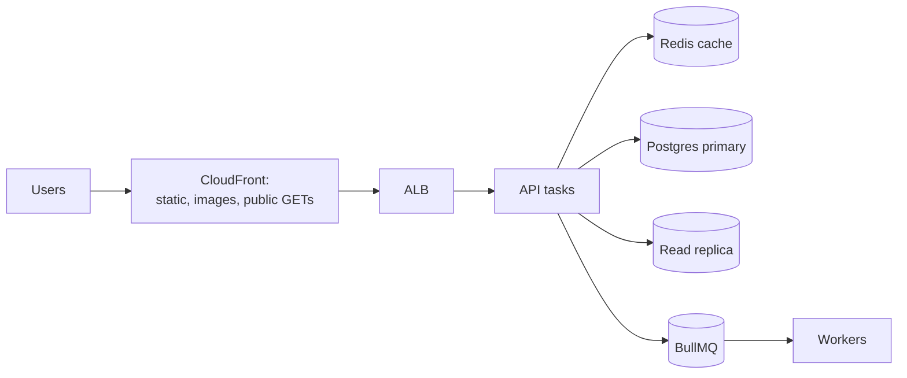

# Offloading work and capacity planning
[← Overview](00-overview.md)

## Why it matters
- Every product page hits Postgres for data that changes twice a day. A CDN with `s-maxage` would have answered 95% of those requests without touching the API.
- An export endpoint builds a 200 MB JSON array in memory. Three concurrent exports and the task is killed for running out of memory.
- The team guesses "10 tasks" for Black Friday. The real peak needs 25, and the database connection budget allows 15.

## Concepts

### The request funnel: absorb load early

| Layer | Offloads | How |
|:--|:--|:--|
| Browser | repeat visits | `max-age`, immutable hashed assets |
| CDN | static files, images, public API responses | `Cache-Control: public, s-maxage=…`, tight cache keys ([06-caching lesson 04](../../06-caching/docs/04-http-caching-and-pitfalls.md)) |
| Redis | computed reads, sessions, counters | cache-aside ([06-caching](../../06-caching/README.md)) |
| Replicas | read queries | [lesson 03](03-scaling-postgresql.md) |
| Precomputation | dashboards, counters, feeds | rollup tables, materialized views, jobs |
| Search | full-text, facets | Postgres full-text search first; also seen: OpenSearch |

### Offloading heavy and bursty work: queues
| Pattern | Example |
|:--|:--|
| Accept now, process later | `202 Accepted` + `Location` of a status resource |
| Absorb spikes | the queue grows during a burst, workers drain it at a steady rate |
| Scale workers separately | one ECS service per worker type, scaled on queue backlog (oldest-job age, waiting count) |
| Batch writes | buffer events, write with multi-row `INSERT` or `COPY` |
| Fan-out | one event becomes many jobs |

### Payloads and batching
| Technique | Effect |
|:--|:--|
| Keyset pagination | same cost on page 1 and page 10,000 ([02-api-design lesson 03](../../02-api-design/docs/03-pagination-idempotency-concurrency.md)) |
| Lean DTOs, field selection | less DB I/O, less JSON work, less bandwidth |
| Compression | Brotli/gzip at CloudFront; also seen: `compression` middleware when there's no CDN |
| Bulk endpoints | `POST /api/items/batch` with a size limit instead of 100 calls |
| Streaming | DB cursor → transform → response or S3 ([01-language-runtime lesson 04](../../01-language-runtime/docs/04-streams-builtins-memory-security.md)) |
| Screen-shaped endpoints | one call per screen instead of chatty clients (backend for frontend) |
| `COPY` for bulk loads | far faster than row-by-row inserts |

### Capacity planning
**Little's law:** `L = λ × W`. Things in the system = arrival rate × time each spends in it. It works for requests, connections, and jobs.

| Question | Calculation |
|:--|:--|
| Requests in flight at peak | 800 req/s × 0.15 s = **120** |
| Tasks needed | 120 ÷ 40 per task (measured at 60% CPU in a load test) = 3 → × 1.5 headroom = 5 → + 1 to survive losing an AZ's share = **6** |
| DB connections busy | 800 req/s × 2 queries × 0.005 s = **8** on average (plus bursts) |
| Concurrent jobs | 50 jobs/s × 2 s = **100** → e.g. concurrency 20 × 5 worker tasks |
| Third-party limits | e.g. Stripe's default rate limit (100 operations/s in live mode): a hard ceiling for checkout |

**Keep utilization at 50–70%.** Queueing delay grows sharply as a resource approaches 100% busy (simple queue model, ρ / (1 − ρ) × service time):
| Utilization | Extra waiting (× service time) |
|:--|:--|
| 50% | 1× |
| 70% | 2.3× |
| 80% | 4× |
| 90% | 9× |
| 95% | 19× |

A capacity plan is one page: expected peak (marketing calendar, growth), measured capacity per task (breakpoint test), headroom, limits of shared resources (DB connections, CPU, IOPS, Redis memory, third-party rate limits), and cost per 1,000 requests.

## Example
Exports as jobs instead of giant responses:
```ts
// POST /api/exports → 202 Accepted; the client polls the status resource or gets an email
router.post('/exports', async (req, res) => {
  const exp = await exportsRepo.create({ accountId: req.user!.accountId, kind: 'orders-csv' }); // status: queued
  await exportsQueue.add('orders-csv', { exportId: exp.id }, { jobId: `export-${exp.id}` });
  res.status(202).location(`/api/exports/${exp.id}`).json({ id: exp.id, status: 'queued' });
});

// GET /api/exports/:id → { status: 'ready', url } with a short-lived S3 presigned URL
router.get('/exports/:id', async (req, res) => {
  const exp = await exportsRepo.getForAccount(req.user!.accountId, req.params.id);
  if (exp.status !== 'ready') return res.json({ id: exp.id, status: exp.status });
  res.json({ id: exp.id, status: 'ready', url: await presignDownload(exp.s3Key, { expiresIn: 300 }) });
});
```
The worker streams rows from a Postgres cursor into an S3 multipart upload (`@aws-sdk/lib-storage` `Upload`), so memory stays flat no matter how big the export is.

Batching writes from a hot path:
```ts
// src/analytics/page-views.ts — buffer page views, write one INSERT per second instead of one per request
import { db } from '#src/db.ts';
import { pageViews } from '#src/db/schema.ts';
import { logger } from '#src/logger.ts';

type PageView = typeof pageViews.$inferInsert;
const buffer: PageView[] = [];

export function recordPageView(view: PageView) {
  buffer.push(view);
  if (buffer.length > 10_000) buffer.splice(0, buffer.length - 10_000); // cap memory if the DB is down
}

setInterval(async () => {
  const batch = buffer.splice(0, 1_000);
  if (batch.length === 0) return;
  try {
    await db.insert(pageViews).values(batch);                          // one round trip for up to 1,000 rows
  } catch (err) {
    logger.warn({ err, dropped: batch.length }, 'page view batch failed'); // analytics: losing a batch is acceptable
  }
}, 1_000).unref();
```
Use this only for data you can afford to lose (it lives in memory until flushed); important events go through the outbox ([07-background-jobs lesson 04](../../07-background-jobs/docs/04-outbox-messaging-monitoring.md)).

## Production patterns
- **Every layer absorbs what it can**: browser and CDN for public content, Redis for computed reads, replicas for reads, queues for heavy work.
- **Big results are produced by jobs** and delivered through S3 presigned URLs, never built in memory.
- **Workers scale on backlog**, independently of the API.
- **Capacity is calculated** with Little's law and measured per-task capacity, targeting 50–70% utilization at peak.
- **Shared limits are part of the plan**: DB connections, Redis memory, third-party rate limits.

## Mistakes
Wrong: building huge responses in memory.
```ts
const rows = await db.select().from(orders).where(eq(orders.accountId, id)); // 2 million rows in one array
res.json(rows);
```
Right: paginate, stream, or run an export job that writes to S3.

Wrong: planning from averages. "We average 100 req/s" says nothing about the 10× peak at 8 p.m. on launch day. Right: plan for the peak, with headroom.

Wrong: running workers inside the API tasks. Heavy jobs steal CPU from requests, and you can't scale them separately. Right: separate worker services.

Wrong: forgetting third-party limits. The API scales to 2,000 req/s; the payment provider allows 100. Right: list external limits in the capacity plan, queue and smooth calls to them.

## Check yourself
1. Use Little's law: 400 req/s with 250 ms average latency. How many requests are in flight?
2. Why target 50–70% utilization instead of 90%?
3. When should an endpoint return `202 Accepted` instead of the result?

<details>
<summary>Answers</summary>

1. L = λ × W = 400 × 0.25 = 100 requests in flight on average. Size tasks, pools, and limits for that number plus headroom.
2. Waiting time grows non-linearly as utilization approaches 100%: at 90% a request waits about 9× its service time in queues, at 70% about 2.3×. Headroom keeps latency stable and absorbs spikes while autoscaling reacts.
3. When the work is slow, heavy, or bursty (exports, imports, video processing, bulk sends) and the client doesn't need the result immediately. Return a status resource the client can poll, or notify it when done.
</details>

## Sources
- [AWS Builders' Library — Avoiding insurmountable queue backlogs](https://aws.amazon.com/builders-library/avoiding-insurmountable-queue-backlogs/)
- [Amazon CloudFront — Serving compressed files](https://docs.aws.amazon.com/AmazonCloudFront/latest/DeveloperGuide/ServingCompressedFiles.html)
- [AWS SDK for JavaScript v3 — `@aws-sdk/lib-storage`](https://docs.aws.amazon.com/AWSJavaScriptSDK/v3/latest/Package/-aws-sdk-lib-storage/)
- [PostgreSQL — Populating a database](https://www.postgresql.org/docs/current/populate.html)
- [Stripe — Rate limits](https://docs.stripe.com/rate-limits)
- [Little's law](https://en.wikipedia.org/wiki/Little%27s_law)
