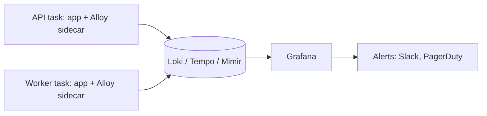

# Grafana LGTM, dashboards, and alerting
[← Overview](00-overview.md)

## Why it matters
- 40 dashboards exist, and during an incident none of them answers "is checkout working right now?"
- 200 alerts fire every week. The on-call mutes the channel, and the alert for the real outage scrolls by unseen.
- Payments fail for 3 hours because an API key expired. HTTP metrics look fine; only a payment success-rate panel would have shown it.

## Concepts

### The LGTM stack
| Component | Stores | Query language |
|:--|:--|:--|
| **L**oki | logs | LogQL |
| **G**rafana | dashboards, exploration, alerting | — |
| **T**empo | traces | TraceQL |
| **M**imir | metrics (Prometheus-compatible) | PromQL |
| Alloy / OpenTelemetry Collector | receives OTLP, batches, scrubs, samples, routes | Alloy config |
| Pyroscope | continuous profiles | also seen |


| Where it runs | Notes |
|:--|:--|
| Local | `grafana/otel-lgtm` in Docker Compose (Grafana on `localhost:3001` in this repo) |
| Grafana Cloud | managed LGTM with a free tier (also seen) |
| Self-hosted on AWS | Loki, Tempo, Mimir on object storage (S3): real operations work |
| AWS-native alternative | CloudWatch, X-Ray, Amazon Managed Grafana and Managed Prometheus (also seen) |

**Why a collector:** batching and retries away from the app, tail sampling ([lesson 04](04-sentry-sampling-cost.md)), dropping or hashing sensitive attributes, sending to several backends, and switching vendors without touching application code. On ECS, run Alloy as a sidecar container; the app sends OTLP to `localhost:4318`.

### Dashboards that help
| Dashboard | Panels |
|:--|:--|
| Service overview (one per service, same layout) | request rate, error rate, p50/p95/p99 per route, saturation (CPU, memory, event loop delay, DB pool), deploy annotations |
| Dependencies | DB query latency and errors, Redis latency, each external API's latency and errors, breaker state |
| Queues | depth, oldest-job age, failure rate, throughput ([07-background-jobs](../../07-background-jobs/README.md)) |
| Business | orders per minute vs last week, payment success rate, signups, login success |
| SLOs | SLI, error budget left, burn rate ([08-reliability](../../08-reliability/README.md)) |

Rules: the top row answers "is it healthy?"; every service uses the same layout; panels link to Explore for traces and logs; dashboards live in git (provisioning or Terraform); unused dashboards get deleted.

### Alerting
| Principle | Example |
|:--|:--|
| Alert on symptoms users feel | error rate, latency SLO burn, checkout success |
| Causes go on dashboards | CPU at 80% is a panel, not a page |
| Every alert is actionable | `runbook_url` annotation with first steps |
| Severity | `page` wakes someone; `ticket` waits for business hours |
| SLO burn-rate alerts | multi-window, from [08-reliability lesson 04](../../08-reliability/docs/04-degradation-slos-failure-testing.md) |
| Alert on silence | no orders, no job runs, no data (`absent()`) |
| Routing | Grafana Alerting contact points and notification policies (Slack, PagerDuty) |
| Grouping and silences | one notification per incident; silence planned maintenance |
| Hygiene | weekly review: fix or delete every noisy alert |

### Business and dependency metrics
| Metric | Catches |
|:--|:--|
| Orders per minute vs the same time last week | silent breakage anywhere in the funnel |
| Payment success rate by provider and method | expired keys, provider incidents, fraud rules |
| Signup and login success rate | auth bugs, abuse |
| Email send failures | provider or domain problems |
| Latency and errors per external dependency | which partner is slow |
| Oldest job age per queue | stuck workers |

## Example
Service dashboard queries (PromQL on Mimir):
```promql
# Request rate per route
sum by (http_route) (rate(http_server_request_duration_seconds_count{job="api"}[5m]))

# Error ratio (5xx)
sum(rate(http_server_request_duration_seconds_count{job="api", http_response_status_code=~"5.."}[5m]))
  / sum(rate(http_server_request_duration_seconds_count{job="api"}[5m]))

# p95 latency per route
histogram_quantile(0.95, sum by (le, http_route) (rate(http_server_request_duration_seconds_bucket{job="api"}[5m])))

# Orders per minute, now and one week ago (two series on one panel)
sum(rate(shop_orders_created_total[5m])) * 60
sum(rate(shop_orders_created_total[5m] offset 1w)) * 60
```
Logs (LogQL on Loki, OTLP-ingested):
```logql
# Errors from the API in the selected time range
{service_name="api"} | detected_level="error"

# Every log line of one request, across services
{service_name=~"api|worker"} | trace_id="4bf92f3577b34da6a3ce929d0e0e4736"
```
Traces (TraceQL on Tempo):
```traceql
{ resource.service.name = "api" && span.http.route = "/api/orders" && duration > 1s }
```
`alerts/shop.rules.yml` — business alerts with runbooks (Prometheus rule format, loaded by Mimir's ruler or Grafana).
```yaml
groups:
  - name: shop-business
    rules:
      - alert: PaymentSuccessRateLow
        expr: |
          sum(rate(shop_payments_total{outcome="succeeded"}[10m]))
            / sum(rate(shop_payments_total[10m])) < 0.9
          and sum(rate(shop_payments_total[10m])) > 0.1
        for: 10m
        labels: { severity: page, team: checkout }
        annotations:
          summary: Payment success rate below 90% for 10 minutes
          runbook_url: https://github.com/acme/shop/blob/main/docs/runbooks/payments.md
      - alert: NoOrders
        expr: sum(rate(shop_orders_created_total[15m])) == 0 and on() hour() >= 7 < 22   # hour() is UTC
        for: 15m
        labels: { severity: page, team: checkout }
        annotations:
          summary: No orders for 15 minutes during the day
          runbook_url: https://github.com/acme/shop/blob/main/docs/runbooks/no-orders.md
```
`alloy/config.alloy` — the sidecar: receive OTLP, scrub, batch, export.
```alloy
otelcol.receiver.otlp "default" {
  http { endpoint = "0.0.0.0:4318" }
  output {
    metrics = [otelcol.processor.attributes.scrub.input]
    logs    = [otelcol.processor.attributes.scrub.input]
    traces  = [otelcol.processor.attributes.scrub.input]
  }
}

// Last line of defense: drop attributes that must never leave the task
otelcol.processor.attributes "scrub" {
  action {
    key    = "enduser.email"
    action = "delete"
  }
  action {
    key    = "http.request.header.authorization"
    action = "delete"
  }
  output {
    metrics = [otelcol.processor.batch.default.input]
    logs    = [otelcol.processor.batch.default.input]
    traces  = [otelcol.processor.batch.default.input]
  }
}

otelcol.processor.batch "default" {
  output {
    metrics = [otelcol.exporter.otlphttp.lgtm.input]
    logs    = [otelcol.exporter.otlphttp.lgtm.input]
    traces  = [otelcol.exporter.otlphttp.lgtm.input]
  }
}

// Grafana Cloud's OTLP gateway, or your own Loki/Tempo/Mimir OTLP endpoints
otelcol.exporter.otlphttp "lgtm" {
  client {
    endpoint = sys.env("LGTM_OTLP_ENDPOINT")
    auth     = otelcol.auth.basic.lgtm.handler
  }
}

otelcol.auth.basic "lgtm" {
  username = sys.env("LGTM_USERNAME")
  password = sys.env("LGTM_TOKEN")
}
```

## Production patterns
- **One collector per task (sidecar)** that batches, scrubs, and routes; the app only knows `localhost:4318`.
- **Same dashboard layout for every service**, top row = health, with deploy annotations and drill-down links.
- **Business panels and alerts next to technical ones**: they catch failures HTTP metrics miss.
- **Pages only for user-facing symptoms**, each with a runbook; causes and capacity go to tickets and dashboards.
- **Dashboards and alert rules in git**, reviewed like code.

## Mistakes
Wrong: a 60-panel dashboard with no structure. In an incident nobody knows where to look. Right: a short overview that links to detailed dashboards.

Wrong: paging on causes.
```yaml
- alert: HighCPU
  expr: avg(ecs_cpu_utilization) > 80   # wakes someone while users are fine
```
Right: page on error rate, latency burn rate, and business success rates; show CPU on a dashboard.

Wrong: alerting only on errors. When traffic stops (DNS, a broken deploy, a payment provider outage), there are no errors at all. Right: alert on missing traffic and business events too.

Wrong: alerts without runbooks. The on-call starts every incident from zero. Right: a `runbook_url` on every paging alert.

## Check yourself
1. What does the collector (Alloy) give you that sending straight from the app doesn't?
2. Why page on symptoms rather than causes?
3. Which failure would a business metric catch that HTTP metrics miss?

<details>
<summary>Answers</summary>

1. Batching and retries outside the app, a place to scrub sensitive attributes, tail sampling, routing to several backends, and the freedom to change backends without changing application code.
2. Symptoms (errors, latency, failed checkouts) mean users are affected, so waking someone is justified. Causes (high CPU, a full disk on one node) often don't affect users, and alerting on all of them produces noise that trains people to ignore alerts.
3. Failures where the API still answers 200: an expired payment API key handled as a "payment declined" response, a broken email provider, a frontend bug that stops orders from being submitted. Orders per minute or payment success rate drop while HTTP error rates look normal.
</details>

## Sources
- [Grafana Alloy — Collect and forward OpenTelemetry data](https://grafana.com/docs/alloy/latest/collect/opentelemetry-data/)
- [Grafana Loki — Ingesting logs with OpenTelemetry](https://grafana.com/docs/loki/latest/send-data/otel/)
- [Grafana Tempo — TraceQL](https://grafana.com/docs/tempo/latest/traceql/)
- [Grafana — Dashboard best practices](https://grafana.com/docs/grafana/latest/dashboards/build-dashboards/best-practices/)
- [Grafana — Alerting](https://grafana.com/docs/grafana/latest/alerting/)
- [Google SRE book — Monitoring distributed systems](https://sre.google/sre-book/monitoring-distributed-systems/)
