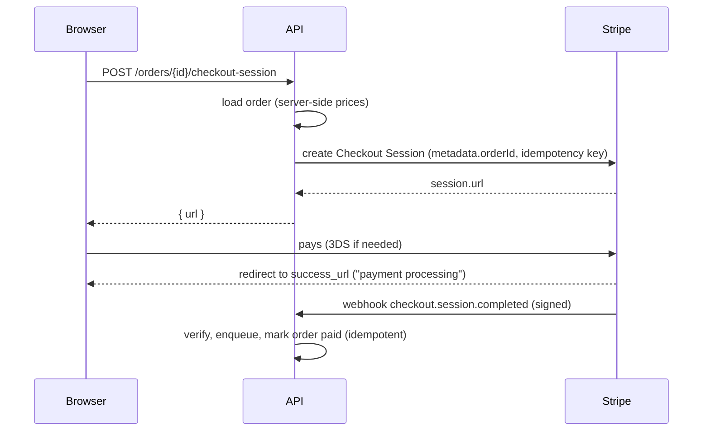

# Integration principles and Stripe payments
[← Overview](00-overview.md)

## Why it matters
- The Stripe call has no idempotency key. A timeout plus an automatic retry charges a customer twice.
- Checkout trusts the amount sent by the browser. Someone pays €0.01 for a €400 order.
- A partner API returns 100 records per page; the nightly sync never follows the cursor and silently imports only the first page.

## Concepts

### Integration principles
| Principle | Practice |
|:--|:--|
| Behind an adapter | provider SDKs and types live only in the adapter ([11-architecture lesson 02](../../11-architecture/docs/02-di-ports-adapters.md)) |
| Timeouts, few retries | Stripe `timeout`, `maxNetworkRetries`; AWS `requestHandler` timeouts and `maxAttempts` |
| Idempotency | idempotency keys on writes (Stripe); your own dedupe records where the provider has none (SES) |
| Async by default | slow or retryable calls run in BullMQ jobs; the request does only what the user must see |
| Secrets | Secrets Manager or SSM, injected into the ECS task; restricted keys; rotation |
| Environments | sandbox or test mode for development and staging; separate keys per environment |
| Incoming events | verify signatures on the raw body, dedupe, process in jobs ([lesson 02](02-stripe-webhooks-reconciliation.md)) |
| Observability | per-provider latency, errors, and 429s; provider request IDs in logs |
| Reconciliation | compare your records with the provider's on a schedule |

### Stripe payments
| Concept | Meaning |
|:--|:--|
| PaymentIntent | one attempt to collect a payment: `requires_payment_method` → `requires_confirmation` → `requires_action` (3DS) → `processing` → `succeeded` or `canceled` |
| Stripe Checkout | Stripe-hosted (or embedded) payment page: payment methods, 3DS, receipts handled for you |
| Payment Element | embeddable payment UI inside your own page, with a PaymentIntent |
| Customer, PaymentMethod | saved customers and their cards or other methods |
| SetupIntent | save a payment method now, charge later (off-session) |
| Amounts | integers in the smallest currency unit (cents); zero-decimal currencies such as JPY have none |
| Idempotency key | `{ idempotencyKey }` on creates; the same key returns the same result (kept at least 24 h) |
| Metadata | your IDs (`orderId`) on Stripe objects, for webhooks, reconciliation, support |
| Test mode and sandboxes | test keys and test cards; no real money moves |
| Restricted keys | `rk_…` keys with only the permissions a service needs |
| Billing | subscriptions, invoices, customer portal: same principles, more events |

**Checkout or Payment Element?** Checkout for most shops: less code, less PCI scope, many payment methods, 3DS handled. Payment Element when the payment step must live inside your own page. Either way, the **server decides the amount**, and the **webhook confirms the payment**, never the browser's redirect.



### Third-party API clients
| Topic | Practice |
|:--|:--|
| SDK or raw HTTP | official, typed, maintained SDK (Stripe, AWS); small APIs: a `fetch` wrapper with timeouts ([08-reliability lesson 01](../../08-reliability/docs/01-failure-modes-timeouts-retries.md)) |
| Rate limits | respect `Retry-After` and rate headers; BullMQ `limiter` for batch work; Stripe allows 100 operations/s in live mode and 25 in test mode by default |
| Pagination | follow cursors until `has_more` is false; Stripe's SDK auto-paginates with `for await` |
| Versioning | pin API versions, upgrade deliberately, read deprecation emails |
| Request IDs | log the provider's request ID (Stripe's `Request-Id` header) for support tickets |
| Errors | translated into domain results inside the adapter |

## Example
Clients with timeouts and retries (built in `src/deps.ts`):
```ts
import Stripe from 'stripe';
import { SESv2Client } from '@aws-sdk/client-sesv2';

const stripe = new Stripe(config.stripe.secretKey, {     // a restricted key from Secrets Manager
  timeout: 10_000,
  maxNetworkRetries: 2,                                  // retried POSTs reuse an idempotency key
  appInfo: { name: 'shop-api', version: config.app.version },
});

const ses = new SESv2Client({
  region: config.aws.region,                             // credentials: the ECS task role, automatically
  maxAttempts: 3,
  requestHandler: { connectionTimeout: 2_000, requestTimeout: 5_000 },
});
```
`src/payments/stripe.adapter.ts` (excerpt) — a Checkout Session from server-side prices.
```ts
async createCheckoutSession(order: CheckoutOrder): Promise<{ sessionId: string; url: string }> {
  const session = await stripe.checkout.sessions.create(
    {
      mode: 'payment',
      line_items: order.lines.map((line) => ({
        quantity: line.quantity,
        price_data: { currency: 'eur', unit_amount: line.unitPriceCents, product_data: { name: line.name } },
      })),
      customer: order.customerRef,
      client_reference_id: order.id,
      metadata: { orderId: order.id, accountId: order.accountId },
      payment_intent_data: { metadata: { orderId: order.id } },
      success_url: `${config.app.url}/orders/${order.id}?checkout=processing`,
      cancel_url: `${config.app.url}/cart`,
      expires_at: Math.floor(Date.now() / 1000) + 60 * 60,      // 1 hour
    },
    { idempotencyKey: `checkout-${order.id}-${order.version}` }, // stable per attempt; new key if the order changes
  );
  return { sessionId: session.id, url: session.url! };
},
```
The route: prices come from the order, never from the client.
```ts
router.post('/orders/:orderId/checkout-session', async (req, res) => {
  const { orderId } = OrderIdParams.parse(req.params);
  const { url } = await orders.startCheckout(req.user!.accountId, orderId);
  res.json({ url });                                              // the frontend sends the browser there
});
```
Following cursors with auto-pagination:
```ts
for await (const intent of stripe.paymentIntents.list({ created: { gte: since }, limit: 100 })) {
  await syncPayment(intent);                                      // the SDK fetches the next page when needed
}
```
Test cards in test mode:
| Card | Behavior |
|:--|:--|
| `4242 4242 4242 4242` | succeeds |
| `4000 0025 0000 3155` | requires 3DS authentication |
| `4000 0000 0000 9995` | declined: insufficient funds |
| `4000 0000 0000 0002` | declined: generic |

## Production patterns
- **Server-side amounts, webhook-confirmed payments**; the success page only says "processing".
- **Stable idempotency keys** derived from your IDs (order ID plus version), never a random value per retry.
- **Restricted keys per service**, stored in Secrets Manager, different for test and live.
- **Every provider call has a timeout** and limited retries, and most run in jobs.
- **Your IDs in provider metadata**, provider IDs in your database, both in logs.

## Mistakes
Wrong: the client sends the amount.
```ts
await stripe.paymentIntents.create({ amount: req.body.total, currency: 'eur' }); // pay €0.01 for anything
```
Right: compute the amount from the order on the server.

Wrong: marking the order paid on the success redirect.
```ts
router.get('/checkout/success', async (req) => { await orders.markPaid(req.query.orderId); }); // forgeable; tab closed = never paid
```
Right: mark it paid in the webhook handler (lesson 02).

Wrong: a new random idempotency key on every retry. Retries become new charges. Right: a key derived from the operation (`checkout-{orderId}-{version}`).

Wrong: live secret keys in staging, or any secret key in frontend code. Right: test keys outside production, publishable keys only in the browser, restricted secret keys on the server.

## Check yourself
1. Why must the amount come from the server, and how does Stripe learn it?
2. Why is the browser redirect to `success_url` not proof of payment?
3. What makes an idempotency key "stable", and why does it matter?

<details>
<summary>Answers</summary>

1. Anything from the browser can be changed by the user. The server loads the order, computes the amount from its own prices, and passes it to Stripe when creating the Checkout Session or PaymentIntent.
2. Anyone can open that URL, and users who close the tab after paying never reach it. Stripe's signed webhook (`checkout.session.completed`) is the reliable signal; the success page should show "processing" until the webhook has updated the order.
3. It's derived from the operation (for example the order ID and version), so every retry of the same operation sends the same key and Stripe returns the original result instead of charging again. A random key per attempt turns retries into duplicate charges.
</details>

## Sources
- [Stripe — Checkout quickstart](https://docs.stripe.com/checkout/quickstart)
- [Stripe — How PaymentIntents work](https://docs.stripe.com/payments/paymentintents/lifecycle)
- [Stripe — Idempotent requests](https://docs.stripe.com/api/idempotent_requests)
- [Stripe — Testing](https://docs.stripe.com/testing)
- [Stripe — Rate limits](https://docs.stripe.com/rate-limits)
- [Stripe — Auto-pagination](https://docs.stripe.com/api/pagination/auto)
