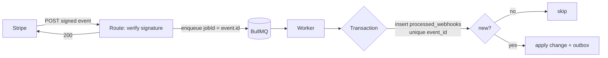

# Stripe webhooks and reconciliation
[← Overview](00-overview.md)

## Why it matters
- Orders are marked paid when the browser reaches the success page. Customers who close the tab after paying never get their order; others type the URL by hand.
- Stripe retries a webhook after a timeout. The handler isn't idempotent, and the order ships twice.
- Events arrive in an unexpected order, the handler throws, and failures pile up for three days until Stripe disables the endpoint. Nobody notices, because nothing alerts on it.

## Concepts

### Webhook rules for Stripe
| Rule | Why |
|:--|:--|
| Verify `Stripe-Signature` on the raw body | `constructEvent(rawBody, header, whsec)`; checks the HMAC and a 5-minute timestamp tolerance |
| Return 2xx fast | Stripe times out slow endpoints and retries; do the work in a job |
| Expect duplicates | dedupe on `event.id` |
| Expect any order | never assume one event arrives before another; guard state transitions |
| Retries for up to 3 days (live mode) | with backoff; endpoints that keep failing get disabled |
| Subscribe only to events you handle | less noise, less load |
| One endpoint and secret per environment | test and live secrets differ |
| Mount before `express.json()` | the JSON parser would consume the raw body |

General verification techniques (raw body, HMAC, replay windows) are in [05-validation-abuse lesson 03](../../05-validation-abuse/docs/03-bots-webhooks-business-abuse.md).

### Events most shops handle
| Event | Do |
|:--|:--|
| `checkout.session.completed` | mark the order paid if `payment_status === 'paid'`; otherwise wait |
| `checkout.session.async_payment_succeeded` / `_failed` | delayed methods such as SEPA Direct Debit |
| `payment_intent.succeeded` / `payment_intent.payment_failed` | Payment Element flows |
| `charge.refunded` | record the refund |
| `charge.dispute.created` | alert someone, collect evidence |
| `invoice.paid`, `invoice.payment_failed`, `customer.subscription.updated` / `.deleted` | subscriptions |

### The processing pipeline

Recording the event and applying the change in **one transaction** makes processing exactly-once in effect: a retry either finds the record (skip) or finds nothing because the transaction rolled back (apply again).

### Reconciliation and monitoring
| Check | How |
|:--|:--|
| Daily reconciliation | list the day's succeeded PaymentIntents (auto-pagination) and compare with paid orders; self-heal or alert |
| Reverse check | orders marked paid without a succeeded PaymentIntent: alert, investigate |
| Stuck orders | `pending` for more than an hour: look up the Stripe state |
| Webhook health | events received, processed, failed per type; lag from `event.created` to processed |
| Stripe Dashboard | failing endpoints, delivery attempts, event log |
| Alerts | payment success rate, webhook failures, reconciliation mismatches > 0 |

## Example
`src/payments/stripe.webhook.ts` — verify, enqueue, answer. Mounted before `express.json()`.
```ts
import express from 'express';
import type Stripe from 'stripe';

app.post('/webhooks/stripe', express.raw({ type: 'application/json', limit: '1mb' }), async (req, res) => {
  let event: Stripe.Event;
  try {
    event = stripe.webhooks.constructEvent(req.body, req.get('stripe-signature') ?? '', config.stripe.webhookSecret);
  } catch {
    webhookSignatureFailures.add(1, { provider: 'stripe' });
    return res.status(400).json({ title: 'Invalid signature' });
  }
  // If this throws, Stripe gets a 500 and retries. jobId = event.id dedupes redeliveries while the job is stored.
  await stripeEventsQueue.add(event.type, { eventId: event.id }, { jobId: event.id });
  res.json({ received: true });
});
```
`src/payments/stripe-events.worker.ts` — dedupe and apply in one transaction.
```ts
import { UnrecoverableError, Worker } from 'bullmq';
import { processedWebhooks } from '#src/shared/schema.ts';

new Worker<{ eventId: string }>('stripe-events', async (job) => {
  const event = await stripe.events.retrieve(job.data.eventId);       // IDs in job data; the event comes from Stripe

  await db.transaction(async (tx) => {
    const fresh = await tx.insert(processedWebhooks)
      .values({ provider: 'stripe', eventId: event.id })
      .onConflictDoNothing()
      .returning();
    if (fresh.length === 0) return;                                    // already applied

    switch (event.type) {
      case 'checkout.session.completed':
      case 'checkout.session.async_payment_succeeded': {
        const session = event.data.object;
        if (session.payment_status !== 'paid') return;                 // delayed methods: a later event follows
        const orderId = session.metadata?.orderId;
        if (!orderId) throw new UnrecoverableError(`session ${session.id} has no orderId`);
        const paymentIntentId = typeof session.payment_intent === 'string' ? session.payment_intent : session.payment_intent?.id;
        await orders.markPaidFromStripe(tx, { orderId, paymentIntentId: paymentIntentId ?? null }); // only pending/failed → paid
        break;
      }
      case 'checkout.session.async_payment_failed': {
        const orderId = event.data.object.metadata?.orderId;
        if (orderId) await orders.markPaymentFailed(tx, orderId);
        break;
      }
      case 'charge.refunded':
        await orders.recordRefund(tx, event.data.object);
        break;
      default:
        break;                                                         // not handled: subscribe to fewer events
    }
  });
}, { connection, concurrency: 5 });
```
`markPaidFromStripe` is a guarded state transition: an order that is already `paid`, `shipped`, or `refunded` stays as it is, so out-of-order or repeated events can't move it backwards.

`src/payments/reconcile.job.ts` — daily, from a BullMQ job scheduler ([07-background-jobs lesson 03](../../07-background-jobs/docs/03-scheduling-flows-shutdown.md)).
```ts
export async function reconcileStripeDay(day: Date) {
  const start = Date.UTC(day.getUTCFullYear(), day.getUTCMonth(), day.getUTCDate()) / 1000;
  const mismatches: string[] = [];

  for await (const intent of stripe.paymentIntents.list({ created: { gte: start, lt: start + 86_400 }, limit: 100 })) {
    if (intent.status !== 'succeeded') continue;
    const orderId = intent.metadata.orderId;
    const order = orderId ? await ordersRepo.findById(db, orderId) : undefined;
    if (!order) {
      mismatches.push(`no order for ${intent.id}`);
    } else if (order.status === 'pending' || order.status === 'payment_failed') {
      await orders.markPaidFromStripe(db, { orderId: order.id, paymentIntentId: intent.id }); // a missed webhook, healed
      logger.warn({ orderId: order.id, paymentIntentId: intent.id }, 'reconciliation marked an order paid');
    }
  }

  reconciliationMismatches.add(mismatches.length, { provider: 'stripe' });
  if (mismatches.length > 0) logger.error({ mismatches }, 'stripe reconciliation found mismatches');
}
```
Local testing: `stripe listen --forward-to localhost:3000/webhooks/stripe` prints a local signing secret, and `stripe trigger checkout.session.completed` sends a test event ([lesson 05](05-outgoing-webhooks-and-testing.md)).

## Production patterns
- **Verify, enqueue, answer** in the route; everything else in the worker.
- **Dedupe record and business change in one transaction**; guarded state transitions for out-of-order events.
- **Order IDs in Stripe metadata**, so every event maps back to your data.
- **Daily reconciliation in both directions**, with self-healing for missed webhooks and alerts for the rest.
- **Webhook metrics and alerts**: failures, lag, signature errors, endpoint disabled emails routed to the team.

## Mistakes
Wrong: marking the event processed before it's safely queued.
```ts
await db.insert(processedWebhooks).values({ eventId: event.id }); // then the enqueue fails…
await queue.add(event.type, { eventId: event.id });               // …and Stripe's retry is skipped as a duplicate
```
Right: enqueue first (deduped by `jobId`); record the event in the worker's transaction.

Wrong: parsing JSON before verifying.
```ts
app.use(express.json());
app.post('/webhooks/stripe', (req) => stripe.webhooks.constructEvent(JSON.stringify(req.body), …)); // bytes differ: fails
```
Right: `express.raw()` on this route, registered before the JSON parser.

Wrong: assuming event order (`payment_intent.created` before `succeeded`, `completed` before `refunded`). Right: state machines that ignore transitions that don't apply.

Wrong: doing slow work in the route (emails, PDFs). Stripe times out and retries, and the work runs twice. Right: answer within a second; the worker does the rest.

## Check yourself
1. Why is the dedupe record written in the same transaction as the business change?
2. How do you handle events that arrive out of order?
3. What does the daily reconciliation catch that webhooks alone don't?

<details>
<summary>Answers</summary>

1. So the two can't disagree. If the change fails, the record is rolled back too and a retry applies it again; if both commit, a retry sees the record and skips. Recording separately could mark an event processed whose change never happened, or apply a change twice.
2. Make handlers state-transition guards: each event moves the order only from states where that move makes sense (`pending` → `paid`, never `refunded` → `paid`). Fetch the current object from Stripe when you need the latest state instead of trusting arrival order.
3. Events that never arrived or were lost (endpoint down past the retry window, a bug that dropped them, a misconfigured endpoint), plus records that drifted apart in either direction. It turns silent data loss into a fix or an alert.
</details>

## Sources
- [Stripe — Webhooks](https://docs.stripe.com/webhooks)
- [Stripe — Fulfill orders after Checkout](https://docs.stripe.com/checkout/fulfillment)
- [Stripe — Event types](https://docs.stripe.com/api/events/types)
- [Stripe CLI](https://docs.stripe.com/stripe-cli)
