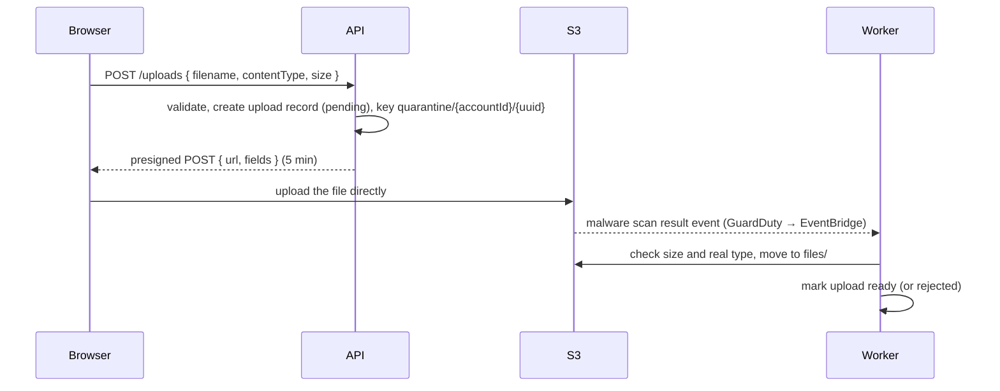

# Files with S3: uploads, serving, security
[← Overview](00-overview.md)

## Why it matters
- Uploads go through the API. A 2 GB video holds a task's memory and connection for minutes; three at once and the task is killed.
- Files are stored under the user's own filename (`uploads/avatar.png`). One user overwrites another's file, and every URL is guessable.
- Someone uploads an HTML file renamed to `.png`. Served from the main domain, the browser sniffs it as HTML and runs its JavaScript in other users' sessions.

## Concepts

### Direct-to-S3 upload flow

| | Presigned PUT | Presigned POST |
|:--|:--|:--|
| Size limit | only by signing an exact `ContentLength` | `content-length-range` condition |
| Type restriction | sign `ContentType`; the client must send it | `eq` / `starts-with` on `$Content-Type` |
| Client request | `PUT` with the file as body | multipart form: fields first, file last |
| Use | simple uploads of known size | enforcing maximum size and type |

The [frontend upload lesson](../../../02-frontend/10-forms/docs/03-dynamic-fields-and-uploads.md) uses a presigned PUT; POST adds a server-enforced size limit.

### Bucket setup
| Setting | Value |
|:--|:--|
| Block Public Access | on (default) |
| Object ownership | bucket owner enforced, ACLs disabled (default) |
| Encryption | SSE-S3 by default; SSE-KMS for stricter key control |
| CORS | your origins only; `POST`/`PUT`; `content-type` header; expose `ETag` |
| Lifecycle | abort incomplete multipart uploads after 7 days; expire `quarantine/` after 1 day |
| Versioning | on for files that matter (protects against overwrites and deletes) |
| Access | the task role may `PutObject`/`GetObject` only on the prefixes it needs |

### Serving files
| Need | Approach |
|:--|:--|
| Private file, occasional download | presigned GET (1–15 min) after an authorization check |
| Public images and assets | CloudFront with Origin Access Control (bucket stays private), long cache, immutable keys |
| Private content at scale | CloudFront signed URLs or signed cookies |
| Several image sizes | resize in a job after upload (also seen: sharp, image CDNs) |
| Large exports | job → S3 → presigned GET ([09-scalability lesson 04](../../09-scalability/docs/04-offloading-and-capacity.md)) |

### Upload security
| Risk | Defense |
|:--|:--|
| Huge files | size limit in the presigned policy, plus a size check after upload |
| Forged types | allowlist; check magic bytes after upload, never the extension or the client's `Content-Type` |
| Scripts in user content (XSS) | a separate domain for user files, `Content-Disposition: attachment` for documents, `X-Content-Type-Options: nosniff`, no SVG or HTML served inline |
| Malware | scan before release: GuardDuty Malware Protection for S3 (also seen: ClamAV in a job); keep files in `quarantine/` until clean |
| Guessable or overwritten keys | server-generated keys (`{accountId}/{uuidv7}`); the original filename only in the database |
| Access to others' files | authorize every download by account, presign only after the check |
| Metadata leaks | strip EXIF data (GPS) when re-encoding images |
| Decompression bombs | limits on pixels and archive sizes when processing |

## Example
`src/files/files.routes.ts` — create an upload with a presigned POST.
```ts
import { createPresignedPost } from '@aws-sdk/s3-presigned-post';
import { z } from 'zod';

const CreateUpload = z.object({
  filename: z.string().min(1).max(200),
  contentType: z.enum(['image/jpeg', 'image/png', 'image/webp', 'application/pdf']),
  size: z.number().int().positive().max(10 * 1024 * 1024),           // 10 MB
});

router.post('/uploads', async (req, res) => {
  const input = CreateUpload.parse(req.body);
  const upload = await files.createPending(req.user!.accountId, input); // key: quarantine/{accountId}/{uuidv7}
  const { url, fields } = await createPresignedPost(s3, {
    Bucket: config.s3.uploadsBucket,
    Key: upload.key,
    Conditions: [
      ['content-length-range', 1, input.size],                        // no bigger than declared
      ['eq', '$Content-Type', input.contentType],
    ],
    Fields: { 'Content-Type': input.contentType },
    Expires: 300,                                                     // seconds
  });
  res.status(201).json({ uploadId: upload.id, url, fields });
});
```
The browser side of a presigned POST:
```ts
const form = new FormData();
for (const [name, value] of Object.entries(fields)) form.append(name, value);
form.append('file', file);                                            // the file must be the last field
const res = await fetch(url, { method: 'POST', body: form });
if (!res.ok) throw new Error(`Upload failed: ${res.status}`);
await api.post(`/uploads/${uploadId}/complete`);                      // optional: tells the API to expect the scan result
```
`src/files/verify-upload.job.ts` — runs when GuardDuty reports the scan result for an object in `quarantine/`.
```ts
import { CopyObjectCommand, DeleteObjectCommand, GetObjectCommand, HeadObjectCommand } from '@aws-sdk/client-s3';

const ascii = (b: Uint8Array, from: number, to: number) => String.fromCharCode(...b.subarray(from, to));
const MAGIC: Record<string, (b: Uint8Array) => boolean> = {
  'image/jpeg': (b) => b[0] === 0xff && b[1] === 0xd8 && b[2] === 0xff,
  'image/png': (b) => [0x89, 0x50, 0x4e, 0x47].every((byte, i) => b[i] === byte),
  'image/webp': (b) => ascii(b, 0, 4) === 'RIFF' && ascii(b, 8, 12) === 'WEBP',
  'application/pdf': (b) => ascii(b, 0, 5) === '%PDF-',
};

export async function verifyUpload(key: string, scanStatus: string) {
  const upload = await files.getByKey(key);
  const bucket = config.s3.uploadsBucket;
  if (scanStatus !== 'NO_THREATS_FOUND') return files.reject(upload.id, 'malware');

  const head = await s3.send(new HeadObjectCommand({ Bucket: bucket, Key: key }));
  if ((head.ContentLength ?? 0) > upload.declaredSize) return files.reject(upload.id, 'size');

  const start = await s3.send(new GetObjectCommand({ Bucket: bucket, Key: key, Range: 'bytes=0-15' }));
  const bytes = await start.Body!.transformToByteArray();
  if (!MAGIC[upload.contentType]?.(bytes)) return files.reject(upload.id, 'type'); // content doesn't match the claim

  const finalKey = key.replace(/^quarantine\//, 'files/');
  await s3.send(new CopyObjectCommand({ Bucket: bucket, CopySource: `${bucket}/${key}`, Key: finalKey }));
  await s3.send(new DeleteObjectCommand({ Bucket: bucket, Key: key }));
  await files.markReady(upload.id, finalKey);
}
```
`src/files/files.routes.ts` — download: authorize, then presign.
```ts
import { GetObjectCommand } from '@aws-sdk/client-s3';
import { getSignedUrl } from '@aws-sdk/s3-request-presigner';

router.get('/files/:fileId/download', async (req, res) => {
  const { fileId } = FileIdParams.parse(req.params);
  const file = await files.getReadyForAccount(req.user!.accountId, fileId); // NotFoundError for other accounts' files
  const url = await getSignedUrl(s3, new GetObjectCommand({
    Bucket: config.s3.uploadsBucket,
    Key: file.key,
    ResponseContentDisposition: `attachment; filename*=UTF-8''${encodeURIComponent(file.originalName)}`,
    ResponseContentType: file.contentType,
  }), { expiresIn: 300 });
  res.redirect(303, url);
});
```
`infra/uploads.tf` — CORS and lifecycle rules.
```hcl
resource "aws_s3_bucket_cors_configuration" "uploads" {
  bucket = aws_s3_bucket.uploads.id
  cors_rule {
    allowed_origins = ["https://shop.example.com"]
    allowed_methods = ["POST", "PUT"]
    allowed_headers = ["content-type"]
    expose_headers  = ["ETag"]
    max_age_seconds = 3600
  }
}

resource "aws_s3_bucket_lifecycle_configuration" "uploads" {
  bucket = aws_s3_bucket.uploads.id
  rule {
    id     = "expire-quarantine"
    status = "Enabled"
    filter { prefix = "quarantine/" }
    expiration { days = 1 }
  }
  rule {
    id     = "abort-incomplete-multipart"
    status = "Enabled"
    filter {}
    abort_incomplete_multipart_upload { days_after_initiation = 7 }
  }
}
```

## Production patterns
- **Browsers upload straight to S3** with short-lived presigned POSTs; the API never handles file bytes.
- **Quarantine, scan, verify, then release**: size and magic bytes checked after upload, malware scanned before anyone can download.
- **Server-generated keys per account**, original names only in the database.
- **Private buckets always**; presigned GETs after authorization, CloudFront with OAC for public assets.
- **User content on a separate domain**, with `attachment` disposition and `nosniff`.

## Mistakes
Wrong: proxying uploads through Express.
```ts
app.post('/upload', express.raw({ limit: '2gb' }), async (req) => s3.send(new PutObjectCommand({ Body: req.body, … }))); // memory, timeouts
```
Right: presigned POST; the browser sends the file to S3.

Wrong: user-chosen keys.
```ts
Key: `uploads/${req.body.filename}` // overwrites, path tricks, guessable URLs
```
Right: `quarantine/${accountId}/${uuidv7()}`, filename stored in the database.

Wrong: trusting `file.type` or the extension. Both are set by the client. Right: check magic bytes after upload against an allowlist.

Wrong: a public bucket "just for avatars". Soon it holds invoices too. Right: private bucket; CloudFront with OAC for what must be public.

## Check yourself
1. Why prefer a presigned POST over a presigned PUT for user uploads?
2. Why keep uploads in `quarantine/` first?
3. How do you stop an uploaded file from running scripts in your users' browsers?

<details>
<summary>Answers</summary>

1. A POST policy can enforce a maximum size (`content-length-range`) and the content type on S3's side. A presigned PUT can only fix an exact signed length, so limiting size is awkward.
2. Nothing in `quarantine/` is ever served. The file is only moved to `files/` after the malware scan is clean and the size and magic bytes match what was declared, so a malicious or mislabeled file never becomes downloadable.
3. Serve user content from a separate domain (so scripts can't reach your app's cookies or origin), send `Content-Disposition: attachment` for documents and `X-Content-Type-Options: nosniff`, set the content type from your verified record, and don't serve HTML or SVG uploads inline.
</details>

## Sources
- [Amazon S3 — Uploading objects with presigned URLs](https://docs.aws.amazon.com/AmazonS3/latest/userguide/PresignedUrlUploadObject.html)
- [Amazon S3 — Browser-based uploads using POST](https://docs.aws.amazon.com/AmazonS3/latest/API/sigv4-UsingHTTPPOST.html)
- [AWS SDK v3 — `@aws-sdk/s3-presigned-post`](https://docs.aws.amazon.com/AWSJavaScriptSDK/v3/latest/Package/-aws-sdk-s3-presigned-post/)
- [Amazon GuardDuty — Malware Protection for S3](https://docs.aws.amazon.com/guardduty/latest/ug/gdu-malware-protection-s3.html)
- [Amazon CloudFront — Restricting access to an S3 origin (OAC)](https://docs.aws.amazon.com/AmazonCloudFront/latest/DeveloperGuide/private-content-restricting-access-to-s3.html)
- [OWASP — File upload cheat sheet](https://cheatsheetseries.owasp.org/cheatsheets/File_Upload_Cheat_Sheet.html)
