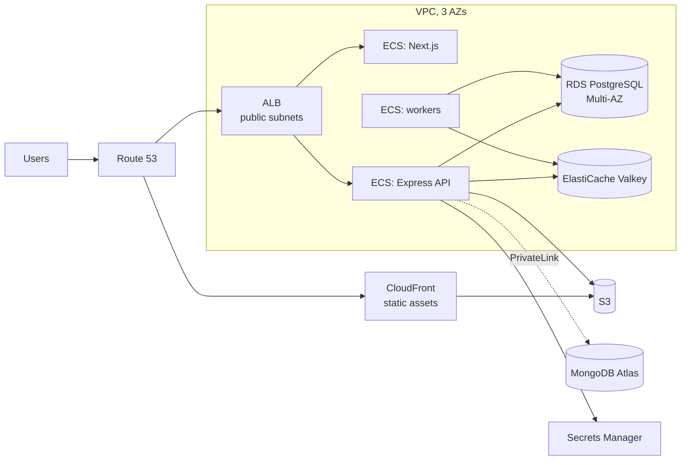

# Cloud — Overview
[← Topic](../README.md)

**TECH:** AWS: accounts and IAM, a VPC with private subnets, ECS Fargate behind an ALB, RDS PostgreSQL, ElastiCache (Valkey), S3 + CloudFront, Route 53 + ACM, Secrets Manager, CloudWatch · MongoDB Atlas for the document database
**LEVEL:** intermediate (mid-level, has shipped production code)

## Why this matters in production
- Most cloud breaches start with credentials: long-lived access keys in a repo, roles that can do everything, databases reachable from the internet.
- Networking mistakes are silent until they hurt: a public database, a single NAT gateway taking down every AZ, cross-AZ traffic doubling the bill.
- Managed services remove a lot of work only if you configure them for production: Multi-AZ, backups, encryption, TLS, the right eviction policy.
- Cloud bills grow quietly. NAT gateways, idle environments, and verbose logs often cost more than the servers.

## Mental model
Separate **accounts** per environment. People sign in through **IAM Identity Center**; workloads use **roles**, never keys. Inside a **VPC**, only the load balancer is public; tasks and databases live in **private subnets**, and **security groups** allow exactly the traffic paths you need.

## Prerequisites
- [01-containers](../../01-containers/README.md): the images these services run.
- [03-backend/08-reliability lesson 02](../../../03-backend/08-reliability/docs/02-health-checks-and-shutdown.md): health checks and shutdown on ECS and ALB.
- [03-backend/03-databases](../../../03-backend/03-databases/README.md) and [06-caching](../../../03-backend/06-caching/README.md): what runs on RDS and ElastiCache.

## Lesson map
| Lesson | Checklist items |
|:--|:--|
| [01 · Accounts, IAM, and networking](01-accounts-iam-networking.md) | 1, 2, 3 |
| [02 · ECS Fargate, load balancing, DNS, and logs](02-ecs-alb-dns-logs.md) | 4, 9, 12 |
| [03 · Managed data: RDS, ElastiCache, S3, MongoDB Atlas](03-managed-data.md) | 5, 6, 7, 10 |
| [04 · Secrets, configuration, and cost](04-secrets-and-cost.md) | 8, 11 |
| [Cheatsheet](cheatsheet.md) | all |

## Suggested order
1. 01 → 04.
2. Then [03-iac](../../03-iac/README.md): everything here is created with Terraform, never by clicking.
3. Ready to build: `/learn 04-shipping/02-cloud mode=tasks`.

## Version notes
- ElastiCache offers Valkey and Redis OSS, not Redis 8; Valkey is the cheaper default. Local Compose runs Redis 8, so stick to portable commands.
- RDS for PostgreSQL 18 runs on Graviton instance classes (`db.t4g`, `db.m7g`/`db.r7g` and newer); RDS can manage the master password in Secrets Manager.
- Fargate supports Graviton (`ARM64`) and Fargate Spot (for interruptible workers).
- Public IPv4 addresses are billed hourly; keep tasks in private subnets without public IPs.
- MongoDB Atlas: Flex replaced the old shared tiers and Serverless instances; dedicated clusters (M10+) for production.

## Sources
- [AWS Well-Architected Framework](https://docs.aws.amazon.com/wellarchitected/latest/framework/welcome.html)
- [AWS — Organizing your environment using multiple accounts](https://docs.aws.amazon.com/whitepapers/latest/organizing-your-aws-environment/organizing-your-aws-environment.html)
- [Amazon ECS — Best practices](https://docs.aws.amazon.com/AmazonECS/latest/developerguide/ecs-best-practice.html)
- [Amazon RDS for PostgreSQL](https://docs.aws.amazon.com/AmazonRDS/latest/UserGuide/CHAP_PostgreSQL.html)
- [Amazon ElastiCache — What is ElastiCache?](https://docs.aws.amazon.com/AmazonElastiCache/latest/dg/WhatIs.html)
