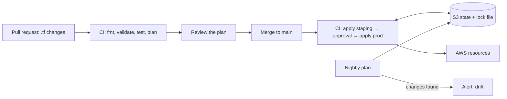

# Infrastructure as Code — Overview
[← Topic](../README.md)

**TECH:** Terraform with the AWS provider · remote state in S3 (native locking) · plans in pull requests and applies from GitHub Actions via OIDC · `terraform test` · an OpenTofu-compatible subset of features
**LEVEL:** intermediate (mid-level, has shipped production code)

STACK.md decision: Terraform with an S3 backend, avoiding Terraform-only features so a move to OpenTofu stays possible.

## Why this matters in production
- Infrastructure clicked together in the console can't be reviewed, repeated, or recovered. After an incident, nobody knows which setting changed.
- A second environment "just like production" takes weeks by hand and still differs in ways nobody notices until it matters.
- Terraform state holds every resource attribute, including secrets. A careless backend leaks credentials; a lost lock corrupts infrastructure.
- One `terraform apply` can delete a database. Plans, reviews, and guardrails decide whether that happens.

## Mental model
You **declare** the desired infrastructure in code; Terraform compares it with **state** (what it created) and the real world, shows a **plan**, and **applies** the difference. Code is reviewed like application code; state lives in a locked, encrypted bucket; applies run only from CI.

## Prerequisites
- [02-cloud](../../02-cloud/README.md): the resources these configurations create.
- [01-foundations/04-ci-cd lesson 03](../../../01-foundations/04-ci-cd/docs/03-secure-workflows.md): OIDC and secure GitHub Actions workflows.

## Lesson map
| Lesson | Checklist items |
|:--|:--|
| [01 · Terraform basics and modules](01-basics-and-modules.md) | 1, 2, 5 |
| [02 · State, environments, and secrets](02-state-environments-secrets.md) | 3, 6, 7 |
| [03 · The plan/apply workflow, CI, and refactoring](03-workflow-ci-refactoring.md) | 4, 8, 10 |
| [04 · Guardrails, drift, testing, and the OpenTofu exit](04-guardrails-testing-opentofu.md) | 9, 11, 12 |
| [Cheatsheet](cheatsheet.md) | all |

## Suggested order
1. 01 → 04.
2. Then [04-deployments](../../04-deployments/README.md): Terraform creates the platform, the pipeline deploys releases onto it.
3. Ready to build: `/learn 04-shipping/03-iac mode=tasks`.

## Version notes
- S3 backend native locking: `use_lockfile = true` (Terraform 1.10+); DynamoDB-based locking is deprecated. OpenTofu supports the same setting.
- Ephemeral resources (1.10+) and write-only arguments (1.11+) keep generated secrets out of state.
- `import`, `moved`, and `removed` blocks make refactors reviewable; `terraform test` with mock providers (1.7+) tests modules without AWS.
- AWS provider 6.x is current; pin `~> 6.0` and upgrade deliberately.
- Terraform 1.14 added features without OpenTofu equivalents (for example `action` blocks and list/query for bulk import): avoid them to keep the exit open.

## Sources
- [Terraform documentation](https://developer.hashicorp.com/terraform/docs)
- [Terraform — S3 backend](https://developer.hashicorp.com/terraform/language/backend/s3)
- [Terraform AWS provider](https://registry.terraform.io/providers/hashicorp/aws/latest/docs)
- [OpenTofu documentation](https://opentofu.org/docs/)
- [terraform-aws-modules](https://registry.terraform.io/namespaces/terraform-aws-modules)
