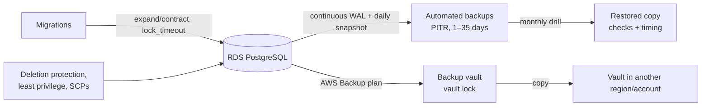

# Data Safety — Overview
[← Topic](../README.md)

**TECH:** RDS automated backups with point-in-time recovery, snapshots, and AWS Backup copies · `pg_dump` for logical backups · safe Drizzle migrations on PostgreSQL 18 · MongoDB Atlas cloud backups · KMS encryption · anonymized staging data
**LEVEL:** intermediate (mid-level, has shipped production code)

## Why this matters in production
- Servers can be replaced in minutes; lost data can't. Data loss is the incident customers never forgive.
- Multi-AZ isn't a backup. A bad `DELETE` or a broken migration is replicated to the standby instantly.
- A backup you've never restored is a hope, not a plan. Restores fail on permissions, missing keys, or a forgotten parameter, usually during the worst hour.
- Most data loss is human: migrations, scripts, console clicks, deleted environments.

## Mental model
Decide **how much data you can lose (RPO)** and **how long you can be down (RTO)**. Choose backups and copies that meet those numbers, **prove them with regular restore drills**, and **prevent the common causes**: risky migrations, broad permissions, and missing deletion protection.

## Prerequisites
- [02-cloud lesson 03](../../02-cloud/docs/03-managed-data.md): RDS, Atlas, and encryption settings.
- [03-backend/03-databases lesson 04](../../../03-backend/03-databases/docs/04-drizzle-and-migrations.md): Drizzle migrations.
- [04-deployments lesson 03](../../04-deployments/docs/03-migrations-environments-rollbacks.md): migrations in the pipeline.

## Lesson map
| Lesson | Checklist items |
|:--|:--|
| [01 · RPO, RTO, and backups](01-rpo-rto-backups.md) | 1, 2, 5, 9 |
| [02 · Restore drills, copies, and disaster recovery](02-restores-copies-dr.md) | 3, 6, 10 |
| [03 · Safe production migrations](03-safe-migrations.md) | 4 |
| [04 · Protection, retention, encryption, and staging data](04-protection-retention-encryption.md) | 7, 8, 11, 12 |
| [Cheatsheet](cheatsheet.md) | all |

## Suggested order
1. 01 → 04.
2. Then [06-incident-response](../../06-incident-response/README.md): restores are an incident tool.
3. Ready to build: `/learn 04-shipping/05-data-safety mode=tasks`.

## Version notes
- RDS automated backups: retention 1–35 days, restores to any second within the window (usually up to about 5 minutes ago). Restores always create a new instance.
- AWS Backup: backup plans, vault lock (compliance mode makes recovery points undeletable), cross-region and cross-account copies, restore testing.
- PostgreSQL 18 keeps the safe-migration toolkit: `CREATE INDEX CONCURRENTLY`, `NOT VALID` constraints, fast `ADD COLUMN` with constant defaults.
- Drizzle's migrator runs pending migrations in a transaction, so `CONCURRENTLY` operations need a separate step.
- MongoDB Atlas: continuous cloud backup with point-in-time restore on dedicated clusters.

## Sources
- [Amazon RDS — Backing up and restoring](https://docs.aws.amazon.com/AmazonRDS/latest/UserGuide/CHAP_CommonTasks.BackupRestore.html)
- [AWS Backup — Developer guide](https://docs.aws.amazon.com/aws-backup/latest/devguide/whatisbackup.html)
- [AWS — Disaster recovery of workloads on AWS](https://docs.aws.amazon.com/whitepapers/latest/disaster-recovery-workloads-on-aws/disaster-recovery-workloads-on-aws.html)
- [PostgreSQL — Backup and restore](https://www.postgresql.org/docs/current/backup.html)
- [MongoDB Atlas — Back up your cluster](https://www.mongodb.com/docs/atlas/backup/cloud-backup/overview/)
