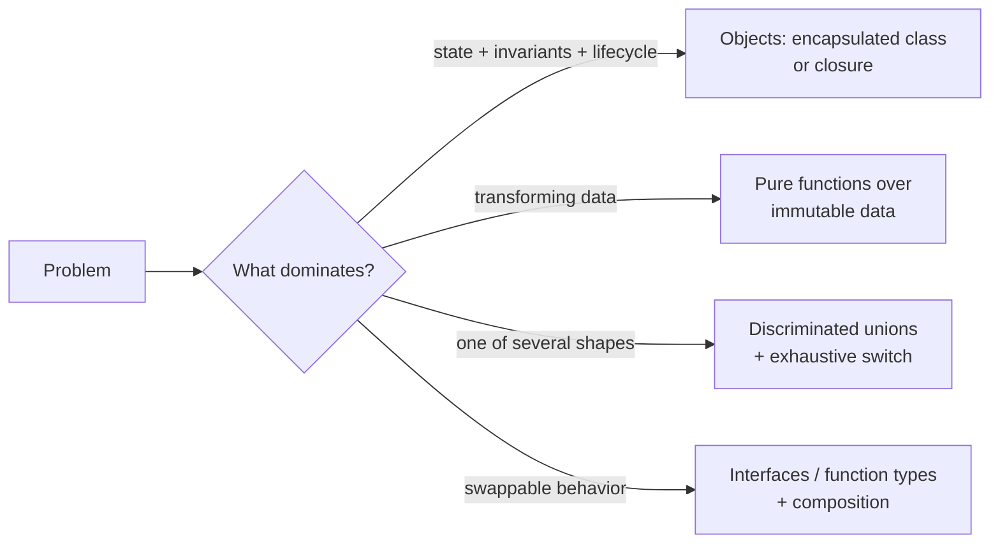

# Paradigms & OOP — Overview
[← Topic](../README.md)

**TECH:** TypeScript 6 (strict) on Node.js 26 · examples are small programs, not framework code
**LEVEL:** intermediate (mid-level, has shipped production code)
**KIND:** concept topic: every idea links to where it shows up in this repo's stack, and says when not to use it

## Why this matters in production
- Paradigms decide how code changes: a class hierarchy that fights every new requirement is as costly as a pile of untyped functions.
- TypeScript supports objects, functions, and algebraic data types. Teams that pick the right tool per problem write less code with fewer bugs.
- Most "SOLID" and "design pattern" advice assumes you understand encapsulation, polymorphism, and composition well.
- Interviews and code reviews expect you to explain these ideas and their trade-offs, not just use them.

## Mental model
**Data plus behavior** can be organized around objects (state and methods together, hidden behind an interface) or around functions over immutable data. Use objects where something has identity, lifecycle, and invariants to protect; use functions and plain data for transformations; use discriminated unions for "one of several shapes".

## Prerequisites
- [02-frontend/03-javascript](../../../02-frontend/03-javascript/README.md): closures, `this`, prototypes, TypeScript basics.
- [01-foundations/05-code-quality lesson 01](../../../01-foundations/05-code-quality/docs/01-strict-typescript.md): strict TypeScript.

## Lesson map
| Lesson | Checklist items |
|:--|:--|
| [01 · Programming paradigms and choosing a style](01-paradigms.md) | 1, 10 |
| [02 · OOP pillars, composition, and TypeScript classes](02-oop-pillars-classes.md) | 2, 3, 4 |
| [03 · Functional programming, algebraic data types, and errors](03-functional-adts-errors.md) | 5, 6, 9 |
| [04 · Polymorphism without classes; entities, values, and DTOs](04-polymorphism-and-data.md) | 7, 8 |
| [Cheatsheet](cheatsheet.md) | all |

## Suggested order
1. 01 → 04.
2. Then [02-principles](../../02-principles/README.md) and [03-design-patterns](../../03-design-patterns/README.md).
3. Ready to build: `/learn 06-design/01-paradigms-oop mode=tasks` (add `lang=go` or `lang=java` for comparison katas).

## Version notes
- Node 26 runs TypeScript by stripping types: no parameter properties, no `enum`, no runtime `namespace`, no decorators. Use `#private` fields, union types, and `as const` objects.
- `Object.groupBy`, `structuredClone`, `Array.prototype.toSorted`/`toSpliced`/`with` support immutable styles natively.
- TypeScript 5.x–6.0 narrowing improvements make discriminated unions and exhaustive `switch` checks the idiomatic way to model variants.

## Sources
- [TypeScript Handbook — Classes](https://www.typescriptlang.org/docs/handbook/2/classes.html)
- [TypeScript Handbook — Narrowing and discriminated unions](https://www.typescriptlang.org/docs/handbook/2/narrowing.html)
- [MDN — Classes](https://developer.mozilla.org/en-US/docs/Web/JavaScript/Reference/Classes)
- [Scott Wlaschin — Designing with types](https://fsharpforfunandprofit.com/series/designing-with-types/)
- [Martin Fowler — Value object](https://martinfowler.com/bliki/ValueObject.html)
