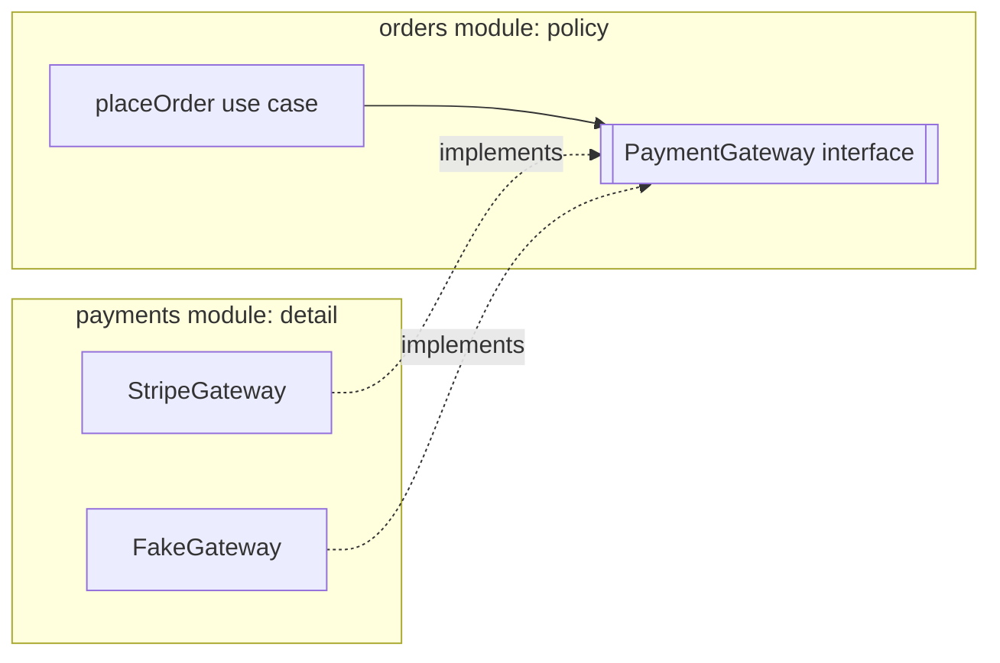

# Open/closed, Liskov, interface segregation, dependency inversion
[← Overview](00-overview.md)

## Why it matters
- Every new shipping carrier means editing a 300-line `switch` in the checkout service, and each edit risks breaking the existing carriers.
- A `ReadOnlyCache` "implements" `Cache` but throws on `set()`. Code that worked with every other cache crashes in production.
- Business logic imports the Stripe SDK directly. Switching providers, or simply testing checkout, means rewriting the core.

## Concepts

### O — Open/Closed Principle
Software entities should be **open for extension, closed for modification**: add new behavior by adding code, not by editing working code. In TypeScript: interfaces, dispatch tables, strategy objects, plugin registries.

### L — Liskov Substitution Principle
Implementations must be **substitutable** for their contract without surprising callers.
| A substitute must not | Example violation |
|:--|:--|
| strengthen preconditions | requiring a non-empty list where the contract accepts any |
| weaken postconditions | returning `undefined` where the contract promises a value |
| throw new kinds of errors for valid input | `ReadOnlyCache.set()` throwing |
| break invariants | a `Square extends Rectangle` whose `setWidth` changes the height |
| change timing or side effects unexpectedly | a "fast" cache that makes network calls |

### I — Interface Segregation Principle
Clients shouldn't depend on methods they don't use. Prefer **small, client-specific interfaces** (`OrderReader`, `OrderWriter`) over one fat `OrderRepository` with 20 methods.

### D — Dependency Inversion Principle
High-level policy shouldn't depend on low-level detail; **both depend on abstractions**, and the abstraction is **owned by the high-level side** (defined in the core's language). This is the foundation of ports and adapters.


Dependency **inversion** (who owns the interface) differs from dependency **injection** (how the implementation is passed in) and inversion of control (a framework calling your code).

## Example
OCP with a registry of shipping carriers:
```ts
export interface Carrier {
  readonly code: string;
  quote(parcel: { weightGrams: number; country: string }): Promise<{ priceCents: number; days: number }>;
}

export function createShippingQuotes(carriers: readonly Carrier[]) {
  return async (parcel: { weightGrams: number; country: string }) =>
    Promise.all(carriers.map(async (c) => ({ carrier: c.code, ...(await c.quote(parcel)) })));
}

// Adding a carrier = a new object in the list at the composition root; no existing code changes
const quotes = createShippingQuotes([dhl, dpd, ups]);
```
LSP: honor the contract or don't claim it.
```ts
interface Cache {
  get(key: string): Promise<string | undefined>;
  set(key: string, value: string, ttlSeconds: number): Promise<void>;
}

// Wrong: claims Cache, breaks callers
class ReadOnlyCache implements Cache {
  async get(key: string) { return snapshot.get(key); }
  async set(): Promise<void> { throw new Error('read only'); } // surprise for every caller of Cache
}

// Right: a smaller contract for the read-only case
interface CacheReader { get(key: string): Promise<string | undefined> }
```
ISP: small interfaces per client; one implementation can satisfy several.
```ts
export interface OrderReader { getForAccount(accountId: string, id: string): Promise<Order | undefined> }
export interface OrderWriter { create(input: NewOrder): Promise<Order>; markPaid(id: string, paymentId: string): Promise<void> }

// The reporting job depends only on what it reads; the drizzle repository implements both interfaces structurally
export function createRevenueReport(orders: OrderReader & { listPaidBetween(from: Date, to: Date): Promise<Order[]> }) { /* … */ }
```
DIP: the core owns the port.
```ts
// orders/ports.ts — defined by the orders module, in its own words
export interface PaymentGateway {
  charge(input: { orderId: string; amountCents: number; idempotencyKey: string }): Promise<{ ok: true; paymentId: string } | { ok: false; reason: string }>;
}

// payments/stripe.adapter.ts — the detail depends on the core's abstraction
import type { PaymentGateway } from '#src/orders/index.ts';
export function createStripeGateway(stripe: Stripe): PaymentGateway { /* translate Stripe types and errors */ }
```

## In our stack
- DIP and ports and adapters: [03-backend/11-architecture lesson 02](../../../03-backend/11-architecture/docs/02-di-ports-adapters.md).
- OCP: outbox subscriptions (add a subscriber without editing the publisher) in [03-backend/11-architecture lesson 04](../../../03-backend/11-architecture/docs/04-events-boundaries-decisions.md); Express middleware chains.
- ISP: small ports such as `CatalogReader`; Zod schemas split per use case (create vs update).

## When not to
- Don't create an interface for every class "for DIP". Ports belong at real boundaries (external systems, modules that change independently).
- Don't build plugin systems for variation that hasn't happened. OCP pays off when the axis of change is known (carriers, payment methods).
- One implementation and no tests needing a fake? A concrete dependency is fine.

## Production patterns
- **Registries and strategies** where new variants arrive regularly.
- **Contracts documented and tested** (shared contract tests run against every implementation) to enforce LSP.
- **Role interfaces** per client, implemented structurally by one adapter.
- **Ports owned by the core**, adapters at the edges, wired in the composition root.

## Mistakes
Wrong: a growing `switch` over variants in core code.
```ts
switch (carrier) { case 'dhl': /* … */ case 'dpd': /* … */ } // edited for every new carrier
```
Right: a `Carrier` interface and a list of implementations.

Wrong: implementations that throw "not supported" for contract methods. Right: split the contract (ISP) so each implementation supports everything it claims.

Wrong: the interface lives next to the adapter (`stripe/types.ts`) and mirrors Stripe's API. The core still depends on Stripe's shapes. Right: the core defines the port in its own vocabulary.

## Check yourself
1. How does a registry of strategies make code open for extension but closed for modification?
2. Give two ways an implementation can violate LSP.
3. What's the difference between dependency inversion and dependency injection?

<details>
<summary>Answers</summary>

1. The core code iterates over or looks up implementations of an interface; a new variant is a new implementation added at the composition root, so the tested core code doesn't change.
2. Throwing for inputs the contract allows (a read-only cache throwing on `set`), returning less than the contract promises (`undefined` instead of a value), requiring more than the contract (stronger preconditions), or breaking invariants callers rely on.
3. Inversion is about ownership and direction: high-level code defines the abstraction and low-level code implements it, so source dependencies point toward the core. Injection is a mechanism for providing an implementation at runtime (constructor or function parameters); you can inject without inverting and vice versa.
</details>

## Sources
- [Robert C. Martin — The Open-Closed Principle (PDF)](https://web.archive.org/web/20060822033314/http://www.objectmentor.com/resources/articles/ocp.pdf)
- [Barbara Liskov, Jeannette Wing — A behavioral notion of subtyping](https://dl.acm.org/doi/10.1145/197320.197383)
- [Robert C. Martin — The Dependency Inversion Principle (PDF)](https://web.archive.org/web/20110714224327/http://www.objectmentor.com/resources/articles/dip.pdf)
- [Martin Fowler — Role interface](https://martinfowler.com/bliki/RoleInterface.html)
