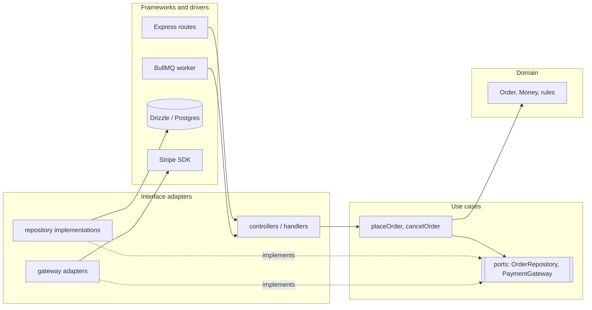

# Clean, hexagonal, onion, and vertical slices
[← Overview](00-overview.md)

## Why it matters
- Business rules import Express and Drizzle types. Moving checkout into a BullMQ job means copying the logic, because it only runs inside an HTTP request.
- A "clean architecture" template creates eight folders and twelve files per feature (entities, use cases, interactors, presenters, gateways…). Adding one field touches nine files.
- A feature folder structure grows without rules; slices import each other's internals, and the codebase becomes a mesh.

## Concepts

### Three names, one idea: the dependency rule
| Style | Origin | Picture | Core idea |
|:--|:--|:--|:--|
| Hexagonal (ports and adapters) | Alistair Cockburn, 2005 | the app inside a hexagon; ports on its edges; adapters outside | the app talks to the world only through ports it defines |
| Onion | Jeffrey Palermo, 2008 | concentric rings: domain model → domain services → application → infrastructure/UI | dependencies point inward |
| Clean | Robert C. Martin, 2012 | rings: entities → use cases → interface adapters → frameworks and drivers | source code dependencies point only inward |

All three share the **dependency rule**: the domain and use cases know nothing about HTTP, databases, queues, or frameworks. Outer layers depend on inner layers; inner layers define interfaces (ports) that outer layers implement.



| Ring (clean) | Contains | Depends on |
|:--|:--|:--|
| Entities / domain | business rules, value objects, invariants | nothing |
| Use cases / application | workflows, transactions, ports | domain |
| Interface adapters | controllers, presenters, repository and gateway implementations, DTO mappers | use cases, domain |
| Frameworks and drivers | Express, Drizzle, BullMQ, SDKs | — (outermost) |

Driving (primary) adapters call into the app (HTTP, CLI, jobs); driven (secondary) adapters are called by it (DB, payments, email).

### Vertical slice architecture
Organize by **feature/request** instead of by layer: each slice (e.g. "cancel order") contains everything it needs, from endpoint to SQL, and slices share little. Coupling between slices is minimized; coupling inside a slice is fine.

| | Layered / clean (horizontal) | Vertical slices |
|:--|:--|:--|
| Unit of organization | technical role (ring) | feature or request |
| Shared abstractions | many (repositories, services) | few; each slice chooses |
| Good for | rich domains with shared rules | many independent features, CRUD-heavy apps |
| Risk | ceremony per feature | duplicated rules across slices |

The two combine well: **feature modules (slices) on the outside, the dependency rule inside each module**, and a shared domain model where rules really are shared.

## Example
A use case that knows only ports; a worker and a route both drive it.
```ts
// orders/application/ports.ts — owned by the application ring
export interface OrderRepository {
  get(id: string): Promise<Order>;
  save(order: Order): Promise<void>;
}
export interface RefundGateway { refund(paymentId: string, amountCents: number, idempotencyKey: string): Promise<void> }

// orders/application/cancel-order.ts — no Express, no Drizzle, no Stripe
export function makeCancelOrder(deps: { orders: OrderRepository; refunds: RefundGateway; clock: () => Date }) {
  return async (orderId: string): Promise<Order> => {
    const order = await deps.orders.get(orderId);
    const cancelled = cancelOrder(order, deps.clock());           // domain rule
    if (order.status === 'paid') await deps.refunds.refund(order.paymentId!, order.totalCents, `refund-${order.id}`);
    await deps.orders.save(cancelled);
    return cancelled;
  };
}

// orders/adapters/http.ts — driving adapter (controller)
router.post('/orders/:id/cancellation', async (req, res) => res.json(toOrderDTO(await cancelOrderUseCase(req.params.id))));

// orders/adapters/worker.ts — another driving adapter, same use case
new Worker('order-commands', async (job) => { if (job.name === 'cancel') await cancelOrderUseCase(job.data.orderId); }, { connection });
```
A vertical slice for a simple read (no repository ceremony):
```ts
// features/orders/list-recent-orders.ts — endpoint, query, and DTO in one slice
export const ListRecentOrdersQuery = z.object({ limit: z.coerce.number().int().min(1).max(50).default(20) });

export function registerListRecentOrders(router: Router, db: Db) {
  router.get('/orders/recent', async (req, res) => {
    const { limit } = ListRecentOrdersQuery.parse(req.query);
    const rows = await db.select({ id: orders.id, totalCents: orders.totalCents, status: orders.status, createdAt: orders.createdAt })
      .from(orders).where(eq(orders.accountId, req.user!.accountId)).orderBy(desc(orders.createdAt)).limit(limit);
    res.json({ items: rows });
  });
}
```
Folder layout combining both:
```text
src/
  orders/                     feature module (vertical boundary, public index.ts)
    domain/                   entities, value objects, rules (inner ring)
    application/              use cases + ports
    adapters/                 http.ts, worker.ts, drizzle-repository.ts, stripe-refunds.ts
    queries/                  read slices that skip the domain (CQRS-lite)
    index.ts
  catalog/ …
```

## In our stack
- Ports and adapters, composition root, domain errors: [03-backend/11-architecture lessons 02–03](../../../03-backend/11-architecture/docs/02-di-ports-adapters.md).
- Boundaries enforced with ESLint `no-restricted-imports`: [03-backend/11-architecture lesson 04](../../../03-backend/11-architecture/docs/04-events-boundaries-decisions.md).
- DDD decides the modules and the domain model: [05-domain-driven-design lesson 04](../../05-domain-driven-design/docs/04-persistence-clean-architecture.md).

## When not to
- Don't create presenters, interactors, and request/response models per use case for CRUD screens; a vertical slice is clearer.
- Don't abstract the database behind ports "in case we switch from Postgres"; ports pay off for external services and testing, not for imaginary migrations.
- In small scripts or prototypes, a single file is fine.

## Production patterns
- **The dependency rule enforced by tooling** (lint rules, architecture tests).
- **Ports at real boundaries**: payments, email, storage, other modules.
- **Several driving adapters per use case** (HTTP, jobs, CLI) without duplication.
- **Feature modules outside, rings inside**, with simple read slices where the domain adds nothing.

## Mistakes
Wrong: domain code importing infrastructure.
```ts
import { db } from '#src/db.ts'; // inside orders/domain/order.ts
```
Right: the domain is pure; repositories implement ports in the adapters ring.

Wrong: a clean-architecture folder template copied into every feature, including trivial ones. Right: rings where rules are rich; slices for simple reads and CRUD.

Wrong: slices importing each other's internals. Right: public module APIs; shared rules extracted into the domain.

## Check yourself
1. What do hexagonal, onion, and clean architecture have in common?
2. What's the difference between driving and driven adapters? Give one of each.
3. When are vertical slices a better fit than strict rings?

<details>
<summary>Answers</summary>

1. The dependency rule: the domain and use cases sit at the center and know nothing about frameworks, databases, or delivery mechanisms; outer parts depend on inner parts and implement interfaces (ports) the inner parts define.
2. Driving (primary) adapters call into the application: an Express route, a BullMQ worker, a CLI command. Driven (secondary) adapters are called by the application through ports: a Drizzle repository, a Stripe gateway, an SES mailer.
3. When features are many and mostly independent (CRUD, reporting, simple reads) and share few rules: a slice keeps each feature's code together with little ceremony. Rings pay off where a rich domain with shared rules is used by many workflows.
</details>

## Sources
- [Alistair Cockburn — Hexagonal architecture](https://alistair.cockburn.us/hexagonal-architecture/)
- [Jeffrey Palermo — The onion architecture](https://jeffreypalermo.com/2008/07/the-onion-architecture-part-1/)
- [Robert C. Martin — The clean architecture](https://blog.cleancoder.com/uncle-bob/2012/08/13/the-clean-architecture.html)
- [Jimmy Bogard — Vertical slice architecture](https://www.jimmybogard.com/vertical-slice-architecture/)
