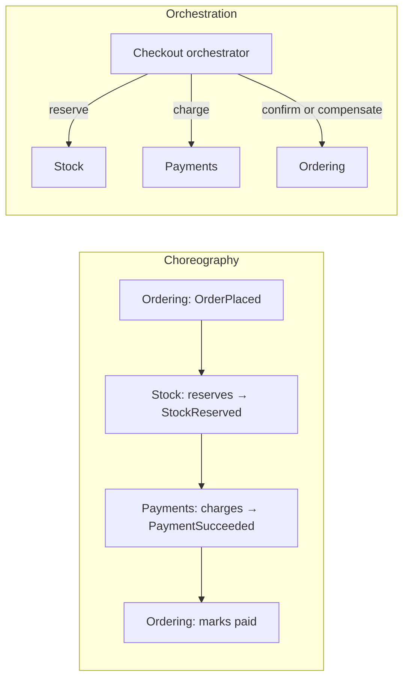

# Modular monolith, microservices, and event-driven architecture
[← Overview](00-overview.md)

## Why it matters
- A startup with six engineers runs 14 microservices. Half the week goes into pipelines, version mismatches, and distributed debugging; features ship slower than before the split.
- A "monolith" without internal boundaries becomes a big ball of mud. Every change risks every feature, and nobody can extract anything later.
- Services call each other synchronously in chains. One slow service makes the whole site slow, and one outage takes everything down.

## Concepts

### Deployment styles
| Style | What it is | Strengths | Costs |
|:--|:--|:--|:--|
| Monolith (unstructured) | one deployable, no internal boundaries | simple to start | turns into a ball of mud |
| **Modular monolith** | one deployable, strong internal modules with public APIs and owned data | simple ops, local transactions, refactorable boundaries | needs discipline and enforced boundaries |
| Microservices | independently deployable services, each owning its data | independent deploys and scaling, team autonomy, fault isolation | network failures, distributed data, observability, ops cost |
| Miniservices / macroservices | a few larger services | middle ground | still distributed |
| Serverless functions | per-function deployables, managed scaling | no servers, pay per use | cold starts, limits, vendor coupling (lesson 04) |

### Microservices: when they pay off
| Signal | Example |
|:--|:--|
| Different scaling or resource needs | video transcoding vs a light API |
| Independent release cadence with team friction | many teams blocked on one deployable |
| Isolation requirements | payments/PCI scope, security boundaries |
| Different technology needs | ML service in Python |
| Proven, stable module boundaries | the module has had a clean API for months |

Prerequisites before splitting: CI/CD per service, observability with distributed tracing, an on-call model, API and event versioning, and data ownership (no shared tables).

**Distributed monolith** signs: services deployed together, shared database tables, long synchronous call chains, a change requiring edits in many services.

### Event-driven architecture
| Concept | Meaning |
|:--|:--|
| Event | a fact that happened (`OrderPaid`), immutable, past tense |
| Event notification | small event with IDs; consumers fetch details |
| Event-carried state transfer | event contains the data consumers need (less coupling at read time, larger events) |
| Choreography | services react to each other's events; no central coordinator |
| Orchestration | a coordinator tells participants what to do (saga orchestrator, workflow engine) |
| Broker | BullMQ (in-app), SQS/SNS/EventBridge, Kafka |
| Eventual consistency | consumers catch up after a delay |

| Choreography | Orchestration |
|:--|:--|
| loose coupling, easy to add consumers | explicit flow, easier to reason about and monitor |
| flow is implicit, hard to see end to end | coordinator becomes a central dependency |
| fits notifications and fan-out | fits multi-step business processes with compensation |

## Example
Modular monolith: modules with public APIs, owned data, and events between them.
```text
src/
  catalog/      index.ts → getProducts(), reserveStock()   owns: products, stock
  ordering/     index.ts → placeOrder(), cancelOrder()      owns: orders, order_lines
  payments/     index.ts → PaymentGateway adapters          owns: payments
  notifications/index.ts → onOrderPaid()                    owns: email_sends
  shared/       db, outbox, errors, money                   (technical only)
```
```ts
// ordering publishes; notifications subscribes; ordering never imports notifications
await db.transaction(async (tx) => {
  await ordersRepo.markPaid(tx, orderId, paymentId);
  await appendOutbox(tx, { topic: 'order.paid', payload: { eventId: uuidv7(), orderId, occurredAt: new Date().toISOString() } });
});
```
Extracting a module later keeps the same contract: the event goes to SQS/SNS instead of BullMQ, and the module's HTTP API replaces in-process calls.

Choreography vs orchestration for checkout:


## In our stack
- Modular monolith with enforced boundaries: [03-backend/11-architecture](../../../03-backend/11-architecture/README.md).
- Events through the outbox and BullMQ: [03-backend/07-background-jobs lesson 04](../../../03-backend/07-background-jobs/docs/04-outbox-messaging-monitoring.md).
- Sagas and delivery guarantees: [07-distributed-systems](../../07-distributed-systems/README.md); service deployment on ECS: [04-shipping](../../../04-shipping/README.md).

## When not to
- Microservices for a new product or a small team: the boundaries aren't known yet and the operational cost dominates.
- Events for request/response needs ("what's the price?"): use a direct call.
- Event-carried state for sensitive data: events spread data to every consumer and every retention policy.

## Production patterns
- **Start with a modular monolith**; extract services along proven boundaries with an ADR and a strangler fig.
- **Data ownership per module/service**; no cross-module table access.
- **Events for facts, commands for requests**, with versioned contracts and idempotent consumers.
- **Orchestration for multi-step business processes**, choreography for notifications and fan-out.
- **Tracing across every boundary** so asynchronous flows stay debuggable.

## Mistakes
Wrong: splitting by technical layer into services (a "database service", a "validation service"). Every feature crosses all of them. Right: split by business capability.

Wrong: services sharing tables. A schema change breaks others, deploys get coordinated. Right: each service owns its data and publishes events or APIs.

Wrong: long synchronous chains (`A → B → C → D`). Availability multiplies down, latency adds up. Right: fewer hops, events for anything that doesn't need an answer now.

## Check yourself
1. What makes a monolith "modular", and why does that matter for a future split?
2. Name three signals that a module is ready to become a service.
3. When would you choose orchestration over choreography?

<details>
<summary>Answers</summary>

1. Modules with public APIs, owned data, and enforced dependency rules, communicating through function calls and events instead of reaching into each other. Because the boundaries already exist and are respected, extracting a module means replacing in-process calls with network calls, not untangling a mesh.
2. Very different resource or scaling needs, a team blocked by a shared deployable, isolation requirements (security or compliance), different technology needs, and a stable public API that has held for months.
3. For multi-step business processes with ordering and compensation (checkout, onboarding, fulfillment), where the flow must be visible, monitored, and changed in one place. Choreography fits loosely coupled reactions like notifications and analytics.
</details>

## Sources
- [Martin Fowler — Monolith first](https://martinfowler.com/bliki/MonolithFirst.html)
- [Martin Fowler — Microservices](https://martinfowler.com/articles/microservices.html)
- [Martin Fowler — What do you mean by "event-driven"?](https://martinfowler.com/articles/201701-event-driven.html)
- [Chris Richardson — Microservice architecture patterns](https://microservices.io/patterns/)
- [Shopify Engineering — Deconstructing the monolith](https://shopify.engineering/deconstructing-monolith-designing-software-maximizes-developer-productivity)
